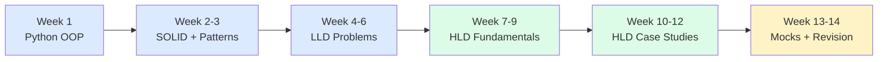

# System Design Study Material (LLD + HLD, Python)

> **Viewing diagrams:** this material uses [Mermaid](https://mermaid.js.org/) diagrams.
> In VS Code install the extension **"Markdown Preview Mermaid Support"** (`bierner.markdown-mermaid`),
> then open any `.md` file and press `Ctrl+Shift+V`. GitHub also renders them natively.

## LLD vs HLD in one minute

| | Low Level Design (LLD) | High Level Design (HLD) |
|---|---|---|
| Question style | "Design a parking lot / LRU cache / elevator" | "Design Twitter / YouTube / Uber" |
| Zoom level | Classes, interfaces, methods **inside one program** | Services, databases, caches, queues **across many machines** |
| You produce | Class diagram + working code (Python here) | Architecture diagram + data model + trade-offs |
| Tested skills | OOP, SOLID, design patterns, concurrency | Scalability, availability, consistency, estimation |
| Where they meet | "What if this ran on many servers?" A lock becomes a DB constraint or Redis lock; an Observer becomes a message queue | |

## How to use this material
1. **Go in order.** Each chapter builds on the previous one, and later chapters link back to earlier ones.
2. **Every chapter** explains *why it matters*, gives intuition and diagrams, shows Python code, and ends with **"Check yourself"** questions. Answer them out loud before moving on.
3. **For LLD problems:** read the requirements, **close the file**, and try designing it yourself for 30-45 minutes. Then compare with the notes and run the code.
4. **For HLD case studies:** set a 45-minute timer, follow the [framework](hld/10-hld-interview-framework.md), draw on paper, then compare.
5. Tick the status boxes below as you go. Revise with the [cheat sheet](cheatsheet.md).

## Roadmap



## Contents

### Part 1 - Low Level Design (`lld/`)
| # | Topic | Status |
|---|---|---|
| 1 | [Python OOP essentials](lld/01-python-oop.md) | [ ] |
| 2 | [SOLID principles](lld/02-solid.md) | [ ] |
| 3 | [UML class diagrams](lld/03-uml.md) | [ ] |
| 4 | [Creational patterns](lld/04-creational-patterns.md) | [ ] |
| 5 | [Structural patterns](lld/05-structural-patterns.md) | [ ] |
| 6 | [Behavioral patterns](lld/06-behavioral-patterns.md) | [ ] |
| 7 | [Concurrency in Python](lld/07-concurrency.md) | [ ] |
| 8 | [LLD interview framework](lld/08-lld-interview-framework.md) | [ ] |

**LLD problems** (`lld/problems/`, each has notes + runnable `.py`)
| Problem | Key patterns | Status |
|---|---|---|
| [Parking Lot](lld/problems/parking_lot/README.md) | Strategy, enum mapping, locking | [ ] |
| [LRU Cache](lld/problems/lru_cache/README.md) | HashMap + Doubly Linked List | [ ] |
| [Vending Machine](lld/problems/vending_machine/README.md) | State | [ ] |
| [Rate Limiter](lld/problems/rate_limiter/README.md) | Strategy | [ ] |
| [Elevator System](lld/problems/elevator/README.md) | Strategy (dispatch), LOOK scheduling | [ ] |
| [Movie Ticket Booking](lld/problems/movie_booking/README.md) | Seat holds with expiry, per-show locking | [ ] |
| [Splitwise](lld/problems/splitwise/README.md) | Strategy, greedy debt settlement | [ ] |

### Part 2 - High Level Design (`hld/`)
| # | Topic | Status |
|---|---|---|
| 1 | [Networking basics](hld/01-networking.md) | [ ] |
| 2 | [Scaling & load balancing](hld/02-scaling-load-balancing.md) | [ ] |
| 3 | [Databases, replication, sharding](hld/03-databases.md) | [ ] |
| 4 | [CAP & consistency](hld/04-cap-consistency.md) | [ ] |
| 5 | [Caching](hld/05-caching.md) | [ ] |
| 6 | [Message queues & async](hld/06-messaging.md) | [ ] |
| 7 | [Distributed systems concepts](hld/07-distributed-systems.md) | [ ] |
| 8 | [Reliability patterns](hld/08-reliability.md) | [ ] |
| 9 | [Estimation cheat sheet](hld/09-estimation.md) | [ ] |
| 10 | [HLD interview framework](hld/10-hld-interview-framework.md) | [ ] |

**HLD case studies** (`hld/case-studies/`)
| Case study | Key ideas | Status |
|---|---|---|
| [URL Shortener](hld/case-studies/url-shortener.md) | Base62, ID generation, cache | [ ] |
| [Distributed Rate Limiter](hld/case-studies/rate-limiter.md) | Redis, token bucket | [ ] |
| [News Feed (Twitter)](hld/case-studies/news-feed.md) | Fan-out on write vs read | [ ] |
| [Chat System (WhatsApp)](hld/case-studies/chat-system.md) | WebSockets, presence | [ ] |
| [Notification System](hld/case-studies/notification-system.md) | Queues, retries | [ ] |
| [Video Streaming (YouTube)](hld/case-studies/video-streaming.md) | Transcoding, CDN | [ ] |
| [Ride Sharing (Uber)](hld/case-studies/ride-sharing.md) | Geohash, matching | [ ] |
| [Web Crawler](hld/case-studies/web-crawler.md) | URL frontier, dedup | [ ] |

### Part 3 - Revision
- [One-page cheat sheet](cheatsheet.md)

## How to run LLD code
```bash
cd system-design/lld/problems/parking_lot
python parking_lot.py
```
Every file has a `if __name__ == "__main__":` demo. Python 3.10+.

## Recommended external resources
- **refactoring.guru/design-patterns** - pattern illustrations (best visuals on the web)
- **github.com/donnemartin/system-design-primer** - HLD primer with many diagrams
- **github.com/ashishps1/awesome-low-level-design** - more LLD problems
- **ByteByteGo** (Alex Xu) - architecture diagrams for HLD case studies
- **Designing Data-Intensive Applications** (book) - depth on databases & distributed systems
