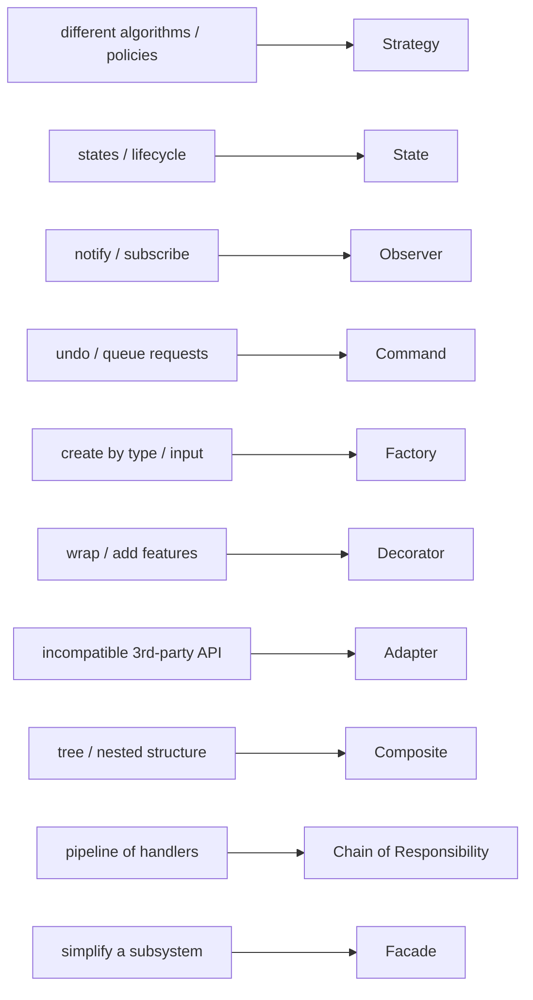
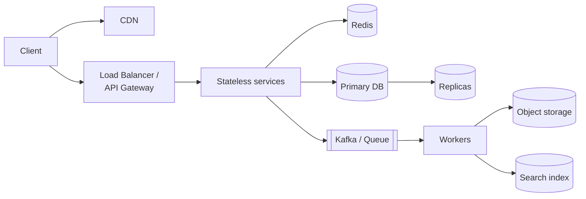

# One-Page Revision Cheat Sheet

Use this the night before an interview. Every line links back to a detailed chapter if something feels shaky.

---

## LLD

### The 45-minute routine ([details](lld/08-lld-interview-framework.md))
**Requirements** (write them down) -> **Entities** (nouns = classes, verbs = methods) -> **Class diagram** (relationships, multiplicity, interfaces) -> **Code** (enums -> entities -> interfaces -> services -> demo) -> **Extend + concurrency**.

### Principles ([SOLID](lld/02-solid.md))
| | Principle | One-line test |
|---|---|---|
| S | Single responsibility | Does this class have more than one reason to change? |
| O | Open/closed | Can I add a new type without editing existing code? |
| L | Liskov substitution | Can every subclass be used where the parent is expected, with no surprises? |
| I | Interface segregation | Is any class forced to implement methods it doesn't support? |
| D | Dependency inversion | Does business logic depend on interfaces that get injected? |

### Patterns by keyword ([creational](lld/04-creational-patterns.md), [structural](lld/05-structural-patterns.md), [behavioral](lld/06-behavioral-patterns.md))

**Commonly confused pairs**
- **Strategy vs State:** same structure. The client picks the strategy; a state switches *itself*.
- **Simple Factory vs Factory Method:** one place picks the class from input, vs a subclass overrides a creation method.
- **Adapter vs Decorator vs Proxy:** changes the interface / adds behaviour / controls access.
- **Aggregation vs Composition:** the part outlives the whole / the part dies with the whole.

### Python toolkit ([OOP](lld/01-python-oop.md), [concurrency](lld/07-concurrency.md))
`ABC` + `@abstractmethod` · `Protocol` · `@dataclass(frozen=True)` · `Enum` · `field(default_factory=list)` · `threading.Lock` (always `with lock:`) · `queue.Queue` · `heapq` · `collections.OrderedDict` / `deque` / `defaultdict`

### Concurrency answer template
*"The shared state is ___. The race is check-then-act on ___. I'll protect it with a lock per ___ so unrelated ___ don't block each other. With several locks, I acquire them in sorted order to avoid deadlock. Across servers, this becomes a conditional DB update or a Redis `SET NX EX`."*

### Problem -> key idea
| Problem | Key idea |
|---|---|
| [Parking lot](lld/problems/parking_lot/README.md) | Strategy for allocation and pricing; lock find + assign |
| [LRU cache](lld/problems/lru_cache/README.md) | Hash map + doubly linked list with dummy nodes |
| [Vending machine](lld/problems/vending_machine/README.md) | State pattern; draw the state diagram first |
| [Rate limiter](lld/problems/rate_limiter/README.md) | Token bucket with lazy refill |
| [Elevator](lld/problems/elevator/README.md) | LOOK scheduling with two heaps; dispatch Strategy |
| [Movie booking](lld/problems/movie_booking/README.md) | Holds with expiry; lock per show; all-or-nothing |
| [Splitwise](lld/problems/splitwise/README.md) | Integer money; net balances; greedy settlement (at most n-1 payments) |

---

## HLD

### The routine ([details](hld/10-hld-interview-framework.md))
Functional + **non-functional** requirements -> estimation -> API -> data model -> high-level diagram -> 2-3 deep dives -> bottlenecks & trade-offs.

### Numbers ([estimation](hld/09-estimation.md))
- 1 day ≈ **10^5 s**; 1 M requests/day ≈ **12/s**; peak ≈ 2-3x average
- RAM ~100 ns · SSD ~100 µs · same-DC round trip ~0.5 ms · cross-continent ~150 ms
- Redis ~100k ops/s per node · app server ~1-10k req/s · SQL node ~thousands to tens of thousands of simple queries/s
- Availability: 99.9% ≈ 8.8 h/year · 99.99% ≈ 53 min/year

### Key facts
| Topic | Remember |
|---|---|
| Scaling | Stateless app servers + LB; move state to Redis/DB/JWT ([ch 2](hld/02-scaling-load-balancing.md)) |
| Read-heavy | Cache (cache-aside + delete on write + TTL), read replicas, CDN ([ch 5](hld/05-caching.md)) |
| Write-heavy | Queue + batching, LSM-based stores (Cassandra), sharding ([ch 3](hld/03-databases.md)) |
| DB scaling order | Index -> cache -> read replicas -> vertical scale -> shard (consistent hashing) |
| Shard key | High cardinality, even load, matches the main query |
| CAP | When partitioned: Consistency (error) or Availability (stale). Choose **per feature** ([ch 4](hld/04-cap-consistency.md)) |
| Quorum | W + R > N gives fresh reads |
| Queues | At-least-once delivery + **idempotent consumers**; DLQ; outbox pattern ([ch 6](hld/06-messaging.md)) |
| Kafka | Order only within a partition: key by entity ID; consumers per group ≤ partitions |
| IDs | Snowflake: 41 bits time · 10 bits machine · 12 bits sequence ([ch 7](hld/07-distributed-systems.md)) |
| Distributed tx | Saga with compensations (not 2PC across services) |
| Locks across servers | Redis `SET NX PX` + token check on release; fencing tokens for correctness |
| Reliability | Timeouts everywhere; retries with backoff + jitter; circuit breaker; bulkheads ([ch 8](hld/08-reliability.md)) |
| Real-time | WebSocket (two-way) · SSE (server push) · long polling (fallback) ([ch 1](hld/01-networking.md)) |
| Geo | Geohash + 8 neighbours, quadtree, H3; Redis GEO |
| Membership at scale | Bloom filter (no false negatives) |
| Leaderboard | Redis sorted set |

### Case study -> key idea
| Case study | Key idea |
|---|---|
| [URL shortener](hld/case-studies/url-shortener.md) | Counter + Base62 (7 chars), range allocation, cache, 302 for analytics |
| [Rate limiter](hld/case-studies/rate-limiter.md) | Token bucket in Redis via Lua; gateway placement; fail-open |
| [News feed](hld/case-studies/news-feed.md) | Hybrid fan-out (push for normal users, pull for celebrities) |
| [Chat](hld/case-studies/chat-system.md) | WebSockets + session registry; persist before ack; partition by chat_id |
| [Notifications](hld/case-studies/notification-system.md) | Queue per channel + priority lane; idempotency keys; preferences |
| [Video streaming](hld/case-studies/video-streaming.md) | Segment-parallel transcoding; ABR (HLS/DASH); CDN-first |
| [Ride sharing](hld/case-studies/ride-sharing.md) | In-memory geo index; atomic driver state change |
| [Web crawler](hld/case-studies/web-crawler.md) | Frontier = priority + per-host politeness; Bloom filter dedup |

### The universal architecture

### Trade-offs you should be able to argue (both sides)
SQL vs NoSQL · push vs pull fan-out · strong vs eventual consistency · cache-aside vs write-through · monolith vs microservices · 301 vs 302 · polling vs WebSocket · fail-open vs fail-closed · 2PC vs saga · Redis lock vs DB constraint · range vs hash sharding
