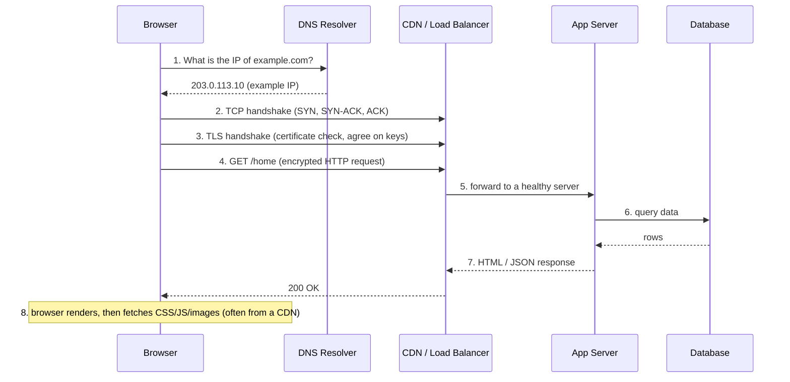
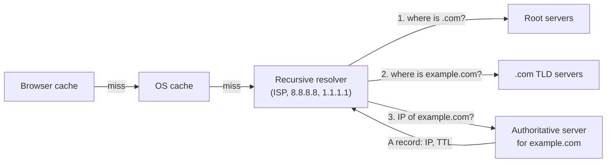
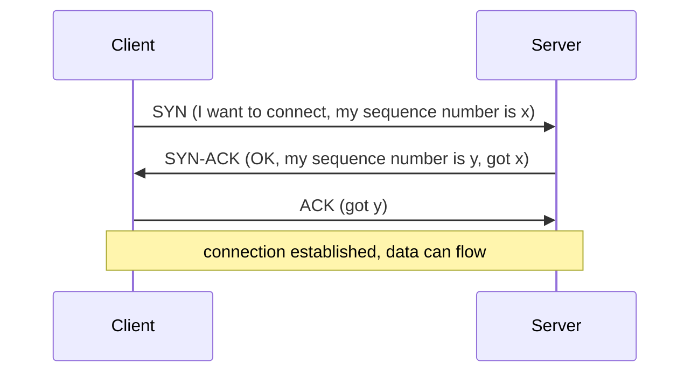
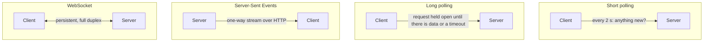
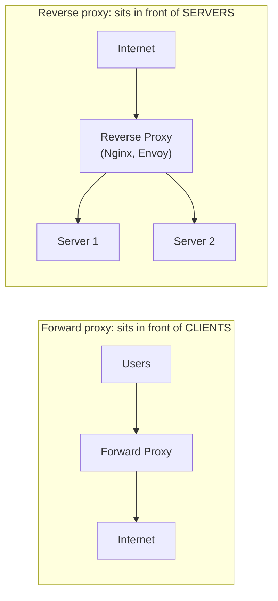

# 1. Networking Basics

## Why this matters
Every system design starts with a client talking to a server over a network. You don't need to be a network engineer, but you must be able to explain **what happens on a request**, choose **TCP vs UDP**, pick an **API style**, and choose a **real-time technique** (polling vs WebSockets vs SSE). These choices show up in nearly every HLD answer.

---

## What happens when you type a URL and press Enter

1. **DNS lookup** turns the human-friendly name into an IP address.
2. **TCP connection:** a reliable channel set up with a 3-way handshake.
3. **TLS handshake:** the server proves its identity with a certificate, and both sides agree on encryption keys. TLS 1.3 needs only one extra round trip.
4. **HTTP request** over that encrypted connection.
5. A **load balancer** (or CDN) forwards it to one of many servers.
6. The **server** runs business logic, often reading from caches and databases.
7. The **response** travels back.
8. The browser **renders** the page and fetches more resources.

Each step is a place to optimise: DNS caching, connection reuse (keep-alive), CDNs close to users, caches before databases. This sequence is a common warm-up interview question in its own right.

---

## DNS (Domain Name System)

DNS is the internet's phone book: it maps `example.com` to an IP address. It's a **hierarchical, heavily cached, distributed** system.

The recursive resolver does the legwork: the root tells it where `.com` lives, the `.com` servers tell it where `example.com`'s authoritative server lives, and that server returns the actual record. Every answer is **cached** for its **TTL** (time to live), so most lookups never leave your machine or ISP.

| Record | Maps | Example |
|---|---|---|
| **A** | name -> IPv4 address | `example.com -> 203.0.113.10` |
| **AAAA** | name -> IPv6 address | |
| **CNAME** | name -> another name (alias) | `www.example.com -> example.com` |
| **MX** | domain -> mail server | |
| **NS** | domain -> its authoritative name servers | |
| **TXT** | arbitrary text (domain verification, SPF) | |

**DNS in system design**
- **Load balancing / failover:** return several IPs, or remove a dead region's IP.
- **GeoDNS:** answer with the IP of the region nearest the user (latency-based routing).
- **TTL trade-off:** a short TTL allows fast failover but means more DNS queries; a long TTL is the reverse.

---

## TCP vs UDP

Both are transport-layer protocols on top of IP.

| | TCP | UDP |
|---|---|---|
| Connection | Yes: 3-way handshake first | No: just send packets ("datagrams") |
| Reliability | Lost packets are retransmitted | Lost packets stay lost |
| Ordering | Delivered in order | May arrive out of order |
| Flow & congestion control | Yes (slows down when the network is busy) | No |
| Overhead / latency | Higher | Lower |
| Used by | HTTP/1.1 & HTTP/2, databases, SSH, email | DNS queries, video calls, online games, live streaming, QUIC (HTTP/3) |

**How to choose:** if correctness matters more than speed (payments, web pages, files), use TCP. If *fresh* data matters more than *complete* data (a video frame from 200 ms ago is useless), use UDP. Apps on UDP add only the reliability they need.

---

## HTTP essentials

HTTP is a **request/response** protocol. It's **stateless**: each request carries everything the server needs (cookies, tokens). Statelessness is what makes horizontal scaling easy (see the next chapter).

### Methods
| Method | Meaning | Idempotent? | Safe (read-only)? |
|---|---|---|---|
| GET | Read a resource | ✅ | ✅ |
| POST | Create / trigger an action | ❌ | ❌ |
| PUT | Replace a resource entirely | ✅ | ❌ |
| PATCH | Partially update | Not guaranteed | ❌ |
| DELETE | Remove | ✅ | ❌ |

**Idempotent** means doing it twice has the same effect as doing it once. That matters because networks fail and clients **retry**. Retrying a PUT is harmless; retrying a POST "create payment" might charge twice. That's why payment APIs accept an **idempotency key** (see [messaging](06-messaging.md)).

### Status codes
| Range | Meaning | Common ones |
|---|---|---|
| 2xx | Success | 200 OK, 201 Created, 202 Accepted (queued for later), 204 No Content |
| 3xx | Redirect | 301 Moved Permanently (browsers cache it), 302 Found (temporary), 304 Not Modified (use your cache) |
| 4xx | Client error | 400 Bad Request, 401 Unauthorized (not logged in), 403 Forbidden (logged in but not allowed), 404 Not Found, 409 Conflict, 429 Too Many Requests |
| 5xx | Server error | 500 Internal Error, 502 Bad Gateway (bad response from upstream), 503 Service Unavailable (overloaded/down), 504 Gateway Timeout |

### HTTP versions
| Version | Key idea | Benefit |
|---|---|---|
| HTTP/1.1 | Keep-alive: reuse a TCP connection for several requests | Avoids a handshake per request, but requests on one connection still wait in line |
| HTTP/2 | **Multiplexing:** many parallel streams over one connection, header compression, binary framing | Much faster page loads; the basis of gRPC |
| HTTP/3 | Runs on **QUIC** (over UDP) | No TCP head-of-line blocking; faster connection setup; survives switching networks (Wi-Fi to 4G) |

---

## API styles

| Style | What it looks like | Strengths | Weaknesses | Typical use |
|---|---|---|---|---|
| **REST** | Resources + HTTP verbs: `GET /users/42`, JSON bodies | Simple, cacheable, universal tooling | Over- or under-fetching; many round trips | Public APIs, CRUD services |
| **gRPC** | Typed functions defined in Protobuf, binary over HTTP/2 | Fast, compact, strongly typed, streaming | Not browser-native; less human-readable | Internal service-to-service calls |
| **GraphQL** | One endpoint; the client asks for exactly the fields it needs | No over-fetching; great for varied frontends | Harder caching; expensive queries need limits | Mobile apps, aggregating many backends |

**Good REST habits to mention:** plural nouns (`/orders`), versioning (`/v1/`), **cursor-based pagination** for large lists (`?cursor=abc&limit=20`), correct status codes, idempotency keys on POST.

---

## Real-time communication

How does the server tell the client that something happened (a new message, a price change)? Plain HTTP only lets the *client* ask.

| Technique | How it works | Pros | Cons | Use for |
|---|---|---|---|---|
| **Short polling** | Client asks every N seconds | Trivial | Wasteful (most answers are "nothing new"); delay up to N s | Dashboards refreshing every minute |
| **Long polling** | Server holds the request open until data arrives, then the client re-asks immediately | Near real-time over plain HTTP | One held request per client; reconnect churn | Fallback when WebSockets are blocked |
| **SSE** | One long HTTP response streaming events, server to client only | Simple; automatic reconnect; works through proxies | One direction only; text only | Notifications, live scores, LLM token streaming |
| **WebSocket** | HTTP "Upgrade" to a persistent two-way TCP connection | True bidirectional, low latency | Stateful connections: harder to load balance and scale | Chat, multiplayer games, collaborative editing |

**Scaling WebSockets** (a common follow-up): each server holds many long-lived connections, so you need a **connection registry** (user -> server) and a **pub/sub** layer to route messages to the right server. See the [chat case study](case-studies/chat-system.md).

---

## Proxies

- **Forward proxy:** acts *for the client*. Corporate content filtering, anonymity, caching for an office.
- **Reverse proxy:** acts *for the server*. Clients think they're talking to the real server. It provides:
  - **TLS termination:** decrypt once at the edge
  - **Load balancing** across servers
  - **Caching** and **compression**
  - **Rate limiting**, request filtering, a single public entry point

In system design diagrams, "load balancer", "reverse proxy" and "API gateway" often appear as one box. Know the differences ([next chapter](02-scaling-load-balancing.md)).

---

## Check yourself
1. Walk through everything that happens between typing a URL and seeing the page.
2. Why might a video-call app choose UDP?
3. Which HTTP methods are idempotent, and why does it matter for retries?
4. Chat app: WebSocket, SSE or long polling? What about a live cricket score page?
5. What's the difference between a 502 and a 504?
