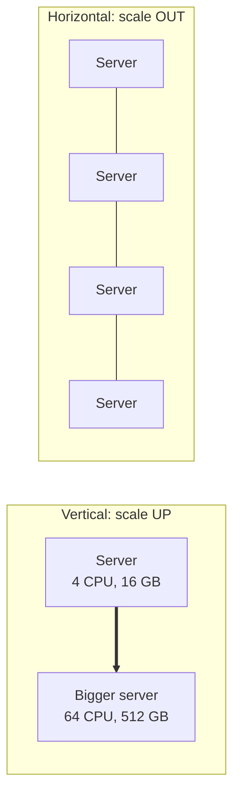
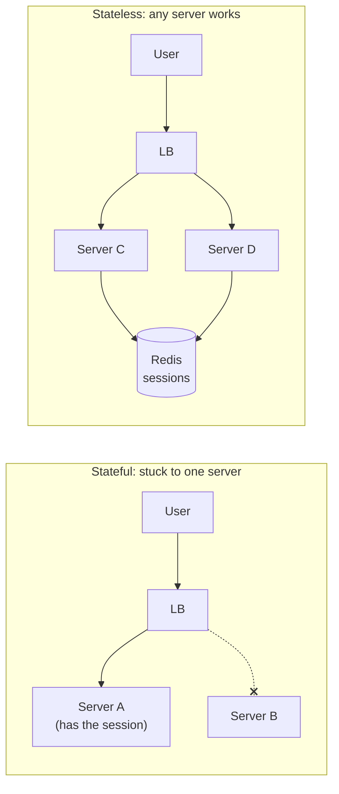
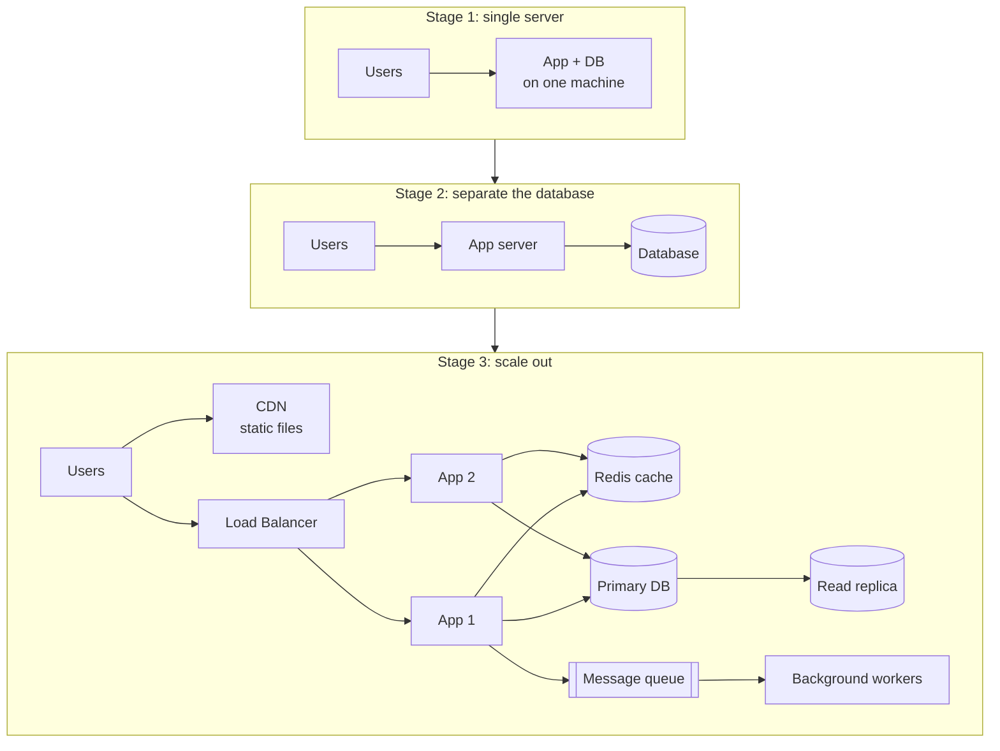
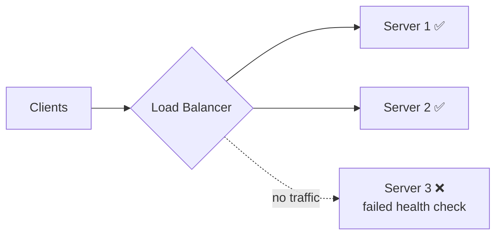
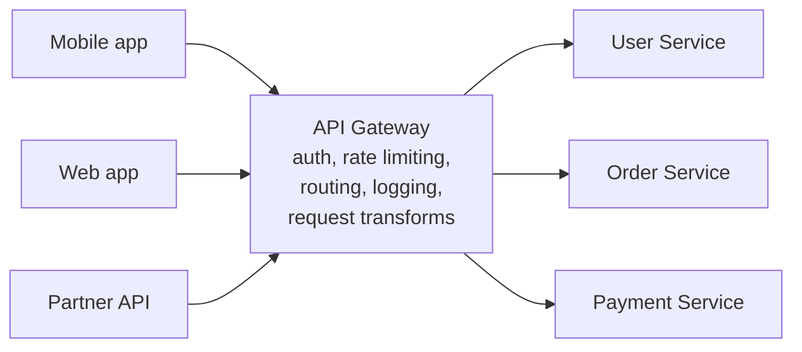
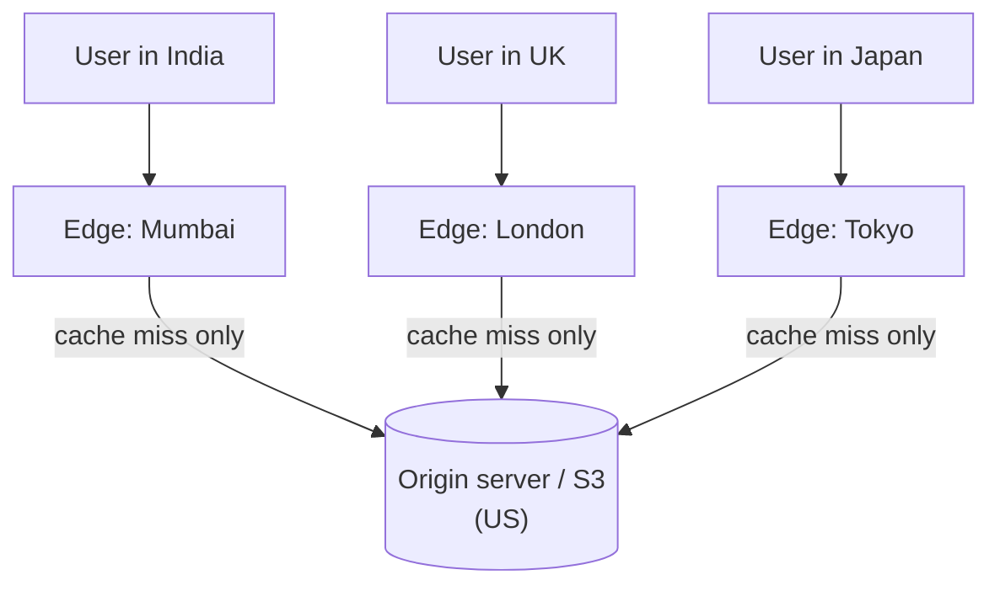

# 2. Scaling & Load Balancing

## Why this matters
"How would this handle 10x or 100x the traffic?" is the central HLD question. Scaling means adding capacity so the system keeps meeting its latency and availability goals as load grows. This chapter covers the basic moves (vertical vs horizontal scaling, stateless servers, load balancers, CDNs, API gateways) that almost every design uses.

---

## Vertical vs horizontal scaling

| | Vertical (bigger machine) | Horizontal (more machines) |
|---|---|---|
| How | More CPU, RAM, faster disks | Add servers behind a load balancer |
| Limit | The biggest machine you can buy; cost grows faster than capacity | Practically unlimited |
| Failure | One machine = **single point of failure** (SPOF) | One server dies, the others carry on |
| Complexity | None: no code changes | Needs load balancing, stateless servers, distributed data |
| Good for | Early stage; databases (scale up before sharding) | Web/app tiers; anything at large scale |

**Typical path:** scale up while it's cheap and simple, scale out when you need fault tolerance or reach hardware limits. Saying this shows pragmatism.

---

## Stateless servers: the key to horizontal scaling

A server is **stateful** if it remembers something about a client between requests (a login session in memory, a shopping cart in a local variable). Then every request from that user *must* reach that same server, and if the server dies, the state is gone.

A **stateless** server keeps no client state locally. Any server can handle any request, so you can add, remove or replace servers freely.

**How to make servers stateless:** move state out to
- a shared **session store** (Redis),
- a **database**,
- the **client** itself: a signed token such as a **JWT** carries the user's identity, so the server only verifies the signature.

**Sticky sessions** (the load balancer always sends a user to the same server) are a workaround for stateful servers. They work, but they cause uneven load and lose sessions when a server dies. Mention them as a fallback, not a goal.

---

## How a system typically evolves

| Stage | Change | Problem it solves |
|---|---|---|
| 1 -> 2 | Database on its own machine | App and DB stop competing for CPU/RAM; each scales independently |
| 2 -> 3 | Load balancer + several app servers | No app-server SPOF; more request capacity |
| | Cache (Redis) | Fewer DB reads; lower latency |
| | Read replicas | Spread read load across copies of the DB |
| | CDN | Static files served from near the user |
| | Queue + workers | Slow work (emails, video processing) moves off the request path |
| later | Sharding, multiple regions, microservices | Data too big for one DB; global users; team scaling |

This narrative is a great way to structure an answer: **start simple, then scale the component that becomes the bottleneck.**

---

## Load balancers

A load balancer (LB) spreads incoming requests across a pool of servers. It also performs **health checks**: it pings each server and stops sending traffic to servers that fail.

### Layer 4 vs Layer 7
| | L4 (transport layer) | L7 (application layer) |
|---|---|---|
| Sees | IP addresses and ports only | Full HTTP: URL path, headers, cookies |
| Routing decisions | Per connection | Per request: `/api/*` -> API servers, `/images/*` -> image servers |
| Can it terminate TLS, rewrite headers, cache? | No | Yes |
| Speed | Very fast, low overhead | Slightly more work per request |
| Examples | AWS NLB, HAProxy (TCP mode) | AWS ALB, Nginx, Envoy, HAProxy (HTTP mode) |

### Balancing algorithms
| Algorithm | How it picks a server | Best when |
|---|---|---|
| Round robin | 1, 2, 3, 1, 2, 3 ... | Identical servers, similar requests |
| Weighted round robin | Bigger servers get proportionally more | Mixed hardware |
| Least connections | Fewest active connections | Requests vary a lot in duration (uploads, WebSockets) |
| Least response time | Fastest recent responses | Heterogeneous performance |
| IP hash / consistent hashing | `hash(client or key)` -> server | The same client or key should hit the same server (caches, sticky sessions) |
| Power of two random choices | Pick 2 servers at random, send to the less loaded | Large fleets; nearly optimal and cheap |

### Isn't the load balancer itself a single point of failure?
Yes, if there's only one. Solutions:
- **Active-passive pair:** a standby takes over the virtual IP if the active one fails its heartbeat.
- **Active-active** behind DNS or anycast.
- **Managed cloud LBs** (AWS ELB, GCP LB) are redundant internally.

---

## API Gateway

An API gateway is a specialised L7 reverse proxy that is the **single entry point** for clients into a set of backend services.

What it centralises (so each service doesn't reimplement it):
- **Authentication** (verify JWTs/API keys) and authorisation
- **Rate limiting** and quotas
- **Routing** to the right service and version
- **Request aggregation:** one client call fans out to several services
- **Observability:** logging, metrics, tracing headers
- Protocol translation (REST outside, gRPC inside)

**LB vs reverse proxy vs API gateway:** a load balancer *distributes* traffic; a reverse proxy *fronts* servers (and often load balances); an API gateway is a reverse proxy with **API-management features**. In practice one product (Nginx, Envoy, Kong) can play all three roles.

---

## CDN (Content Delivery Network)

A CDN is a global network of **edge servers** that cache content close to users. A user in Mumbai gets the image from a Mumbai edge instead of a server in Virginia: about 10 ms instead of about 200 ms.

| | Pull CDN | Push CDN |
|---|---|---|
| How content gets there | The edge fetches from the origin on the first request (cache miss), then caches it | You upload content to the CDN in advance |
| Pros | Zero effort; only popular content is cached | No first-request penalty; full control |
| Cons | The first user in each region is slower | You manage uploads and expiry |
| Good for | Most websites | Large files known in advance (video releases, game patches) |

**Cache control:** `Cache-Control: max-age=86400` headers set the TTL. To update a file instantly, use **versioned URLs** (`app.3f9c2.js`). A new name means a guaranteed fresh fetch, which is far more reliable than purging caches.

**What CDNs serve:** images, CSS/JS, fonts, video segments, downloadable files, and increasingly dynamic content via edge computing. They also absorb DDoS traffic.

---

## Monolith vs microservices

| | Monolith | Microservices |
|---|---|---|
| Structure | One codebase, one deployable | Many small services, each with its own data |
| Deploy | Everything together | Each service independently |
| Scale | The whole app as a unit | Only the hot service |
| Failure isolation | One bug can take everything down | A failing service can be isolated (with circuit breakers) |
| Complexity | Low: function calls, one DB, simple transactions | High: network calls, partial failures, distributed transactions, tracing, versioning |
| Team fit | Small teams | Many teams owning separate domains |

**Pragmatic answer:** *"Start with a well-structured, modular monolith. Split out services when a team-ownership or scaling need justifies the operational cost, for example the video-transcoding part that needs very different hardware."* Splitting too early is a well-known anti-pattern (a "distributed monolith").

---

## Check yourself
1. Why must app servers be stateless to scale horizontally? Where does the state go?
2. When would you use an L7 load balancer instead of L4?
3. Which balancing algorithm suits long-lived WebSocket connections, and why?
4. How do you update a cached JavaScript file on a CDN immediately?
5. Give two reasons *not* to start a new product with microservices.
