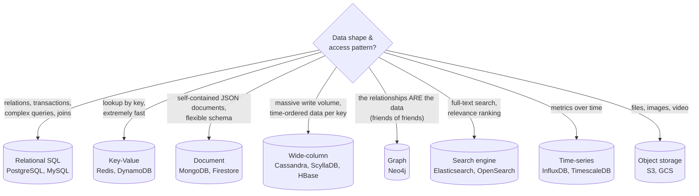
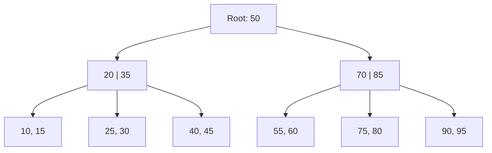
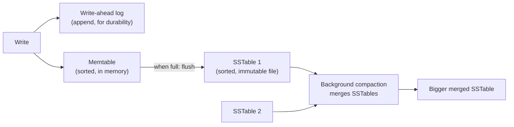
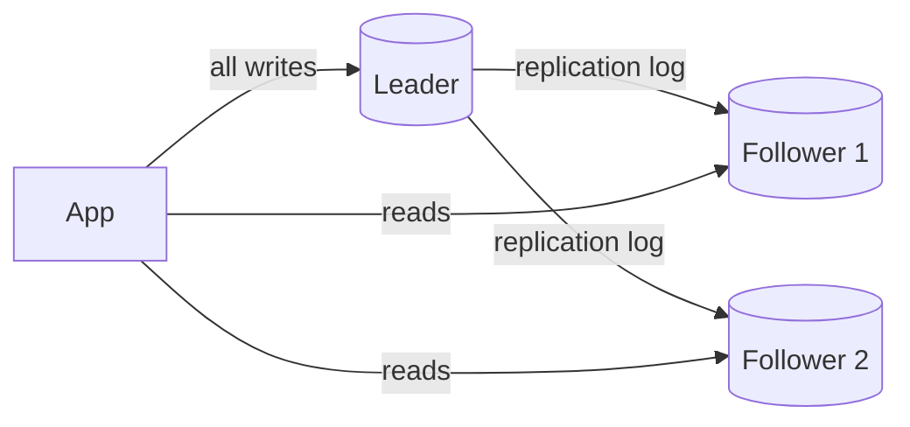
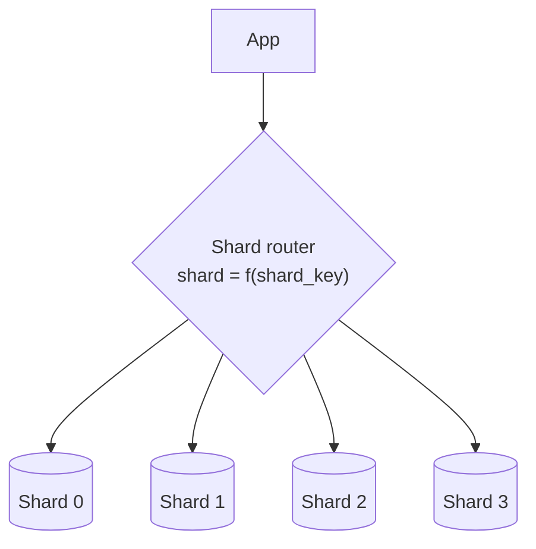
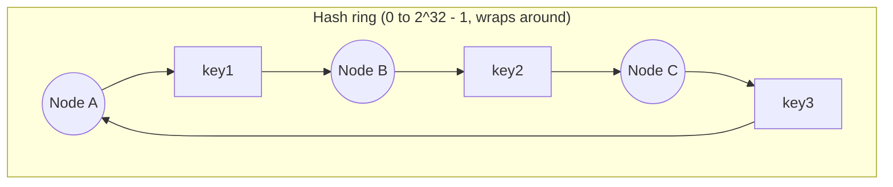

# 3. Databases: Choosing, Indexing, Replicating, Sharding

## Why this matters
The database is usually the **hardest part of a system to scale** and the most expensive to get wrong. App servers are stateless and easy to multiply; data has to stay correct, durable and consistent. In an interview you'll be expected to:
1. **pick** a database type and justify it,
2. design the **schema / keys** around the access patterns,
3. explain how it **scales**: indexes, replication, sharding.

---

## Choosing a database

Start from the **data shape** and the **access pattern** (how will you read and write it?), not from what's fashionable.



Real systems use **several** (polyglot persistence): Postgres for orders, Redis for sessions and caching, Elasticsearch for product search, S3 for images.

---

## SQL vs NoSQL

| | Relational (SQL) | NoSQL (key-value, document, wide-column) |
|---|---|---|
| Schema | Fixed tables and columns, enforced | Flexible / schema-on-read |
| Relationships | Foreign keys, **joins** | Usually **denormalised**: related data embedded or duplicated |
| Transactions | Full **ACID** across rows and tables | Often limited to one item/partition (many now offer more) |
| Scaling | Scale up first; replicas for reads; sharding is manual and hard | Designed to **shard automatically** across many nodes |
| Query flexibility | Ad-hoc queries over any column | Efficient only for queries designed in advance (by key) |
| Choose when | Money, inventory, bookings, anything relational or needing strong consistency | Huge scale, simple known access patterns, high write throughput, flexible data |

**A sensible default:** *"PostgreSQL unless there's a specific reason not to."* Relational databases scale much further than people think (read replicas plus caching handle most products). Choose NoSQL when you can name the reason: write volume, data size, a key-based access pattern, global distribution.

### ACID (what relational databases guarantee)
- **Atomicity:** a transaction happens completely or not at all (a transfer debits *and* credits, or neither).
- **Consistency:** constraints (unique keys, foreign keys, checks) always hold after a transaction.
- **Isolation:** concurrent transactions don't see each other's half-finished work.
- **Durability:** once committed, data survives crashes (it's in the write-ahead log on disk).

### BASE (the philosophy of many distributed NoSQL stores)
**B**asically **A**vailable, **S**oft state, **E**ventually consistent. The system prefers staying up and fast; replicas may briefly disagree but converge.

### Isolation levels
Stronger isolation means fewer anomalies, but more locking or aborts and less concurrency.

| Level | Prevents | Still allows | Notes |
|---|---|---|---|
| Read uncommitted | (nothing) | Dirty reads (seeing uncommitted data) | Rarely used |
| **Read committed** | Dirty reads | Non-repeatable reads (a row changes between two reads in your transaction) | **Default in PostgreSQL** and Oracle |
| **Repeatable read** | + non-repeatable reads | Phantoms (new rows appearing in a range query) in the SQL standard | **Default in MySQL InnoDB**. PostgreSQL's version (snapshot isolation) also prevents phantoms but allows *write skew* |
| Serializable | All of the above, including write skew | (none: behaves as if transactions ran one at a time) | Safest; more aborts/retries |

**Write skew example:** two doctors each check "at least 2 doctors are on call", both see 2, and both go off call. Each transaction was fine alone; together they broke the rule. Serializable isolation, or an explicit `SELECT ... FOR UPDATE`, prevents it.

---

## Indexes

Without an index, `WHERE email = ?` scans every row: O(n). An index is a separate sorted structure pointing at rows, so lookups become O(log n).



### B-tree (more precisely B+ tree): the default in relational databases
- A balanced tree with **high fan-out** (hundreds of keys per node), so even billions of rows need only 3-4 levels, which means 3-4 disk reads.
- Keys are **sorted**, so it supports equality *and* **range queries** (`BETWEEN`, `ORDER BY`, prefix `LIKE 'abc%'`).
- Updates happen **in place**, so writes do random disk I/O.

### LSM tree (log-structured merge tree): used by Cassandra, RocksDB, LevelDB, ScyllaDB

- Writes go to memory plus a sequential log, which makes them **very fast**.
- Reads may check the memtable and several SSTables. **Bloom filters** skip files that can't contain the key.
- Background **compaction** merges files and discards overwritten or deleted values.

| | B-tree | LSM tree |
|---|---|---|
| Writes | Slower (random I/O) | **Faster** (sequential I/O) |
| Reads | **Faster, predictable** | Can be slower (several files) |
| Best for | Read-heavy, transactional workloads | Write-heavy workloads (logs, metrics, messages, IoT) |

### Index trade-offs
- Every index **speeds up reads but slows down writes** (each insert updates every index) and uses storage.
- Index the columns you filter, join and sort on (`WHERE`, `JOIN`, `ORDER BY`).
- A **composite index** `(user_id, created_at)` serves "this user's posts, newest first". Column order matters: the index works for queries on `user_id` alone, but not on `created_at` alone.
- A **covering index** contains every column the query needs, so the table itself is never touched.

---

## Replication: copies of the same data on several machines

Why replicate?
1. **High availability:** if one machine dies, another has the data.
2. **Read scaling:** spread reads across copies.
3. **Lower latency:** a copy near users in each region.

### Leader-follower (primary-replica), the most common setup

- All writes go to the leader; followers apply the leader's change log in the same order.
- **Scales reads, not writes:** every write still hits the single leader.
- **Failover:** if the leader dies, a follower is promoted (automatically or manually). The danger is **split brain**, where two nodes both believe they're the leader. Avoid it with consensus or fencing (see [distributed systems](07-distributed-systems.md)).

**Synchronous vs asynchronous replication**
| | Synchronous | Asynchronous |
|---|---|---|
| Leader confirms a write after... | at least one follower has it | writing it locally only |
| Durability if the leader dies | No data loss | Recent writes can be lost |
| Write latency | Higher | Lower |
| Common practice | "Semi-sync": one sync follower, the rest async | Default in many setups |

**Replication lag** problems with async replicas, and their fixes:
- **Read-your-writes:** a user updates their profile, reads from a lagging replica, and sees the old value. Fix: read your *own* data from the leader for a short while after writing.
- **Monotonic reads:** successive reads hit different replicas, and data appears to go back in time. Fix: pin each user to one replica.

### Multi-leader
Each region has its own leader that accepts writes, and leaders replicate to each other. This gives low write latency everywhere and survives a region outage, but the **same record can be changed in two places at once**, so you need conflict resolution: last-write-wins (simple, loses data), merge rules, or **CRDTs** (data types that merge automatically, as used by collaborative editors).

### Leaderless (Dynamo-style: Cassandra, Riak, ScyllaDB)
The client (or a coordinator) writes to **N** replicas and reads from several. Consistency comes from **quorums**:

> With N replicas, if a write waits for **W** acknowledgements and a read queries **R** replicas, then **W + R > N** guarantees the read set overlaps the write set, so at least one replica returns the latest value.

Common choice: N = 3, W = 2, R = 2. Tune for speed: W = 1 gives fast writes, R = 1 fast reads, at the cost of weaker consistency. See the diagram in [CAP & consistency](04-cap-consistency.md).

---

## Sharding (partitioning): splitting data across machines

Replication copies **all** the data to each node. Sharding **splits** the data so each node holds **a part**. You need it when data or write volume outgrows one machine.


(Each shard is usually *also* replicated: shards for scale, replicas for availability.)

### Sharding strategies
| Strategy | How a key maps to a shard | Pros | Cons |
|---|---|---|---|
| **Range** | `user_id 1-1M -> shard 0`, `1M-2M -> shard 1` | Range scans are efficient | **Hot spots**: new, sequential IDs all hit the last shard |
| **Hash (modulo)** | `hash(key) % N` | Even spread | Changing N **remaps almost every key**: a huge migration |
| **Consistent hashing** | Keys and nodes on a hash ring (below) | Adding or removing a node moves only ~1/N of keys | Slightly more complex; needs virtual nodes for balance |
| **Directory / lookup** | A table says which shard holds each key or tenant | Total flexibility; easy to move hot tenants | The lookup service is an extra dependency |
| **Geographic** | Users' data in their region | Latency, data-residency laws | Uneven region sizes |

### Choosing the shard key (the most important decision)
A good shard key:
1. Has **high cardinality** (many distinct values), so data can spread.
2. Spreads **load evenly**, avoiding hot keys.
3. Matches the **main query pattern**, so most queries touch a single shard.

Examples: chat messages by `conversation_id`; an e-commerce order history by `user_id`; a multi-tenant SaaS by `tenant_id`.

### Pain points of sharding
- **Cross-shard queries and joins** have to scatter to every shard and gather the results: slow.
- **Cross-shard transactions** need 2PC or sagas (see [distributed systems](07-distributed-systems.md)).
- **Hot partitions:** a celebrity's data on one shard. Mitigate by adding a random suffix to hot keys or handling them specially.
- **Rebalancing** when adding shards needs data migration.
- **Unique IDs** can no longer come from one auto-increment counter (use Snowflake IDs).

> Sharding is a big step in complexity. Mention the cheaper options first: indexes, caching, read replicas, vertical scaling, archiving old data.

---

## Consistent hashing

**Problem with `hash(key) % N`:** going from 4 to 5 servers changes the result for about 80% of keys. For a cache, that's a mass miss storm; for a database, a massive migration.

**Idea:** map both **servers** and **keys** onto the same circular hash space (a ring). A key belongs to the **first server clockwise** from its position.


- `key1` lies between A and B, so it goes clockwise to **B**. Likewise `key2` goes to **C** and `key3` goes to **A**.
- **Add node D** between A and B: only the keys between A and D move (from B to D). Everything else stays put.
- **Remove node B:** only B's keys move, to the next node clockwise.

**Virtual nodes:** with only a few points on the ring, the arcs are uneven, so one server may own 50% of the ring. Instead, put each physical server on the ring **many times** (`A#0, A#1, ... A#99`). Load evens out, and when a server leaves, its keys spread across *many* servers instead of overloading one neighbour. You can also give more powerful machines more virtual nodes.

```python
import bisect
import hashlib

class ConsistentHash:
    def __init__(self, nodes: list[str], vnodes: int = 100):
        self.vnodes = vnodes
        self.ring: list[tuple[int, str]] = []        # sorted (hash, node) pairs
        for n in nodes:
            self.add(n)

    @staticmethod
    def _h(s: str) -> int:
        return int(hashlib.md5(s.encode()).hexdigest(), 16)   # stable across processes, unlike hash()

    def add(self, node: str) -> None:
        for i in range(self.vnodes):
            bisect.insort(self.ring, (self._h(f"{node}#{i}"), node))

    def remove(self, node: str) -> None:
        self.ring = [(h, n) for h, n in self.ring if n != node]

    def get(self, key: str) -> str:
        h = self._h(key)
        i = bisect.bisect(self.ring, (h, chr(0x10FFFF)))   # first point clockwise from h
        return self.ring[i % len(self.ring)][1]            # wrap around past the end

ch = ConsistentHash(["A", "B", "C"])
keys = [f"user:{i}" for i in range(10_000)]
before = {k: ch.get(k) for k in keys}
ch.add("D")
moved = sum(before[k] != ch.get(k) for k in keys)
print(f"moved {moved / len(keys):.0%} of keys")   # about 25% (= 1/4), not ~75% like modulo
```

Used by: DynamoDB and Cassandra partitioning, Memcached/Redis client-side sharding, CDNs, load balancers.

---

## Normalisation vs denormalisation

- **Normalised:** each fact stored once (`users` table holds the name; `posts` stores `user_id`). Updates are easy and consistent; reads need **joins**.
- **Denormalised:** duplicate data for faster reads (store `author_name` inside each post). Reads are fast with no joins, but updating a name means updating many rows, and copies can drift apart.

**Rule of thumb:** normalise by default in SQL; denormalise deliberately for hot read paths, or when the database can't join (most NoSQL). Precomputed feeds, counters and materialised views are all forms of denormalisation.

---

## Check yourself
1. You're storing orders and payments. SQL or NoSQL, and why?
2. Why do LSM trees write faster than B-trees? What do they give up?
3. With N = 3 replicas, which (W, R) combinations guarantee reading the latest write?
4. Why does `hash(key) % N` hurt when adding a server, and how does consistent hashing fix it?
5. Choose a shard key for a chat app's messages table. What query does it make fast?
6. A user updates their bio and immediately sees the old one. What's happening, and how do you fix it?
