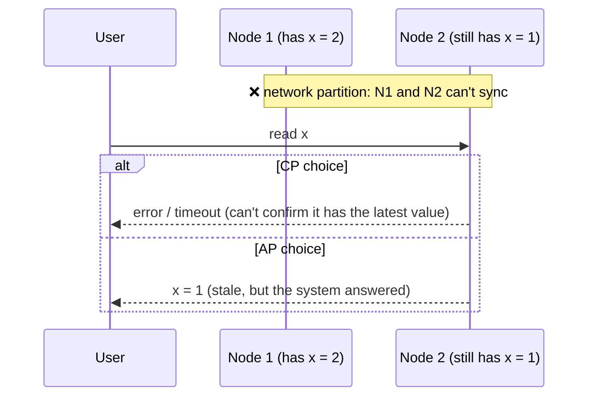
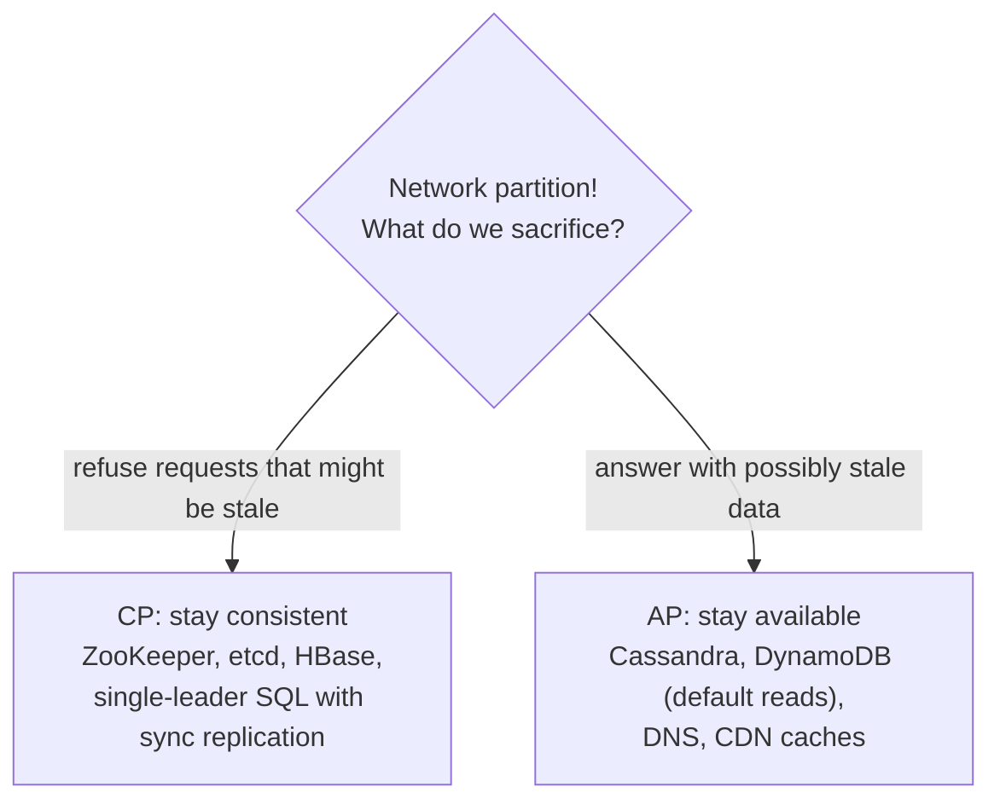
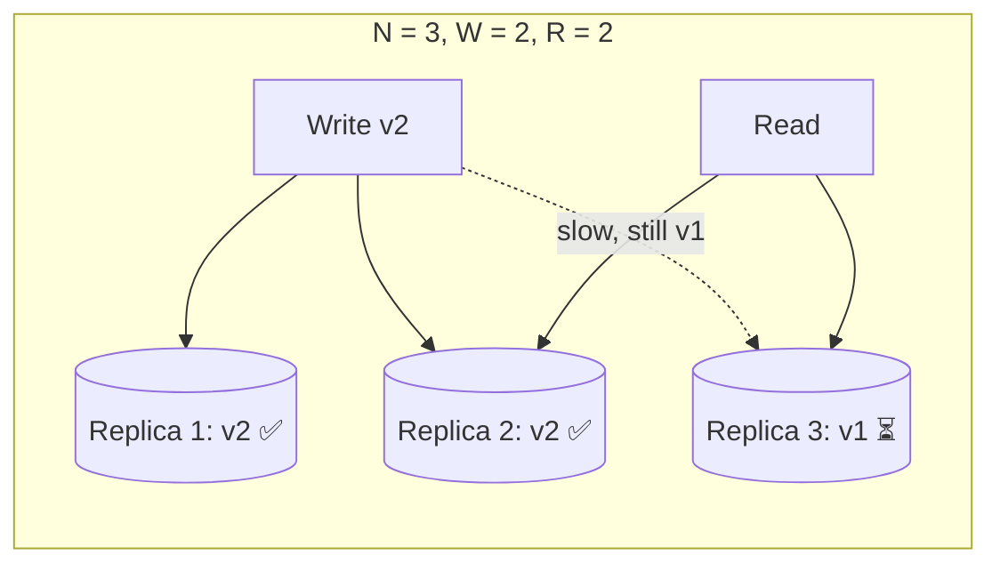

# 4. CAP Theorem & Consistency Models

## Why this matters
As soon as data lives on more than one machine (replicas, shards, regions), the copies can disagree. Interviewers want to hear you make a **deliberate choice**: *"For the like counter, eventual consistency is fine. For the seat booking, we need strong consistency."* CAP, PACELC and consistency models give you the vocabulary.

---

## The CAP theorem

In a distributed data store, when a **network partition** happens (some nodes can't talk to others), you must choose between:

- **C - Consistency:** every read returns the most recent write (or an error). Formally this is *linearizability*: the system behaves as if there were one copy of the data.
- **A - Availability:** every request to a non-failed node gets a (non-error) response, even if it may not be the latest data.
- **P - Partition tolerance:** the system keeps working despite lost or delayed messages between nodes.

> ⚠️ The "C" in CAP is **not** the "C" in ACID. ACID consistency means "constraints hold"; CAP consistency means "all nodes agree on the latest value".

### "Pick 2 of 3" is misleading
In any real distributed system, **partitions will happen** (cables get cut, switches fail, GC pauses look like outages). You can't opt out of P. The real statement is:

> **When a partition happens, choose between Consistency and Availability.**

When there is **no** partition, a well-built system can give you both C and A.

### CP vs AP in practice

| Choose **CP** when a wrong answer is worse than no answer | Choose **AP** when no answer is worse than a slightly old one |
|---|---|
| Bank balances, payments, ledgers | Social feeds, likes, view counts |
| Inventory when overselling is costly | Product catalogue, reviews |
| Seat/ticket booking, unique usernames | Shopping cart (merge conflicts later) |
| Distributed locks, leader election | DNS, caches, analytics |

> Most databases are **tunable**: Cassandra and DynamoDB let you pick consistency per query (quorum reads, strongly consistent reads); MongoDB's behaviour depends on read/write concern settings. So it's more accurate to say "this *configuration* is CP or AP" than "this database is".

**Interview move:** don't label the whole system. Choose **per feature**: *"Payments go through a CP store; the feed and counters are AP."*

---

## PACELC: the more complete picture

CAP only talks about partitions, which are rare. **PACELC** adds the everyday trade-off:

> **If** there's a **P**artition, choose **A**vailability or **C**onsistency; **E**lse (normal operation), choose **L**atency or **C**onsistency.

Even without failures, strong consistency costs latency: a write must reach several replicas (perhaps across regions) before it's acknowledged.

| System (typical configuration) | During partition | Normal operation |
|---|---|---|
| Cassandra, DynamoDB (default) | PA: stay available | EL: favour low latency |
| Spanner, etcd, ZooKeeper | PC: stay consistent | EC: pay the latency for consistency |
| PostgreSQL primary + synchronous replica | PC: writes block if the sync replica is unreachable | EC: every commit waits for the replica |

(Classifications depend on configuration, and sources disagree for some databases. Focus on explaining the trade-off, not memorising labels.)

---

## Consistency models (strongest to weakest)

| Model | Guarantee | Everyday example |
|---|---|---|
| **Strong (linearizable)** | Once a write completes, every later read, anywhere, sees it | Bank balance after a transfer |
| **Sequential** | All nodes see all operations in the *same* order (maybe delayed) | |
| **Causal** | If A caused B, everyone sees A before B; unrelated events can appear in any order | A reply never appears before the comment it answers |
| **Read-your-writes** | *You* always see your own updates | You edit your bio and see the new one immediately |
| **Monotonic reads** | You never see data go "back in time" | A comment doesn't vanish on refresh after you've seen it |
| **Eventual** | If writes stop, all replicas *eventually* converge | Like counts, DNS propagation |

Read-your-writes and monotonic reads are **session guarantees**: cheap to provide and they fix most user-visible weirdness, even on an eventually consistent system.

**Techniques for session guarantees**
- **Read-your-writes:** after a user writes, route *their* reads to the leader for N seconds, or track the write's version and read only from replicas that have caught up to it.
- **Monotonic reads:** pin a user's session to one replica.

---

## Quorums (leaderless replication)

With **N** replicas, a write waits for **W** acknowledgements, and a read asks **R** replicas and takes the newest version.

> **W + R > N** means every read set overlaps every write set, so at least one replica in the read has the latest value.

The read contacts replicas 2 and 3. Replica 2 has v2, which is newer than replica 3's v1, so the read returns **v2**. The overlap guaranteed it.

| Setting (N = 3) | Effect |
|---|---|
| W = 2, R = 2 | Balanced; tolerates 1 node down for both reads and writes |
| W = 3, R = 1 | Fast reads; writes fail if any replica is down |
| W = 1, R = 3 | Fast writes; reads fail if any replica is down |
| W = 1, R = 1 | Fastest, but W + R = 2 is not > 3, so **reads may be stale** (eventual consistency) |

Stale replicas are repaired by **read repair** (when a read notices an old version, it writes back the new one) and **anti-entropy** (background comparison, using Merkle trees).

> Quorums give strong-*ish* consistency, but edge cases (sloppy quorums, concurrent writes, clock-based last-write-wins) can still produce anomalies. If you need true linearizability, use consensus (Raft/Paxos).

---

## Conflict resolution (when two writes collide)
| Method | How | Downside |
|---|---|---|
| Last-write-wins (LWW) | Keep the value with the latest timestamp | Silently loses one write; depends on clocks |
| Version vectors | Detect concurrent versions and keep both ("siblings") | The app must merge them |
| CRDTs | Data types whose merges always converge (counters, sets, text) | Only certain data types |
| Application merge | Custom logic, e.g. union the two shopping carts | Code complexity |

---

## Check yourself
1. Why is "CA" not a real option for a distributed system?
2. For a ticket-booking system, should seat inventory be CP or AP? The movie description?
3. What does PACELC add that CAP misses?
4. N = 5. Give a (W, R) pair that guarantees fresh reads while tolerating 2 failed nodes for writes.
5. A user posts a comment, refreshes and doesn't see it. Which guarantee is missing, and how do you provide it cheaply?
