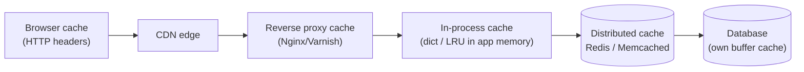
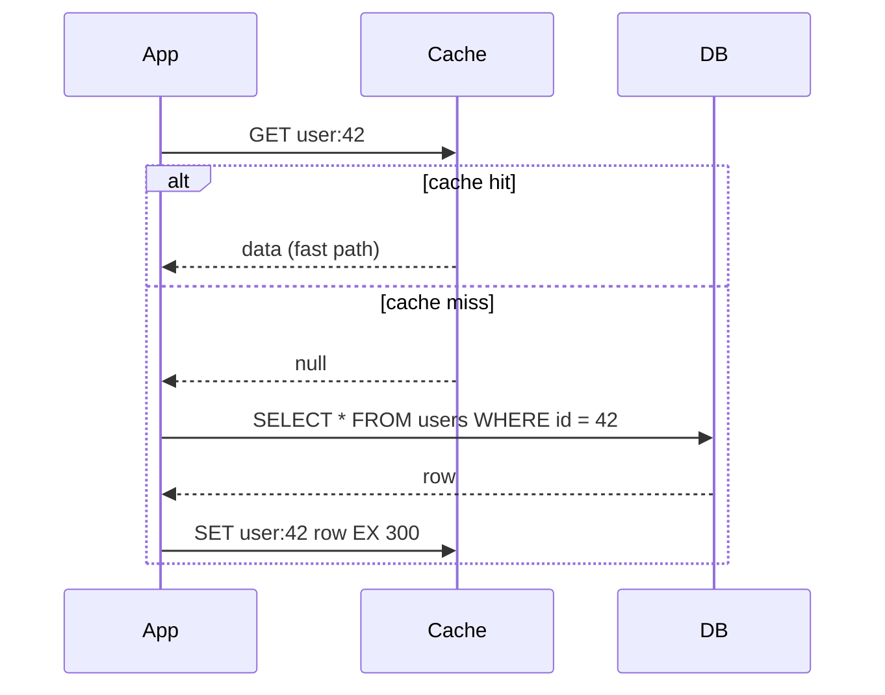
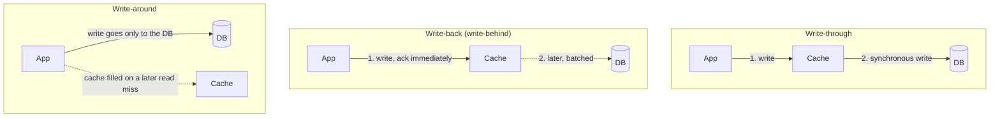

# 5. Caching

## Why this matters
A cache stores the result of expensive work (a DB query, an API call, a rendered page) in fast storage, usually memory, so the next request gets it almost instantly. Caching is the **single most effective tool** for read-heavy systems:
- Reading from RAM (Redis) takes **~0.1-1 ms** vs **~5-50 ms** for a typical database query.
- It **reduces load** on the database, often by 90% or more.
- Real traffic is skewed (the **80/20 rule**: a small fraction of items gets most of the requests), so a small cache covers most reads.

The hard parts are **staleness** (the cache disagrees with the database) and **failure modes** (stampedes, hot keys). Interviewers probe exactly these.

---

## Where caches live



| Layer | Latency | Shared across servers? | Typical content |
|---|---|---|---|
| Browser | ~0 | No (one user) | Static assets, API responses with `Cache-Control` |
| CDN | ~10-50 ms (near the user) | Yes, per region | Images, video, JS/CSS, public pages |
| In-process | ~nanoseconds | **No**: each server has its own copy | Config, very hot small objects |
| Distributed (Redis) | ~0.5 ms | **Yes** | Sessions, query results, computed feeds |

An **in-process** cache is the fastest, but each server holds a separate copy, so invalidation is harder and memory is duplicated. A **distributed** cache is one shared copy, one network hop away.

---

## Read strategies

### Cache-aside (lazy loading): the most common
The **application** manages the cache: check the cache; on a miss, read the DB and populate the cache.



```python
import json

def get_user(user_id: int) -> dict:
    key = f"user:{user_id}"
    cached = redis.get(key)
    if cached is not None:
        return json.loads(cached)                  # hit
    row = db.fetch_one("SELECT * FROM users WHERE id = %s", (user_id,))
    redis.set(key, json.dumps(row), ex=300)        # miss: fill with a 5-minute TTL
    return row

def update_user(user_id: int, fields: dict) -> None:
    db.update_user(user_id, fields)                # 1. update the source of truth
    redis.delete(f"user:{user_id}")                # 2. invalidate (don't write the new value)
```

**Why delete instead of updating the cache on writes?** If two writers update the DB and then the cache, their cache writes can land in the opposite order, leaving the *older* value cached indefinitely. Deleting is simpler: the next reader reloads the fresh value.

**Remaining race (good to mention):** a reader misses, reads the *old* row, and is delayed; meanwhile a writer updates the DB and deletes the key; then the slow reader writes the old row into the cache. Mitigations: **always set a TTL** (staleness is bounded), **delayed double delete** (delete again a moment later), or version checks. For strong consistency on critical data, read from the database.

| Pros | Cons |
|---|---|
| Only requested data is cached | The first request after a miss is slow |
| A cache outage degrades performance but doesn't break correctness | Stale data possible until TTL/invalidation |
| Simple, works with any database | Cache logic lives in application code |

### Read-through
Same flow, but the **cache library or service** loads from the DB on a miss, not your app code. Cleaner app code, but you need a cache that supports loaders.

---

## Write strategies



| Strategy | How | Pros | Cons | Use when |
|---|---|---|---|---|
| **Write-through** | Write cache and DB together | Cache always fresh for written keys | Higher write latency; caches data that may never be read | Read-after-write is common, staleness unacceptable |
| **Write-back** | Write the cache, flush to the DB asynchronously | Very fast writes; batching reduces DB load | **Data loss** if the cache dies before flushing; complex | Counters, metrics, write-heavy data that tolerates loss |
| **Write-around** | Write only to the DB; invalidate the cache | Doesn't pollute the cache with write-once data | The first read after a write is a miss | Logs, uploads, data rarely read right after writing |

In practice, **cache-aside + invalidate-on-write + TTL** covers most interview answers.

---

## Eviction policies

The cache is smaller than the data, so when it's full, something must go.

| Policy | Evicts | Good for |
|---|---|---|
| **LRU** (Least Recently Used) | The item untouched for the longest | General default; recency predicts reuse. See the [LRU LLD](../lld/problems/lru_cache/README.md) |
| **LFU** (Least Frequently Used) | The item with the fewest accesses | Stable popularity (a product catalogue) |
| FIFO | The oldest inserted | Simple; rarely optimal |
| TTL-based | Expired items | Bounding staleness; combined with the above |
| Random | A random item | Surprisingly decent, very cheap |

Redis supports `allkeys-lru`, `allkeys-lfu`, `volatile-ttl` and others via its `maxmemory-policy` setting (it uses approximate LRU/LFU by sampling).

---

## Classic caching problems (interview favourites)

| Problem | What happens | Fixes |
|---|---|---|
| **Cache stampede (thundering herd)** | A hot key expires; thousands of requests miss at once and all hit the DB | **Single-flight / mutex:** the first miss takes a short lock and recomputes, the rest wait or serve stale data. **Jittered TTLs** (300 s ± random) so keys don't expire together. **Early refresh** before expiry. |
| **Cache penetration** | Requests for keys that **don't exist** (often malicious) always miss and hit the DB | **Cache the "not found"** briefly (negative caching). A **Bloom filter** of existing keys rejects impossible keys up front. Validate input. |
| **Cache avalanche** | Many keys expire at the same time, or the cache cluster restarts, and the DB is flooded | Jittered TTLs, a replicated cache cluster, warm-up before taking traffic, rate limits / circuit breakers to protect the DB |
| **Hot key** | One key (a celebrity profile, a flash-sale item) overloads a single cache node | Replicate the key under several names (`key#1..#N`, pick one at random); an in-process cache in front; split the value |
| **Stale data** | The DB changed but the cache didn't | Invalidate on write + TTL as a safety net; versioned keys |

### Single-flight sketch
```python
import random
import time

def get_with_lock(key: str, loader, ttl: int = 300):
    value = redis.get(key)
    if value is not None:
        return value
    # Only one caller gets the lock (NX = only if not exists); it expires in case we crash.
    if redis.set(f"lock:{key}", "1", nx=True, ex=10):
        try:
            value = loader()
            redis.set(key, value, ex=ttl + random.randint(0, 30))   # jittered TTL
            return value
        finally:
            redis.delete(f"lock:{key}")
    time.sleep(0.05)                         # someone else is loading: wait briefly, retry
    return get_with_lock(key, loader, ttl)   # (in production: bounded retries / serve stale)
```

---

## Redis vs Memcached

| | Redis | Memcached |
|---|---|---|
| Data types | Strings, hashes, lists, sets, **sorted sets**, streams, bitmaps, HyperLogLog, geo | Strings (blobs) only |
| Persistence | Optional (RDB snapshots, AOF log) | None (pure cache) |
| Replication & clustering | Built in (replicas, Redis Cluster with 16384 hash slots) | Client-side sharding |
| Threading | Commands run on one main thread (I/O threads optional), so each command is atomic | Multi-threaded |
| Extras | Pub/sub, Lua scripts (atomic multi-step logic), transactions, TTL per key | Very simple, very fast |
| Pick when | You need data structures, persistence, atomic counters, locks, leaderboards | You need a simple, huge, multi-threaded blob cache |

Redis features that show up in designs:
- **Sorted sets** (`ZADD`, `ZREVRANGE`) -> leaderboards, ranked feeds, sliding-window rate limiters
- **`INCR` + `EXPIRE`** -> counters, fixed-window rate limiting
- **`SET key val NX EX 30`** -> distributed locks, idempotency keys
- **Geo commands** -> nearby drivers or restaurants
- **HyperLogLog** -> approximate unique counts (daily active users) in 12 KB

---

## What to cache, and what not to
✅ Read-heavy, rarely changing data: user profiles, product details, configuration
✅ Expensive results: aggregations, recommendations, rendered pages, precomputed feeds
✅ Session data
✅ Results of slow external API calls

❌ Data that must be exactly current: account balance at payment time, seat availability at booking time (read the source of truth)
❌ Data that is written far more than it's read
❌ Huge objects that would evict everything else

**Hit ratio** (hits / total lookups) is the key metric. If it's low, the cache is adding latency and cost without benefit.

---

## Check yourself
1. Why delete the cache key on update instead of writing the new value into the cache?
2. A celebrity's profile key gets 1 M requests per second. What breaks, and how do you fix it?
3. What's the difference between cache penetration and a cache stampede?
4. When is write-back caching acceptable?
5. Which Redis data structure would you use for a game leaderboard?
