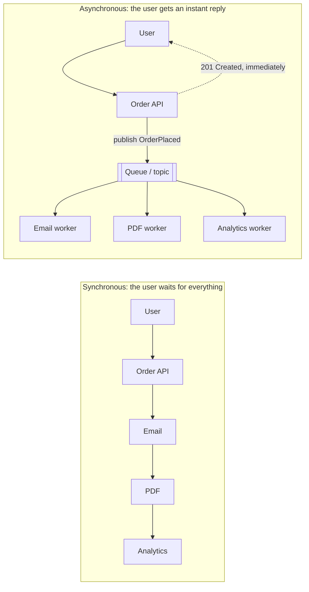
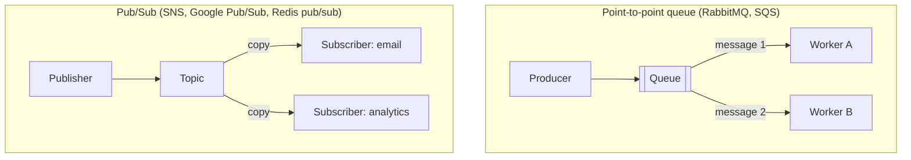
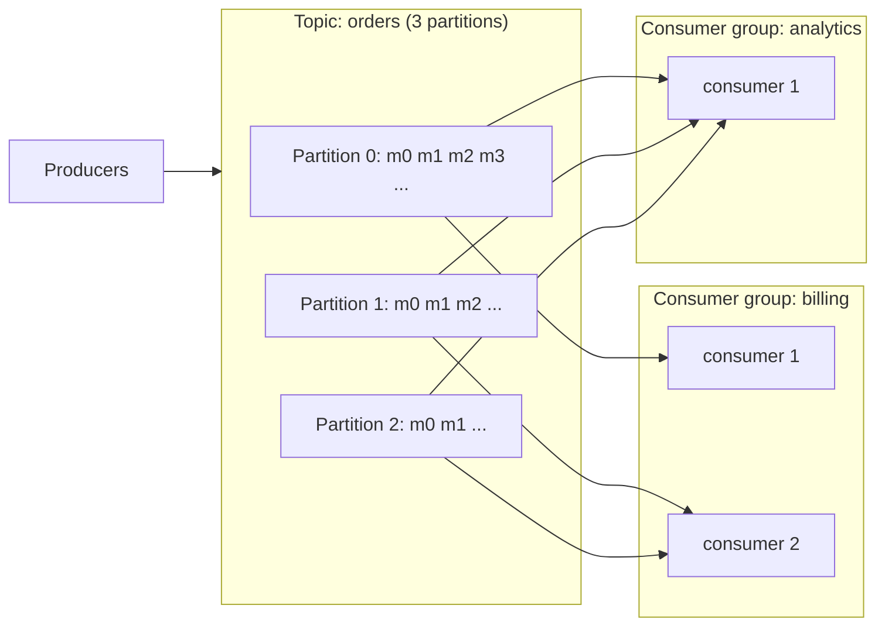
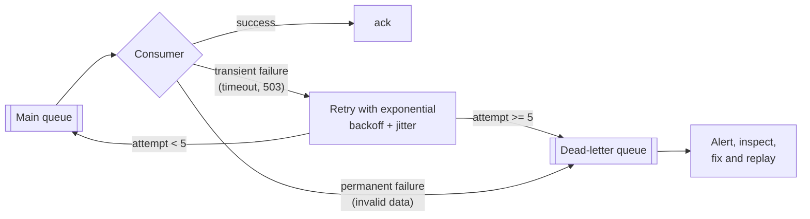
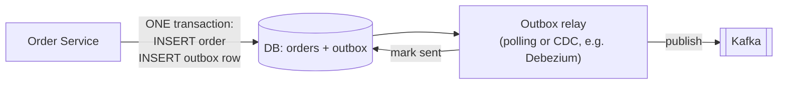

# 6. Message Queues & Asynchronous Processing

## Why this matters
Not all work has to happen while the user waits. When you place an order, the confirmation email, invoice PDF, analytics event and warehouse notification can all happen **a few seconds later**. Message queues let one service **hand off work** to others reliably, which is how large systems stay fast, absorb spikes and survive partial failures. Almost every HLD answer above "toy" scale has a queue in it.

---

## Synchronous vs asynchronous



In the synchronous version, response time is the **sum** of all steps, and if the email service is down, the order fails. In the asynchronous version the API only writes the order and publishes an event.

**Benefits of a queue**
| Benefit | Meaning |
|---|---|
| **Decoupling** | Producers don't know or care who consumes; add a new consumer without touching the producer |
| **Load levelling** | A traffic spike fills the queue; workers drain it at their own pace instead of crashing |
| **Resilience** | If a consumer is down, messages wait in the queue; nothing is lost |
| **Retries** | Failed processing can be retried automatically |
| **Independent scaling** | Add more workers just for the slow part |

**Costs:** eventual consistency (the email arrives *later*), more infrastructure to run, and harder debugging (you need tracing across async hops). Duplicates and ordering need thought (below).

---

## Queue vs pub/sub vs log



| Model | Who gets each message | After consumption | Example use |
|---|---|---|---|
| **Work queue** (point-to-point) | Exactly **one** of the competing workers | Deleted once acknowledged | Background jobs: resize this image, send this email |
| **Pub/sub** | **Every** subscriber gets a copy | Gone once delivered to all | Fan-out of events to several services |
| **Log** (Kafka, Kinesis, Pulsar) | Every **consumer group** reads it; within a group each partition goes to one consumer | **Retained** for days; can be **replayed** | Event streaming, analytics pipelines, event sourcing |

---

## Kafka in depth (the distributed log)



Key concepts:
- **Topic:** a named stream of events (`orders`).
- **Partition:** a topic is split into ordered, append-only logs. Partitions are the unit of **parallelism** and are spread across brokers (and replicated).
- **Offset:** each message's position in its partition. Consumers **track their own offset**, which makes **replay** possible (reset the offset and reprocess).
- **Consumer group:** consumers sharing the work. Each partition is read by **exactly one consumer in a group**, so a group can have at most as many active consumers as there are partitions. Different groups read independently: billing and analytics each see every message.
- **Ordering:** guaranteed **only within a partition**. Messages with the same **key** (e.g. `order_id`) go to the same partition, so all events for one order stay in order.
- **Retention:** messages are kept for a configured time or size, whether or not they've been consumed.

| | RabbitMQ (traditional broker) | Kafka (distributed log) |
|---|---|---|
| Model | Smart broker routes messages to queues; consumers ack and messages are deleted | Dumb broker appends to logs; consumers pull and track offsets |
| Retention / replay | Until consumed; no replay | Configurable retention; **replay** from any offset |
| Throughput | High (tens of thousands of msgs/s per node) | Very high (hundreds of thousands+ msgs/s per broker) |
| Ordering | Per queue (with a single consumer) | Per partition |
| Routing | Rich (exchanges, routing keys, priorities, per-message TTL) | By key to partition |
| Best for | Task queues, complex routing, per-message acks | Event streaming, log aggregation, analytics, event sourcing |

---

## Delivery guarantees

Networks and processes fail **between** "consumer got the message" and "consumer acknowledged it". Where you acknowledge decides the guarantee:

| Guarantee | How | Risk |
|---|---|---|
| **At-most-once** | Ack (commit the offset) **before** processing | Crash after the ack -> the message is **lost** |
| **At-least-once** | Ack **after** processing succeeds | Crash after processing but before the ack -> the message is **redelivered** (a duplicate) |
| **Exactly-once** | Very hard end to end | Achieved in practice as at-least-once **+ idempotent processing** (or with transactional systems, e.g. Kafka transactions for Kafka-to-Kafka pipelines) |

**Default answer:** *"At-least-once delivery with idempotent consumers."*

### Idempotent consumers (must know)
An operation is **idempotent** if applying it twice has the same effect as once. Make the consumer idempotent so duplicates are harmless.

**Option 1: a unique constraint in the same transaction as the side effect (the most robust)**
```python
def handle_payment(msg):
    with db.transaction():
        # message_id is the PRIMARY KEY, so a duplicate inserts nothing (rowcount 0).
        inserted = db.execute(
            "INSERT INTO processed_messages (message_id) VALUES (%s) ON CONFLICT DO NOTHING",
            (msg.id,),
        ).rowcount
        if inserted == 0:
            return                      # duplicate: already applied, skip
        db.execute("UPDATE accounts SET balance = balance - %s WHERE id = %s",
                   (msg.amount, msg.account_id))
    # transaction committed -> now ack the message
```
The "mark as processed" and the effect commit **together**: either both happen or neither does.

**Option 2: a Redis marker, set only after success**
```python
def handle(msg):
    if redis.exists(f"done:{msg.id}"):
        return                                        # already processed
    do_the_work(msg)                                  # must itself be safe to retry
    redis.set(f"done:{msg.id}", 1, ex=7 * 86400)      # mark done AFTER success
```
⚠️ A common bug is to set the marker **before** doing the work. If the worker then crashes, the retry sees the marker and skips the message, so the work is **never done**. And when the work and the marker live in different systems, there's still a small window for a duplicate, which is why Option 1 is preferred for money.

**Option 3: naturally idempotent operations**: `SET status = 'SHIPPED'` (instead of a toggle), `PUT` semantics, upserts keyed by event id.

---

## Failure handling: retries and dead-letter queues



- **Transient errors** (timeouts, a downstream briefly down) -> retry with **exponential backoff + jitter** so retries don't hammer the struggling service in sync.
- **Poison messages** (malformed data that will never succeed) -> after N attempts, move to a **dead-letter queue (DLQ)** so they don't block everything behind them.
- Monitor DLQ size; after fixing the bug, **replay** the DLQ.

---

## Back-pressure

If producers are consistently faster than consumers, the queue grows without bound: latency rises, then memory or disk runs out. Options:
1. **Scale consumers** (autoscale on queue depth or consumer lag).
2. **Bounded queues:** producers block or get rejected when full, which slows the source.
3. **Rate-limit producers.**
4. **Shed load:** drop or sample low-priority messages (e.g. analytics) and keep critical ones.

The key metric is **consumer lag**: how far behind the newest message the consumers are.

---

## Event-driven patterns

### Transactional outbox: never lose an event
Problem: the service must update its DB **and** publish an event. If it does the DB write and then crashes before publishing, the event is lost; if it publishes first and the DB write fails, the event is a lie. You can't atomically write to two systems.


The event is written to an `outbox` table **in the same DB transaction** as the business data. A separate relay reads the outbox and publishes. The relay may publish twice after a crash, which is why consumers are idempotent.

### Event sourcing
Instead of storing current state (`balance = 70`), store every **event** (`Deposited 100`, `Withdrew 30`); the current state is a replay of the events. You get a full audit history and time travel, at the cost of complexity and snapshots for speed. Common in banking, ledgers and order workflows.

### CQRS (Command Query Responsibility Segregation)
Separate the **write model** (normalised, validated commands) from **read models** (denormalised views optimised for queries), with the read models built from events. Example: orders are written to Postgres; events feed an Elasticsearch index for search and a Redis view for the dashboard.

---

## Check yourself
1. Name three things a queue gives you that a direct HTTP call doesn't.
2. Why can't a Kafka consumer group have more active consumers than partitions?
3. How do you keep all events for one order in sequence in Kafka?
4. Explain at-least-once delivery, and show how to make a payment consumer safe under it.
5. What problem does the outbox pattern solve?
6. What's a dead-letter queue for?
