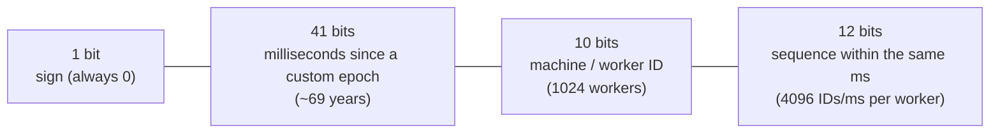
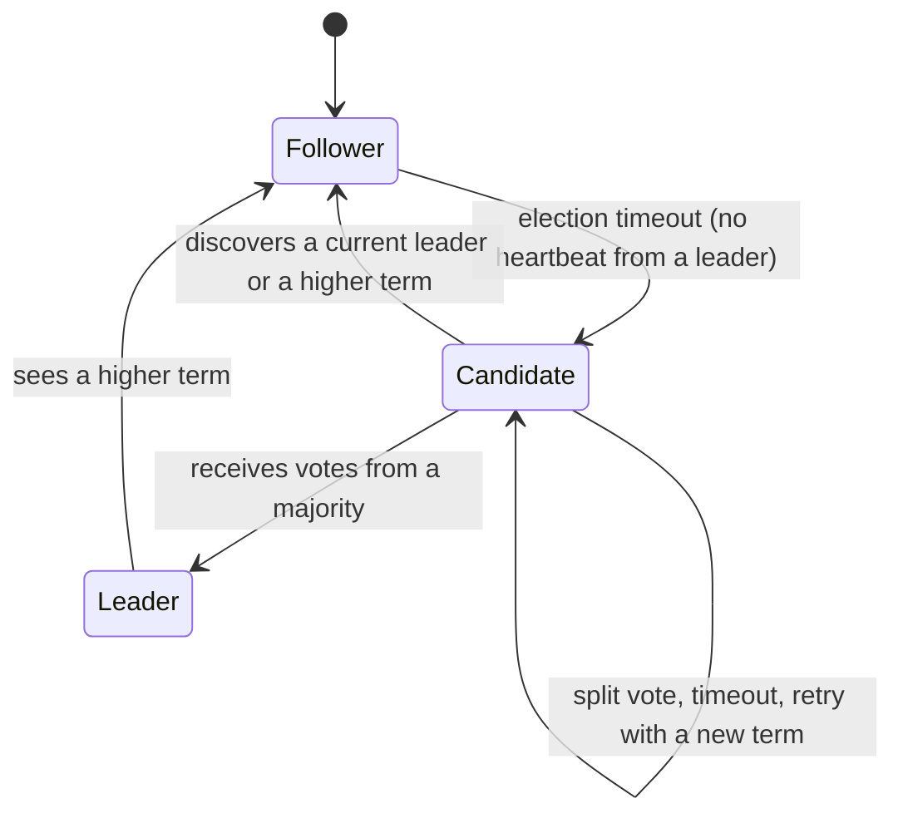
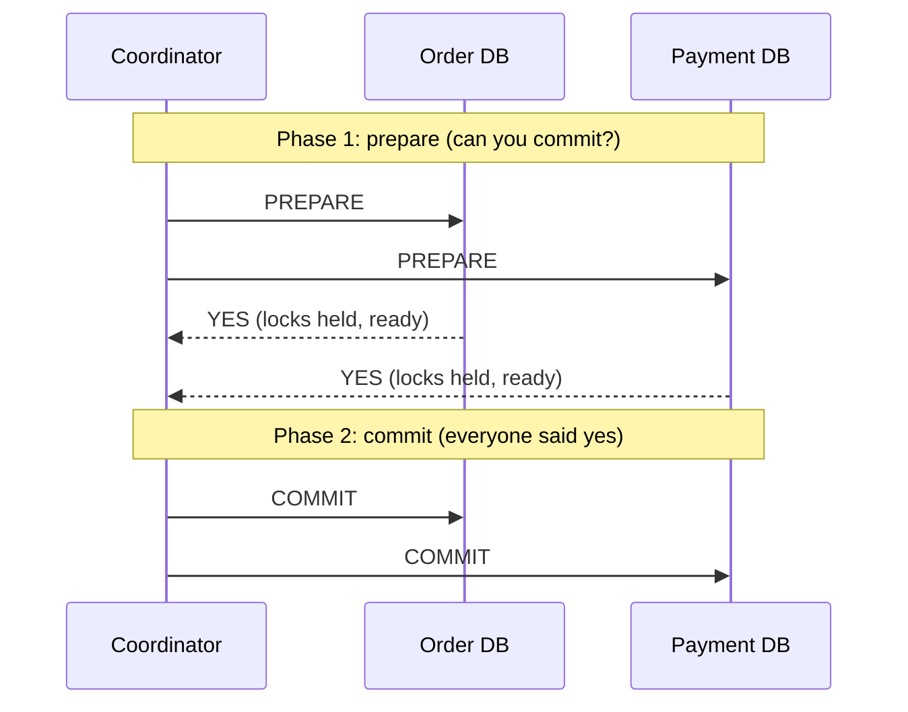
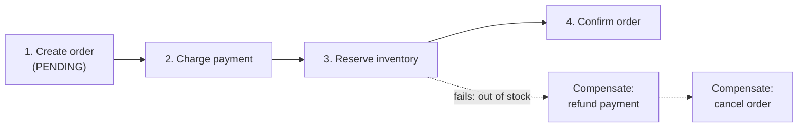
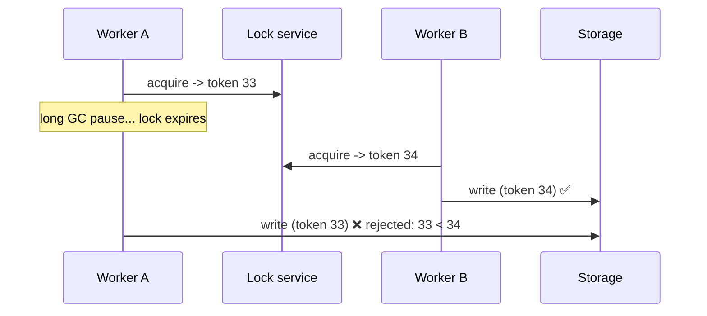
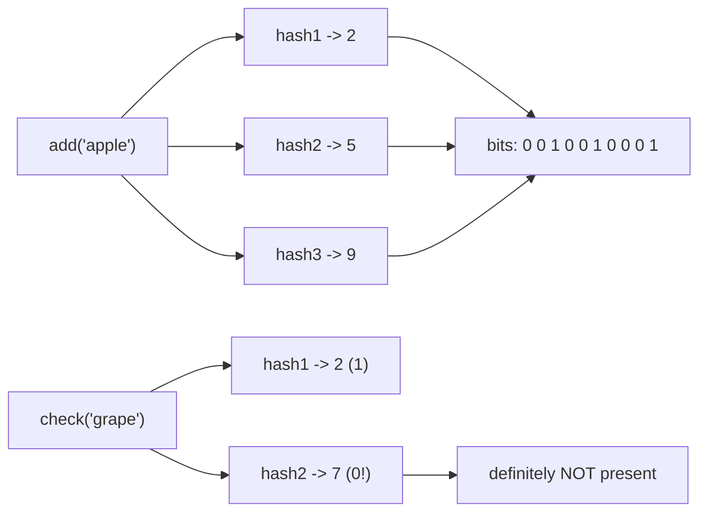

# 7. Distributed Systems Concepts

## Why this matters
Once a system runs on many machines, problems appear that don't exist on one: generating **unique IDs** without a central counter, deciding **who is in charge** (leader election), keeping **transactions** correct across services, **locking** across servers, and reasoning about **time** when every machine's clock is slightly different. These topics show up as deep-dive questions ("How do you generate IDs?", "What if the coordinator crashes?").

The fundamental challenge: **you can't tell the difference between a slow node and a dead one.** Messages can be delayed, lost or duplicated; nodes can pause (GC, VM migration) and come back thinking nothing happened. Everything below is a tool for staying correct anyway.

---

## Unique ID generation

On one database, `AUTO_INCREMENT` works. With many shards or services, you need IDs that are **unique without coordination**, ideally **sortable by time** (so "newest first" is just "largest ID first") and **compact** (64-bit integers index far better than 128-bit random values).

| Approach | Unique? | Sortable by time? | Size | Coordination | Notes |
|---|---|---|---|---|---|
| DB auto-increment | ✅ (one DB) | ✅ | 64-bit | Single DB = bottleneck and SPOF | Fine until you shard |
| Multi-master auto-increment (step N) | ✅ | Roughly | 64-bit | Fixed number of servers | Server k issues k, k+N, k+2N... Hard to add servers |
| UUID v4 (random) | ✅ (probabilistically) | ❌ | 128-bit | None | Random keys scatter B-tree inserts (poor index locality) |
| UUID v7 / ULID | ✅ | ✅ (time prefix) | 128-bit | None | Modern choice when 128 bits is OK |
| Ticket server / range allocation | ✅ | Roughly | 64-bit | Fetch a range of IDs occasionally | Flickr's approach; each server grabs a block of 1000 |
| **Snowflake** | ✅ | ✅ | **64-bit** | Only a unique machine ID | Twitter's approach; the interview favourite |

### Snowflake ID layout (64 bits)

- **Time first**, so IDs sort by creation time.
- **Machine ID** keeps two workers from colliding (assigned by config or ZooKeeper/etcd).
- **Sequence** distinguishes IDs created in the same millisecond on the same worker.
- Capacity: 4096 IDs per ms per worker, about 4 million per second per worker.

```python
import threading
import time

class Snowflake:
    EPOCH_MS = 1_704_067_200_000          # custom epoch: 2024-01-01 UTC (extends the 69-year range)

    def __init__(self, machine_id: int):
        if not 0 <= machine_id < 1024:
            raise ValueError("machine_id must fit in 10 bits")
        self.machine_id = machine_id
        self.sequence = 0
        self.last_ms = -1
        self.lock = threading.Lock()

    @staticmethod
    def _now_ms() -> int:
        return time.time_ns() // 1_000_000

    def next_id(self) -> int:
        with self.lock:
            now = self._now_ms()
            if now < self.last_ms:
                # The clock moved backwards (e.g. an NTP correction): refuse rather than risk duplicates.
                raise RuntimeError(f"clock moved backwards by {self.last_ms - now} ms")
            if now == self.last_ms:
                self.sequence = (self.sequence + 1) & 0xFFF          # 12-bit wrap-around
                if self.sequence == 0:                               # 4096 IDs used this ms:
                    while now <= self.last_ms:                       # spin until the next ms
                        now = self._now_ms()
            else:
                self.sequence = 0
            self.last_ms = now
            return ((now - self.EPOCH_MS) << 22) | (self.machine_id << 12) | self.sequence

gen = Snowflake(machine_id=7)
ids = [gen.next_id() for _ in range(10_000)]
assert len(set(ids)) == len(ids) and ids == sorted(ids)    # unique and increasing
```

**Weakness:** it depends on reasonably accurate clocks. If the clock jumps backwards, you must wait or fail (as above), or you risk duplicates.

---

## Leader election & consensus

Many tasks need **exactly one** node in charge: the database primary, the scheduler that runs a cron job once, the owner of a shard. If two nodes both believe they're the leader (**split brain**), they can corrupt data.

**Consensus** algorithms let a group of nodes **agree on a value** (who the leader is, the order of log entries) even when some nodes fail. The well-known ones: **Paxos** (classic, notoriously hard to follow), **Raft** (designed to be understandable), **ZAB** (used by ZooKeeper).

### Raft in one picture


1. Every node starts as a **follower**. The leader sends regular **heartbeats**.
2. If a follower hears nothing for a (randomised) **election timeout**, it becomes a **candidate**, increments the **term** (an election counter) and asks for votes.
3. A candidate with votes from a **majority** becomes **leader** for that term. Each node votes once per term, so two leaders can't win the same term.
4. The leader appends client commands to its **log** and replicates them. An entry is **committed** once a **majority** has stored it; then it's applied.

**Why majorities?** Any two majorities overlap in at least one node, so a new leader always knows about every committed entry, and a minority partition can't elect its own leader. That's how split brain is avoided.

| Cluster size | Majority needed | Failures tolerated |
|---|---|---|
| 3 | 2 | 1 |
| 4 | 3 | 1 (no better than 3!) |
| 5 | 3 | 2 |
| 7 | 4 | 3 |

That's why clusters use **odd sizes**. In practice you rarely implement Raft; you **use** a system built on it, such as **etcd** (Kubernetes), **Consul** or **ZooKeeper**, for leader election, configuration and locks.

---

## Distributed transactions

An order needs to: create the order (Order DB), charge the card (Payment service), and reserve stock (Inventory DB). These live in different services and databases. How do you keep them all-or-nothing?

### Two-Phase Commit (2PC)

- If **any** participant votes NO, the coordinator tells everyone to **ABORT**.
- ✅ Atomic and strongly consistent.
- ❌ **Blocking:** if the coordinator crashes after PREPARE, participants hold locks and can't decide alone. They wait.
- ❌ Slow (several round trips, locks held throughout) and couples services tightly.
- Used **inside** databases and in some XA setups; generally **avoided across microservices**.

### Saga: the microservices answer
A saga is a sequence of **local transactions**, each committed independently. If a step fails, you run **compensating transactions** to undo the earlier steps.



| Style | How | Pros | Cons |
|---|---|---|---|
| **Choreography** | Each service listens for events and emits the next (`OrderCreated` -> payment service charges -> `PaymentDone` -> ...) | Decoupled, no central component | The flow is hard to see and debug; risk of cyclic dependencies |
| **Orchestration** | A central **orchestrator** tells each service what to do and tracks the state | Clear flow, easy to monitor and change | The orchestrator is extra logic to run |

Important properties:
- **Eventually consistent:** between steps, the system is in an intermediate state (order PENDING). Design the UI for it ("processing...").
- **Compensations are business actions,** not rollbacks: a refund, a cancellation email. Some things can't be undone (an email that was sent), so order steps with that in mind.
- Every step and compensation must be **idempotent** (retries happen).

---

## Distributed locks

You need mutual exclusion across *servers* (only one worker processes this file; only one booking per seat across all app servers).

```python
import uuid

def acquire(lock_key: str, ttl_ms: int = 30_000) -> str | None:
    token = uuid.uuid4().hex
    # NX: only set if the key doesn't exist. PX: auto-expire, so a crashed holder can't block forever.
    if redis.set(lock_key, token, nx=True, px=ttl_ms):
        return token
    return None

RELEASE = """
if redis.call('get', KEYS[1]) == ARGV[1] then
    return redis.call('del', KEYS[1])
else
    return 0
end
"""
def release(lock_key: str, token: str) -> None:
    # Delete only if we still own the lock (atomic check-and-delete via Lua).
    redis.eval(RELEASE, 1, lock_key, token)
```

**Why the token check on release?** If our lock expired (we were slow) and another worker acquired it, a plain `DEL` would delete *their* lock.

**The deeper problem: pauses.** Worker A gets the lock, then pauses for 40 s (GC or VM freeze). The lock expires and worker B takes it. A wakes up and, still believing it holds the lock, writes. Now **two writers**. The fix is a **fencing token**: the lock service hands out an increasing number with each grant, and the storage rejects writes carrying an older token than one it has already seen.



**Choosing a lock service:** Redis is fast and fine for efficiency locks (avoiding duplicate work). For correctness-critical locks, use a consensus-based store (**etcd / ZooKeeper**) with fencing, or avoid locks entirely with **database constraints and conditional updates** (`UPDATE ... WHERE version = ?`).

---

## Time and ordering

**Physical clocks can't be trusted for ordering across machines.** Clocks drift, NTP corrections make them jump, and leap seconds exist. Two events 1 ms apart on different machines may be timestamped in the wrong order. This is why last-write-wins by timestamp can silently lose data.

**Logical clocks** order events without wall-clock time:
- **Lamport clock:** each node keeps a counter; increment it on each event; send it with messages; on receiving, set `counter = max(local, received) + 1`. If A happened before B, then `L(A) < L(B)`. (The reverse doesn't hold, so it can't detect concurrency.)
- **Vector clock:** each node keeps a vector of counters, one per node. It can tell whether two events are **ordered or concurrent**, which is exactly what you need to detect conflicting writes.
- **Hybrid logical clocks** (used by CockroachDB) and **TrueTime** (Google Spanner, using GPS and atomic clocks with bounded uncertainty) combine physical and logical time.

---

## Failure detection and membership

- **Heartbeats + timeouts:** each node pings regularly; after N missed heartbeats it's presumed dead. The timeout trade-off: too short gives false alarms during slow periods; too long means slow failover.
- **Gossip protocols:** each node periodically exchanges membership and health information with a few random peers. Information spreads through the cluster quickly (in O(log N) rounds), with no central coordinator. Used by Cassandra, Consul and DynamoDB-style systems.

---

## Bloom filter (probabilistic membership)

**Question:** "Have we seen this URL / username / key before?" over **billions** of items, using little memory.

A Bloom filter is a **bit array** plus **k hash functions**.
- **Add(x):** compute k hashes and set those k bits to 1.
- **Check(x):** if **any** of the k bits is 0, x is **definitely not** in the set. If all are 1, x is **probably** in the set (other items may have set those bits).



- **No false negatives, some false positives.** About 10 bits per item gives roughly a 1% false-positive rate.
- You can't delete items (counting Bloom filters can).

```python
import hashlib

class BloomFilter:
    def __init__(self, size_bits: int, k: int):
        self.size, self.k = size_bits, k
        self.bits = bytearray((size_bits + 7) // 8)

    def _positions(self, item: str):
        for i in range(self.k):
            h = int(hashlib.sha256(f"{i}:{item}".encode()).hexdigest(), 16)
            yield h % self.size

    def add(self, item: str) -> None:
        for p in self._positions(item):
            self.bits[p // 8] |= 1 << (p % 8)

    def might_contain(self, item: str) -> bool:
        return all(self.bits[p // 8] & (1 << (p % 8)) for p in self._positions(item))

bf = BloomFilter(size_bits=10_000, k=7)
for w in ["apple", "banana", "cherry"]:
    bf.add(w)
print(bf.might_contain("apple"), bf.might_contain("grape"))   # True False (almost certainly)
```

**Used for:** web crawler "URL already seen?", databases skipping SSTables that can't contain a key (Cassandra, RocksDB), blocking cache penetration, "username taken?" pre-checks.

---

## Check yourself
1. Why are Snowflake IDs preferred over random UUIDv4 as database primary keys?
2. Why does a 4-node Raft cluster tolerate no more failures than a 3-node one?
3. What makes 2PC "blocking"? How does a saga avoid it, and what does it give up?
4. Why does a distributed lock need a fencing token?
5. Why is ordering events by wall-clock timestamp across servers unreliable?
6. A Bloom filter says "present". What do you actually know?
