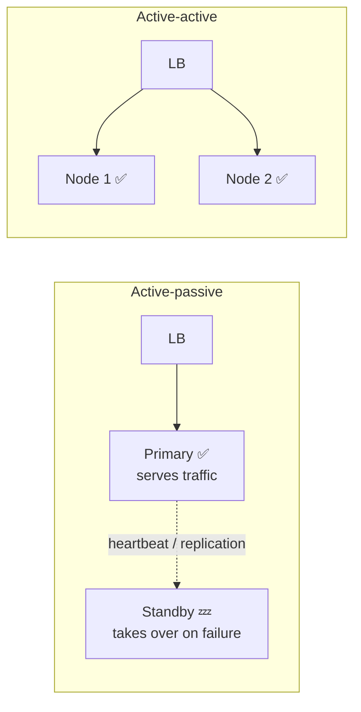
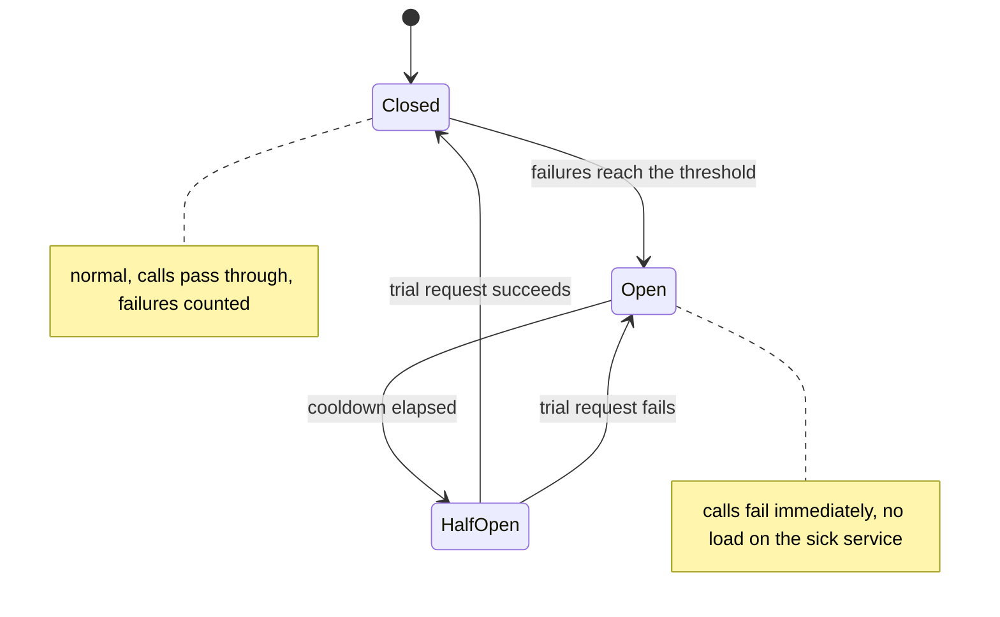
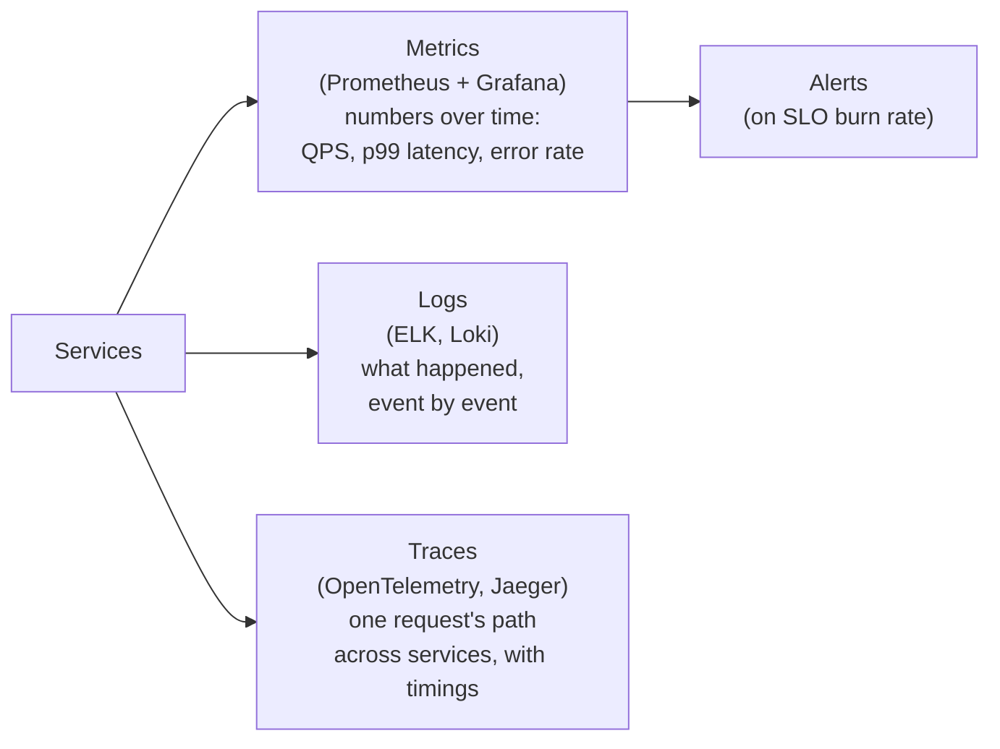

# 8. Reliability Patterns

## Why this matters
In a large system **something is always failing**: a disk, a server, a network link, a dependency deploying a bad version. Reliability engineering accepts this and designs so that **individual failures don't become outages**. Interviewers listen for redundancy, timeouts, retries done right, circuit breakers and graceful degradation in your deep dive.

---

## Measuring availability

**Availability** = the fraction of time the system is working (serving requests successfully).

| Availability | "Nines" | Downtime per year | Downtime per month (30 days) |
|---|---|---|---|
| 99% | two nines | 3.65 days | 7.2 hours |
| 99.9% | three nines | 8.76 hours | 43.2 minutes |
| 99.99% | four nines | 52.6 minutes | 4.3 minutes |
| 99.999% | five nines | 5.26 minutes | 26 seconds |

Each extra nine is roughly **10x harder and more expensive**.

### Availability of combined components
- **In series** (a request needs A **and** B): `A_total = A_a x A_b`. Two 99.9% services in series give 99.8%, which is **worse** than either. A long chain of synchronous calls is fragile.
- **In parallel** (redundant copies; the request works if **any** copy is up): `A_total = 1 - (1 - A)^n`. Two 99% replicas give `1 - 0.01^2` = 99.99%, **much better**. (This assumes failures are independent; a shared power supply or bad deploy breaks that assumption.)

### SLI, SLO, SLA
| Term | What it is | Example |
|---|---|---|
| **SLI** (indicator) | A measured number | % of requests that succeed in under 300 ms |
| **SLO** (objective) | The internal target for an SLI | 99.9% of requests under 300 ms over 30 days |
| **SLA** (agreement) | A contract with customers, with penalties | 99.5% monthly uptime or service credits |

The **error budget** is 100% minus the SLO, i.e. the downtime you're *allowed*. If you have budget left, ship features faster; if it's used up, focus on stability.

---

## Redundancy and failover

Remove **single points of failure (SPOFs)**: any component whose failure takes the system down.



| | Active-passive | Active-active |
|---|---|---|
| Normal operation | Only the primary serves | All nodes serve |
| Failover | The standby is promoted (seconds to minutes) | Traffic shifts to the survivors instantly |
| Utilisation | The standby sits idle | Everything is used |
| Complexity | Simpler, especially for databases | Nodes must stay consistent with each other |

**Failure domains:** spread copies across **availability zones** (separate data centres in one region) to survive hardware and power failures, and across **regions** to survive disasters or region-wide outages. Multi-region active-active is the hardest level because of data consistency across regions.

---

## Timeouts: every remote call needs one

Without a timeout, a hung dependency makes your threads wait **forever**. Threads pile up, the pool runs out, and **your** service goes down too. That's a cascading failure.

- Set a timeout on **every** network call (HTTP, DB, cache, queue).
- Choose it from the dependency's latency profile (e.g. a little above its p99).
- Use **deadlines** across call chains: if the user's request has 2 s total, a downstream call made after 1.8 s should get only the remaining 0.2 s.

---

## Retries: done right

Retrying recovers from **transient** failures (a dropped packet, a brief overload). Done naively, retries **amplify** outages: if every layer retries 3 times, a request through 3 layers can become 3 x 3 x 3 = 27 attempts at the bottom.

Rules:
1. Retry only **transient** errors (timeouts, 503, connection reset), never 400s.
2. Retry only **idempotent** operations, or use **idempotency keys**.
3. **Exponential backoff:** wait 100 ms, 200 ms, 400 ms, 800 ms...
4. **Jitter:** randomise the waits so thousands of clients don't retry in perfect sync (a thundering herd).
5. **Cap** the number of attempts and the maximum delay; use a **retry budget** (e.g. retries at most 10% of traffic).

```python
import random
import time

class TransientError(Exception):
    """Raised for errors worth retrying: timeouts, 503s, connection resets."""

def call_with_retry(fn, max_attempts: int = 5, base: float = 0.1, cap: float = 5.0):
    for attempt in range(max_attempts):
        try:
            return fn()
        except TransientError:
            if attempt == max_attempts - 1:
                raise                                   # out of attempts: surface the error
            backoff = min(cap, base * 2 ** attempt)     # 0.1, 0.2, 0.4, 0.8, ... capped
            time.sleep(random.uniform(0, backoff))      # "full jitter"
```

---

## Circuit breaker

**Problem:** a dependency is down. Every request still waits for its timeout, wasting threads and piling more load on a service that's trying to recover.

**Solution:** like an electrical circuit breaker, **trip** after repeated failures and **fail fast** for a while, then carefully test whether the dependency has recovered.



```python
import threading
import time

class CircuitOpenError(Exception):
    pass

class CircuitBreaker:
    def __init__(self, failure_threshold: int = 5, cooldown_sec: float = 30.0):
        self.threshold, self.cooldown = failure_threshold, cooldown_sec
        self.state, self.failures, self.opened_at = "CLOSED", 0, 0.0
        self._lock = threading.Lock()

    def call(self, fn, *args, **kwargs):
        with self._lock:
            if self.state == "OPEN":
                if time.monotonic() - self.opened_at < self.cooldown:
                    raise CircuitOpenError("failing fast: dependency unhealthy")
                self.state = "HALF_OPEN"                  # let one trial request through
        try:
            result = fn(*args, **kwargs)
        except Exception:
            with self._lock:
                self.failures += 1
                if self.state == "HALF_OPEN" or self.failures >= self.threshold:
                    self.state, self.opened_at = "OPEN", time.monotonic()
            raise
        with self._lock:
            self.state, self.failures = "CLOSED", 0       # success resets everything
        return result
```
(A production breaker also counts failures over a sliding time window and allows only one trial call in HALF_OPEN. Libraries: `pybreaker`, Resilience4j, Envoy/Istio outlier detection.)

When the circuit is open, return a **fallback**: cached data, a default value, or a clear "temporarily unavailable" message.

---

## More resilience patterns

| Pattern | Idea | Example |
|---|---|---|
| **Bulkhead** | Isolate resources per dependency (separate thread or connection pools) so one slow dependency can't use up everything | The recommendations pool is full, but checkout still has its own threads |
| **Rate limiting** | Cap incoming request rates per client | Protect the API from abuse. See the [case study](case-studies/rate-limiter.md) |
| **Load shedding** | When overloaded, reject some requests early (fast 503) to keep serving the rest well | Drop low-priority traffic first (analytics before checkout) |
| **Graceful degradation** | Lose a feature rather than the whole page | Recommendations down? Show "popular items". Search down? Show categories. |
| **Health checks** | **Liveness:** is the process alive? (restart if not). **Readiness:** can it serve? (stop routing traffic if not, e.g. while warming up) | Kubernetes probes |
| **Idempotency keys** | Make retries safe for non-idempotent operations | `Idempotency-Key` header on payment POSTs |
| **Chaos engineering** | Deliberately inject failures in production-like environments to prove resilience | Netflix's Chaos Monkey kills random instances |

---

## Observability: knowing what's wrong

You can't fix what you can't see. The three pillars:



- **Metrics:** cheap aggregated numbers. Use them for dashboards and alerting.
- **Logs:** detailed records. Use structured (JSON) logs with a **request ID** so you can follow one request.
- **Traces:** a request ID propagated through every service call shows **where time is spent** in a microservice chain.

**The four golden signals** (from the Google SRE book): **latency** (watch p50/p95/p99, not just the average), **traffic** (QPS), **errors** (rate), **saturation** (how full: CPU, memory, queue depth).

> Why p99 rather than the average? Averages hide pain. If 1% of requests take 5 s, the average may look fine, yet a page that makes 100 backend calls will hit at least one slow call most of the time.

---

## Check yourself
1. Two services, each 99.9% available, are called in sequence. What's the combined availability? What if they were redundant copies instead?
2. Why can retries make an outage worse, and which three techniques prevent that?
3. Walk through the circuit-breaker states. What does the HALF_OPEN state protect against?
4. What's the difference between liveness and readiness checks?
5. Why alert on p99 latency rather than average latency?
