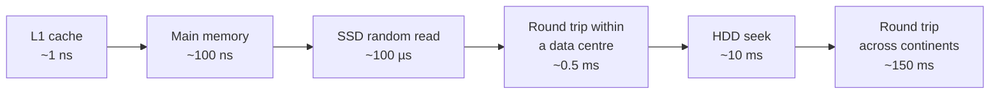

# 9. Back-of-the-Envelope Estimation

## Why this matters
Estimation turns vague scale ("lots of users") into numbers that **drive design decisions**:
- 1,000 QPS? One database might do. 1,000,000 QPS? You need caching, sharding and a CDN.
- 10 GB of data fits in RAM; 10 PB needs distributed object storage.

Interviewers don't want precision. They want to see you **make reasonable assumptions, compute orders of magnitude quickly, and draw conclusions**. Spend 3-5 minutes, round aggressively, and say the conclusion out loud.

---

## Numbers to memorise

### Powers of two (data sizes)
| Power | Approx. value | Unit |
|---|---|---|
| 2^10 | thousand (10^3) | 1 KB |
| 2^20 | million (10^6) | 1 MB |
| 2^30 | billion (10^9) | 1 GB |
| 2^40 | trillion (10^12) | 1 TB |
| 2^50 | quadrillion (10^15) | 1 PB |

### Typical object sizes
| Object | Size |
|---|---|
| A character (ASCII / UTF-8 English) | 1 byte |
| An integer / timestamp | 4-8 bytes |
| A UUID | 16 bytes |
| A tweet-like text post with metadata | ~0.5-1 KB |
| A user profile row | ~1 KB |
| A compressed photo | ~200 KB - 2 MB |
| A minute of HD video | ~10-50 MB (depends on bitrate) |

### Time conversions
- 1 day = 86,400 s. **Round to 10^5 s** for estimates (about 15% high, which is fine).
- 1 month ≈ 2.6 x 10^6 s
- 1 year ≈ 3.15 x 10^7 s

**Handy shortcut:** 1 million requests per day ≈ **12 per second** (10^6 / 86,400 ≈ 11.6).

### Latency numbers (orders of magnitude)


| Operation | Time |
|---|---|
| L1 cache reference | ~1 ns |
| Main memory reference | ~100 ns |
| Compress 1 KB (fast codec) | ~2-10 µs |
| Read 1 MB sequentially from memory | ~10-50 µs |
| SSD random read (4 KB) | ~20-100 µs |
| Round trip within the same data centre | ~0.5 ms |
| Read 1 MB sequentially from SSD | ~0.2-1 ms |
| Disk (HDD) seek | ~10 ms |
| Round trip US <-> Europe | ~70-150 ms |

**Takeaways**
- Memory is about **1000x faster** than SSD random access, so **cache hot data in RAM**.
- Network calls inside a data centre are cheap (sub-ms), but **cross-region calls cost 100+ ms**: keep chatty calls within a region.
- Sequential I/O is far faster than random I/O. That's why logs, Kafka and LSM trees append.
- Avoid HDD seeks on hot paths.

### Rough per-server capacity (for "how many servers?")
| Component | Ballpark (simple operations) |
|---|---|
| Web / app server (simple API) | ~1,000-10,000 requests/s |
| Relational DB (one node, simple indexed queries) | thousands to low tens of thousands of queries/s |
| Redis (one node) | ~100,000+ operations/s |
| Kafka (one broker) | ~100,000s of messages/s |
| A modern server's RAM | ~64-512 GB |

These vary hugely with hardware and workload. State them as assumptions ("assume ~5k QPS per app server").

---

## The core formulas

```
Daily active users (DAU) x actions per user per day   = requests per day
requests per day / 10^5                               ≈ average QPS
average QPS x 2 to 3                                  ≈ peak QPS
writes per day x size per write                       = new storage per day
storage per day x 365 x years x replication factor    = total storage
QPS x average response size                           = bandwidth
peak QPS / QPS per server                             = servers needed (then add headroom)
cache size ≈ 20% of daily read data                   (80/20 rule: hot data fits in memory)
```

---

## Worked example: a Twitter-like service

**Assumptions (state them on the board):**
- 300 M monthly active users, 50% active daily -> **150 M DAU**
- Each user posts **2** tweets per day and views **100** tweets per day
- A tweet is ~**1 KB** (text + metadata); **10%** of tweets include a **1 MB** image
- Keep data for **5 years**, replicated **3x**

| Quantity | Calculation | Result |
|---|---|---|
| Tweets per day | 150 M x 2 | 300 M/day |
| **Write QPS** (average) | 300 M / 10^5 | **~3,000/s** |
| Peak write QPS | x 2 | ~6,000/s |
| Tweet views per day | 150 M x 100 | 15 B/day |
| **Read QPS** (average) | 15 B / 10^5 | **~150,000/s** |
| Peak read QPS | x 2 | ~300,000/s |
| Read : write ratio | 150 k : 3 k | **50 : 1**, read-heavy |
| Text storage per day | 300 M x 1 KB | 300 GB/day |
| Text storage, 5 years | 300 GB x 365 x 5 | ~550 TB (x3 replication ≈ **1.6 PB**) |
| Image storage per day | 30 M x 1 MB | **30 TB/day** (~55 PB over 5 years before replication) |
| Read bandwidth (text) | 150 k/s x 1 KB | ~150 MB/s |
| App servers for peak reads | 300 k / 5 k per server | ~60 servers (+ headroom) |

### Conclusions to say out loud
1. **Read-heavy (50:1)** -> heavy caching (precomputed timelines in Redis), read replicas.
2. **Images dominate storage** (30 TB/day) -> object storage (S3) + **CDN** for delivery; the DB stores only image URLs.
3. **~1.6 PB of text over 5 years** -> doesn't fit one database: **shard** (e.g. by user ID or tweet ID).
4. **~6 k writes/s at peak** is modest per shard, but timeline fan-out multiplies it (each tweet is copied to every follower's timeline). That leads to the push vs pull discussion in the [news feed case study](case-studies/news-feed.md).

---

## Second quick example: URL shortener
- 100 M new URLs/day -> 100 M / 10^5 ≈ **1,000 writes/s** (exact: 1,157)
- Reads 100x writes -> **~100,000 redirects/s**
- 5 years: 100 M x 365 x 5 ≈ **180 B URLs**; at ~500 bytes each ≈ **90 TB**
- Short-code length: 62^6 ≈ 57 billion (too few for 180 B); 62^7 ≈ **3.5 trillion** ✅, so **7 Base62 characters**
- Cache: 20% of daily lookups' distinct URLs. If ~10 B lookups/day hit ~1 B distinct URLs, 20% x 1 B x 500 B ≈ 100 GB of RAM, a few Redis nodes.

---

## Tips
- **Write assumptions first;** the interviewer may adjust them.
- Use **powers of 10** and round freely: 86,400 becomes 10^5, 365 becomes 400 if it helps.
- Always compute **peak**, not just average.
- Remember **replication** (x3) and **growth** when sizing storage.
- Keep units visible (KB vs MB mistakes are the most common error).
- **Every number should lead to a decision.** A number that changes nothing is wasted time.

## Check yourself
1. 50 M DAU, each making 20 API calls a day. What's the average and peak QPS?
2. 1 B photos per day at 500 KB each, kept for 10 years with 3x replication. How much storage?
3. Why is 6 Base62 characters not enough for 180 B URLs?
4. Is it reasonable to keep 10% of 1 PB in a cache? What would you do instead?
