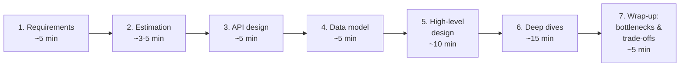
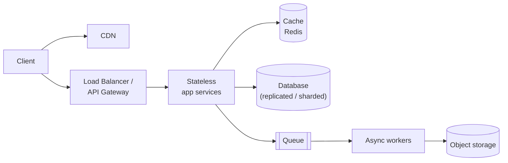

# 10. HLD Interview Framework (45-60 minutes)

## Why a framework?
System design questions are deliberately open-ended ("Design YouTube"). Without structure you'll either drown in details or stay too shallow. A consistent sequence lets you cover requirements, scale, interfaces, data and architecture, then go deep where it matters, all within the time limit. It also makes it easy for the interviewer to follow (and grade) you.



Treat it as a **conversation**, not a monologue. Check in at each step: *"Does this scope sound right?"*, *"Which part would you like me to go deeper on?"*

---

## Step 1: Requirements (~5 min)

### Functional requirements: what the system does
List 3-5 core features and confirm them. Explicitly **park** the rest.
> **URL shortener:** (1) create a short URL from a long one, (2) redirect a short URL to the original, (3) optional custom alias, (4) optional expiry. *Out of scope: user accounts, analytics dashboards.*

### Non-functional requirements: how well it must do it
These drive the architecture more than the features do.

| Quality | Questions to ask / state | Example |
|---|---|---|
| **Scale** | How many users? Requests per second? Data size? | 100 M new URLs/day |
| **Latency** | What response time is acceptable? | Redirect p99 < 50 ms |
| **Availability** | How bad is downtime? | 99.99%: redirects must always work |
| **Consistency** | Must everyone see the latest data immediately? | A new short URL can take a second to work everywhere |
| **Read/write ratio** | Read-heavy or write-heavy? | 100 : 1 reads |
| **Durability** | Can we lose data? | Never lose a created URL |
| Others | Security, cost, privacy and compliance, global users | |

---

## Step 2: Estimation (~3-5 min)
Average and peak **QPS**, **storage** over the years, **bandwidth**, **cache memory**. Then state what the numbers imply. Method and examples in [estimation](09-estimation.md).

> *"About 1k writes/s and 100k reads/s: very read-heavy, so caching is central. 90 TB over 5 years means we'll need to partition the data."*

---

## Step 3: API design (~5 min)
Define the contract between clients and the system. It forces clarity about inputs and outputs.

```
POST /api/v1/urls
     body: { "long_url": "...", "custom_alias": "optional", "expires_at": "optional" }
     ->  201 Created  { "short_url": "https://sho.rt/aB3xY9z" }

GET  /{code}
     ->  302 Found, header  Location: <long_url>      (404 if unknown, 410 if expired)
```

Mention as relevant:
- **Authentication** (API keys, OAuth/JWT) and **rate limits**
- **Pagination** for lists: cursor-based (`?cursor=...&limit=20`), not offset, at scale
- **Idempotency keys** for POSTs that must not be duplicated (payments, orders)
- Protocol choice: REST for public APIs, gRPC internally, WebSocket/SSE for push

---

## Step 4: Data model (~5 min)
- Main **entities** and their key fields
- **Primary keys** and **indexes** that match the access patterns
- **Which database and why** (see [databases](03-databases.md))
- The **partition (shard) key** if the data is big

```
urls
  code        VARCHAR(7)  PRIMARY KEY   -- lookup by code is THE hot query
  long_url    TEXT
  user_id     BIGINT      (indexed, for "my links")
  created_at  TIMESTAMP
  expires_at  TIMESTAMP   NULL
```
> *"The access pattern is a pure key lookup at very high read volume, so a key-value store like DynamoDB or Cassandra partitioned by `code` fits. Postgres with a cache in front would also work at moderate scale."*

---

## Step 5: High-level design (~10 min)
Draw the main components and the request flow. **Start simple** and make it work end to end, then evolve it for the scale you estimated.



Walk through **one write path and one read path** on the diagram: *"A create request hits the LB, goes to a write service, which gets an ID, encodes it, and stores the row. A redirect request checks Redis first..."*

---

## Step 6: Deep dives (~15 min)
Pick 2-3 areas, guided by the interviewer, or choose the **hardest or most interesting** parts yourself:
- The core algorithm (ID generation, feed fan-out, matching, ranking)
- Scaling the data layer (sharding, hot keys, replication)
- Consistency and concurrency (double booking, idempotency, ordering)
- Failure handling (what if X goes down?)
- Caching strategy and invalidation

For each: present **options**, compare **trade-offs**, **choose** one, and explain why.

---

## Step 7: Wrap-up (~5 min)
- **Single points of failure?** Add redundancy.
- **Bottlenecks at 10x scale?** What breaks first, and what would you change?
- **Monitoring and alerting:** which metrics matter (QPS, p99 latency, error rate, queue lag)?
- **Trade-offs** you made and the alternatives you rejected
- Future extensions (analytics, multi-region, ...)

---

## Phrases that show senior thinking
- *"Since reads outnumber writes 100 to 1, I'll put a cache in front of the database and add read replicas."*
- *"This doesn't need strong consistency: a like count that's a few seconds stale is fine, so I'll use eventual consistency here."*
- *"Celebrities with millions of followers would make fan-out on write expensive, so I'll use a hybrid approach."*
- *"The queue gives at-least-once delivery, so the consumer must be idempotent. I'll dedupe on the event ID."*
- *"I'd start with Postgres and a cache. If writes outgrow one primary, we shard by user_id."*
- *"The trade-off here is X versus Y. Given our requirement Z, I'd choose X."*

---

## Component cheat-sheet: when to add what

| Need | Add | Why |
|---|---|---|
| Lower read latency / less DB load | Cache (Redis), read replicas | Serve hot data from memory or copies |
| Serve static or media content globally | Object storage (S3) + CDN | Cheap durable storage; delivery from the edge |
| Absorb spikes / slow work off the request path | Message queue + workers | Decoupling, load levelling, retries |
| Data or writes too big for one DB | Sharding (consistent hashing) | Horizontal scale for data |
| Full-text search, fuzzy matching | Elasticsearch / OpenSearch | Inverted indexes, relevance ranking |
| Real-time push to clients | WebSockets / SSE + pub/sub | Server-initiated updates |
| Unique IDs across many servers | Snowflake-style IDs | No central counter; time-sortable |
| Protect against abuse / overload | Rate limiter at the gateway | Fairness and protection |
| Analytics over huge event volumes | Kafka -> stream processing / data warehouse | Decouple OLTP from OLAP |
| "Nearby" queries | Geohash / quadtree / Redis GEO | Spatial indexing |
| Leaderboards / top-K | Redis sorted sets; Count-Min Sketch for approximate counts | Ordered sets, approximate counting |
| Coordinate a leader / config / locks | ZooKeeper / etcd | Consensus-backed coordination |
| Multi-step workflows across services | Saga (orchestrator) | Consistency without 2PC |

---

## Common mistakes
- Diving into a specific technology before understanding the requirements.
- Skipping non-functional requirements. They're what make the problem hard.
- Over-engineering on day one (Kafka + microservices + 5 databases for 100 users).
- Never mentioning **trade-offs**: every choice has a cost, so say it.
- Ignoring failure scenarios ("What if the cache goes down?").
- Spending 20 minutes on estimation, or skipping it entirely.
- Monologuing without checking what the interviewer cares about.

## Practice routine
1. Pick a case study (see the [README](../README.md)) and set a **45-minute timer**.
2. Talk out loud and draw on paper or a whiteboard tool (Excalidraw).
3. Then compare with the case-study notes. What did you miss: requirements, scale, a component, a trade-off?
4. Redo the same problem a week later from memory.
