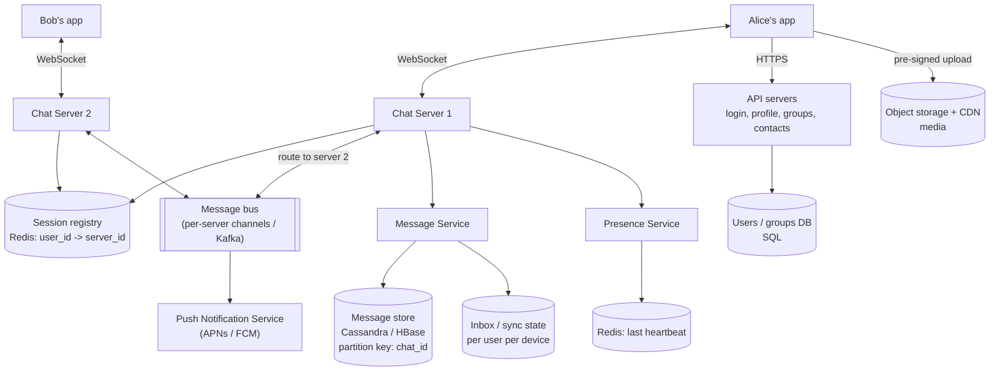
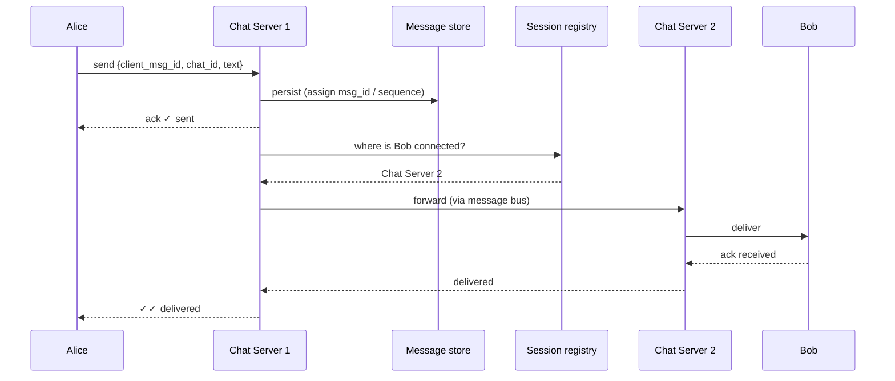
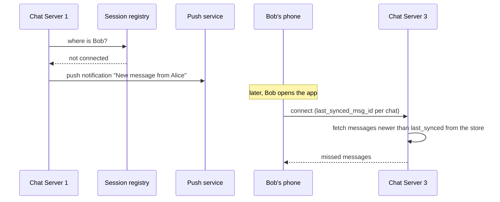

# HLD: Chat System (WhatsApp / Messenger / Slack)

The key ideas: **persistent connections** (WebSockets) for real-time delivery, **routing** messages to whichever server the recipient is connected to, **never losing** a message (even when the recipient is offline), and **per-conversation ordering**.

---

## 1. Requirements

**Functional**
1. **1:1 chat** and **group chat** (say up to 500 members).
2. **Delivery receipts:** sent ✓ (server stored it), delivered ✓✓ (reached the device), read (seen).
3. **Online / last-seen** presence.
4. **Offline delivery:** messages wait and arrive when the user reconnects, plus a push notification.
5. Media (images, video, voice) and multi-device support.

**Non-functional**
- **Real-time:** delivery in < ~100-200 ms when both users are online.
- **Durability:** a message, once acknowledged as sent, is **never lost**.
- **Ordering:** messages within a conversation appear in the same order for everyone.
- Huge scale: ~1 B users, ~100 B messages/day, tens of millions of concurrent connections.

---

## 2. Why WebSockets?
The server must **push** messages to the recipient instantly. Polling would be wasteful (most polls return nothing) and slow. A **WebSocket** keeps a persistent, bidirectional connection open for each online device (see [networking](../01-networking.md)). Mobile apps commonly use similar long-lived connections (MQTT, custom TCP protocols).

Consequence: chat servers become **stateful**. Each holds tens of thousands of open connections, so we need to know **which server holds which user's connection**.

---

## 3. Architecture



| Component | Responsibility |
|---|---|
| **Chat servers** | Hold WebSocket connections; receive and deliver messages |
| **Session registry** | Maps each online user/device to its chat server (updated on connect and disconnect, with a TTL) |
| **Message bus** | Moves a message from the sender's chat server to the recipient's |
| **Message Service + store** | Persists every message **before** acknowledging it; serves history and offline sync |
| **Presence Service** | Tracks online / last-seen from heartbeats |
| **Push notifications** | Wakes offline devices via Apple/Google push services |
| **API servers** | Everything that isn't real-time (accounts, groups, settings), over plain HTTPS |

---

## 4. Sending a message (online recipient)



**Persist before acknowledging.** The "sent ✓" tick means "the server has it durably". If the server crashed after acking but before storing, the message would be lost.

### Offline recipient

The message store is the **source of truth**. Each device remembers the last message ID it synced per chat and fetches everything newer on reconnect. Delivery doesn't depend on any in-memory state.

---

## 5. Data model

```
messages   (Cassandra-style wide rows)
  PARTITION KEY  chat_id
  CLUSTERING KEY msg_id DESC          -- time-sortable (Snowflake / per-chat sequence)
  sender_id, type (text/image/...), content or media_url, created_at

chats         chat_id, type (direct/group), created_at
chat_members  chat_id, user_id, role, joined_at
user_chat_state  user_id, chat_id, last_read_msg_id, last_delivered_msg_id
                                   -- unread counts + read receipts
```
- **Partition by `chat_id`:** the dominant query is "the latest N messages of this chat", which becomes one partition read, already sorted.
- Direct chat ID: deterministic from both user IDs, e.g. `min(a,b) + ":" + max(a,b)`, so both sides find the same chat.
- Why Cassandra/HBase? Huge write volume, simple key-based access, horizontal scaling, time-ordered data within a partition. (Facebook Messenger famously used HBase; Discord moved from Cassandra to ScyllaDB.)
- Very large or long-lived chats: bucket partitions by time (`(chat_id, month)`) so no partition grows without bound.

---

## 6. Deep-dive topics

### Ordering
- **Don't trust client clocks.** Order by a **server-assigned**, monotonically increasing ID per chat (a per-chat sequence number, or a Snowflake ID from the chat's owning server).
- Clients display messages sorted by that ID. If a message arrives out of order, the client inserts it in the right place.

### Duplicates and retries
- On a flaky network the client may resend. Each message carries a **`client_msg_id`** (UUID generated on the device); the server **dedupes** on `(sender, client_msg_id)` and returns the original ack. That makes sending **idempotent**.

### Group messages
| Group size | Approach |
|---|---|
| Small and medium (up to ~hundreds) | **Fan-out on write:** store the message once; look up members; route to each online member's server; push to offline ones |
| Very large (channels with thousands+) | Store once; members **pull** on open; push notifications only to those who opted in |

### Presence
- Clients send a **heartbeat** every ~30 s; Presence stores `last_seen` with a TTL. A missed heartbeat window means offline.
- **Don't broadcast every change to everyone** (presence storms). Push presence updates only to users who are online *and* currently viewing that contact; others fetch it lazily.

### Connection management
- Clients connect through an LB to any chat server; on connect the server registers `user -> server` in the registry (with a TTL, refreshed by heartbeats).
- If a chat server dies, its clients reconnect elsewhere, re-register and resync from the store. **No message is lost**, because the store is the source of truth.

### Multiple devices
The registry maps a user to a **list** of `(device, server)` entries; deliver to every device; track sync state per device.

### End-to-end encryption
With the Signal protocol (WhatsApp), messages are encrypted on the sender's device for each recipient device. The server only stores and routes **ciphertext**: it can't read content, so server-side search and moderation become impossible. That's a real product trade-off.

### Media
Upload to object storage (pre-signed URL), send a message containing the media URL and metadata, deliver via CDN, generate thumbnails asynchronously.

## 7. Trade-offs summary
- WebSockets plus a **session registry** to route between stateful servers.
- **Persist before ack;** the message store is the source of truth; offline sync by last message ID.
- Partition messages by **chat_id**, ordered by server-assigned IDs.
- Idempotent sends via `client_msg_id`.
- Presence is approximate and lazily propagated.
