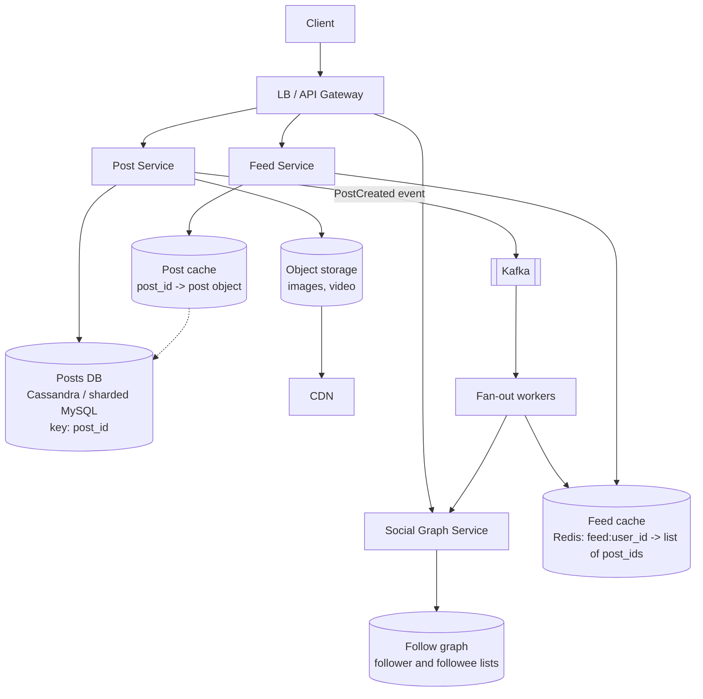
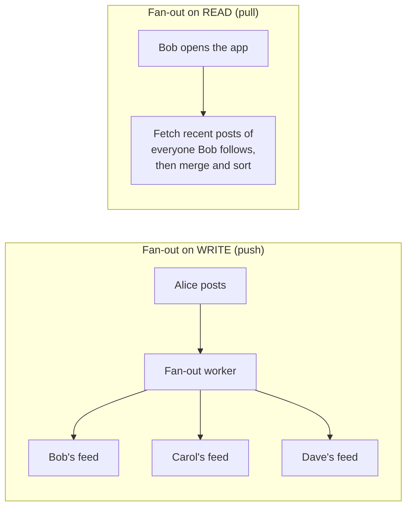
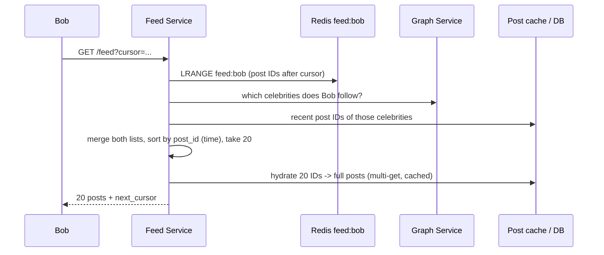

# HLD: News Feed / Timeline (Twitter, Instagram, Facebook)

The defining challenge: each user's home feed is built from **many** other users' posts, and the follower graph is extremely **skewed** (most users have about 100 followers; some have 100 million). The key deep dive is **fan-out on write vs fan-out on read**.

---

## 1. Requirements

**Functional**
1. Publish a post (text, optional images/video).
2. Follow / unfollow users.
3. View the **home timeline**: recent posts from people you follow, newest first (or ranked), with infinite scroll.

**Non-functional**
- Timeline load is **fast** (p99 < ~200 ms) and highly available.
- **Eventual consistency is acceptable:** a new post may take a few seconds to show up in followers' feeds.
- Very **read-heavy** (people scroll far more than they post).

**Out of scope:** comments, likes (mentioned as counters), search, ads.

---

## 2. Estimation (from [chapter 9](../09-estimation.md))
- 150 M DAU, 2 posts/day each -> **~3,000 posts/s** (peak ~6k)
- 100 posts viewed per user per day -> **~150,000 feed reads/s**
- Average ~200 followers -> **fan-out writes ≈ 3,000 x 200 = 600,000 feed insertions/s**
- Media ~30 TB/day -> object storage + CDN

**Conclusion:** precompute feeds where possible (reads dominate), but watch the fan-out cost, especially for celebrities.

---

## 3. Architecture



| Component | Role |
|---|---|
| Post Service | Validates and stores posts (IDs are time-sortable Snowflakes); media goes straight to object storage |
| Social Graph Service | Who follows whom: `followers(user)` and `following(user)` |
| Kafka + fan-out workers | Asynchronously push new post IDs into followers' feed caches |
| Feed cache | One Redis list per user of the latest ~500-1000 **post IDs** (IDs, not full posts) |
| Feed Service | Reads the feed IDs, merges in celebrity posts, **hydrates** IDs into full posts via the post cache |

---

## 4. The core decision: fan-out on write vs fan-out on read



| | Push (fan-out on write) | Pull (fan-out on read) |
|---|---|---|
| When the work happens | When the post is created | When the feed is viewed |
| Feed read | ⚡ Very fast: read one precomputed list | 🐢 Slow: query N followees and merge |
| Write cost | One insert **per follower**: a celebrity with 100 M followers means 100 M inserts | One insert |
| Wasted work | Feeds computed for users who never log in | None |
| Freshness | Delayed by fan-out time | Always current |

### ✅ The hybrid (what Twitter famously did)
- **Regular users** (below a follower threshold, e.g. 10k): **push**. Their posts are fanned out to followers' feed caches.
- **Celebrities** (above the threshold): **don't fan out**. At read time, the Feed Service fetches recent posts from the celebrities the user follows and **merges** them into the precomputed feed.
- **Inactive users:** skip fan-out to users who haven't logged in for weeks; build their feed on demand when they return.

This bounds the write cost (no 100 M-insert storms) while keeping reads fast (merging a handful of celebrity timelines is cheap).

### Reading the feed


### Writing a post
1. Post Service stores the post (assigning a Snowflake `post_id`) and returns success to the author immediately.
2. It publishes `PostCreated` to Kafka.
3. Fan-out workers look up the author's followers (in batches) and `LPUSH` the post ID onto each follower's feed list, trimming the list to its maximum length (`LTRIM`).
4. If the author is a celebrity, step 3 is skipped.

---

## 5. Data model
```
users(user_id PK, name, ..., follower_count)
follows(follower_id, followee_id, created_at)
   -- stored twice / indexed both ways:
   --   "who do I follow?"   key = follower_id
   --   "who follows me?"    key = followee_id
posts(post_id PK [Snowflake, time-sortable], author_id, text, media_urls, created_at)
   -- plus an index or table by (author_id, post_id DESC) for "a user's own posts"

Redis:
feed:{user_id} -> list of post_ids, newest first, capped at ~800
post:{post_id} -> serialised post (cache)
```
Storing **IDs** in feeds (not full posts) keeps the cache small, and edits or deletes need updating in only one place.

---

## 6. Deep-dive topics

| Topic | Approach |
|---|---|
| **Pagination** | **Cursor = last seen post_id.** "Give me 20 posts older than ID X" stays correct as new posts arrive. Offset pagination shifts and duplicates items. |
| **Media** | The client uploads directly to object storage using a **pre-signed URL** (app servers don't proxy big files); the post stores URLs; served via CDN; thumbnails generated asynchronously. |
| **Ranking** | Replace "sort by time" with a ranking service: gather candidates (the feed + celebrity posts + recommendations), score them with an ML model (engagement prediction), then return the top N. |
| **Likes and counts** | High-write counters: Redis `INCR`, flushed to the DB in batches. Eventually consistent counts are fine. |
| **Deleted posts** | Remove from the post store; feeds still hold the ID, so hydration simply skips missing posts. Lazy cleanup. |
| **Unfollow** | Stop future fan-out; filter the unfollowed author's posts out at read time (or rebuild the feed). |
| **Feed cache lost** | Rebuild on demand by pulling from followees (slow, but rare). Redis is replicated. |
| **Hot posts** | A viral post's object is read millions of times: the post cache (plus an in-process cache) absorbs it. |

## 7. Trade-offs summary
- **Hybrid fan-out:** push for normal users, pull for celebrities.
- Feeds hold **IDs**, hydrated from a post cache.
- **Eventual consistency** for feeds and counters; strong consistency only where needed (e.g. account settings).
- **Cursor pagination** with time-sortable IDs.
