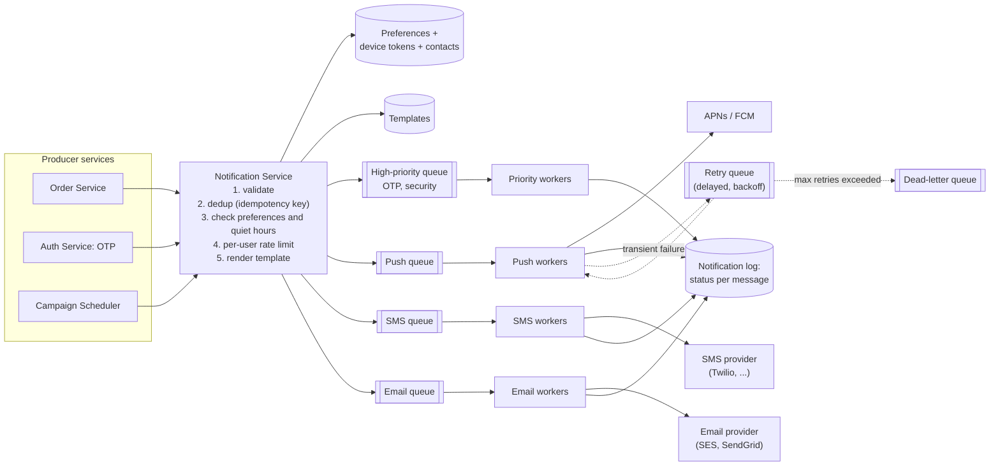
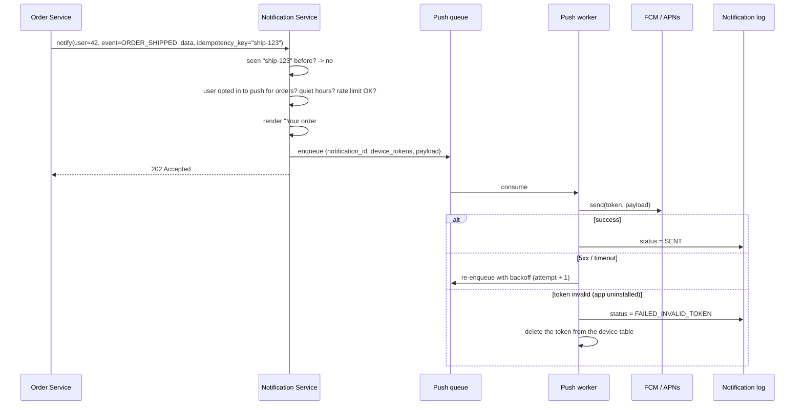

# HLD: Notification System

A central service that every other team uses to reach users through **push** (iOS/Android), **SMS** and **email**, and sometimes in-app messages. The interesting parts: **decoupling** through queues, **per-channel isolation**, **user preferences**, **reliability with retries**, and **not spamming** users with duplicates.

---

## 1. Requirements

**Functional**
1. Other services trigger notifications: transactional ("your order shipped", OTP codes) or bulk/marketing campaigns.
2. Channels: **push**, **SMS**, **email** (extensible to in-app, WhatsApp, ...).
3. **Templates** with variables: "Hi {name}, order #{id} has shipped".
4. **User preferences:** opt out per channel or category; quiet hours.
5. **Scheduling:** send at a given time, or in the user's local morning.
6. **Tracking:** sent, delivered, opened, clicked, failed.

**Non-functional**
- Scale: tens of millions of notifications per day, with bursts (a campaign to 50 M users).
- **At-least-once** delivery for important messages, but **no visible duplicates**.
- **Low latency** for urgent messages (OTP within seconds) even during a marketing blast.
- A third-party provider outage must not take down other channels.

---

## 2. Architecture

---

## 3. Key design decisions

### Why a central service?
Without one, every team integrates each provider, re-implements templates, preferences and rate limiting, and users get inconsistent (and too many) messages. A central service gives **one place** for policy, compliance (unsubscribe rules) and analytics.

### Why queues at all?
- Producers get an instant **202 Accepted** and never block on slow providers.
- Bursts (a campaign to 50 M users) are **absorbed** and drained at the providers' rate limits.
- Failed sends are **retried** without involving the producer.

### Why one queue per channel (plus a priority queue)?
| Reason | Example |
|---|---|
| **Failure isolation** | The SMS provider is down; emails and pushes keep flowing |
| **Independent scaling** | Email volume is 10x SMS: run more email workers |
| **Different rate limits** | Each provider throttles differently |
| **Priority** | OTPs must not wait behind 50 M marketing emails, so they get their own queue and workers |

---

## 4. Sending flow

---

## 5. Deep-dive topics

### Deduplication
At-least-once queues and producer retries create duplicates, and users hate getting the same SMS twice.
- Producers send an **idempotency key** per logical notification (e.g. `order-123-shipped`).
- The Notification Service stores seen keys (Redis `SET key NX EX 86400`, or a unique constraint in the log) and drops repeats.
- Workers also guard on `notification_id` before calling the provider, so a redelivered queue message isn't re-sent after a successful send. A tiny window remains (the provider accepted it but the worker crashed before recording that), which is why it's at-least-once overall.

### Reliability
- Persist the notification (status `PENDING`) **before** enqueueing, so nothing is lost if the queue publish fails. A sweeper re-enqueues stuck `PENDING` rows (the outbox idea from [messaging](../06-messaging.md)).
- Retries with exponential backoff + jitter for transient provider errors; DLQ after N attempts.
- **Provider failover:** keep a secondary SMS/email provider and switch when the primary's error rate spikes (circuit breaker).

### Respecting users
- **Preferences** per user x category x channel (marketing email off, order push on).
- **Quiet hours** in the user's time zone: delay non-urgent messages.
- **Per-user rate limits / digests:** at most N pushes per hour; batch the rest into a summary.
- Legal compliance: unsubscribe links in marketing email, opt-in for SMS.

### Scheduling and campaigns
- Scheduled notifications are stored with `send_at`; a scheduler polls due items (indexed by `send_at`) and enqueues them. For large campaigns, the job **streams** through the audience in batches instead of loading 50 M users at once.

### Tracking
- Provider delivery callbacks (webhooks) update status to `DELIVERED`.
- Email **opens** via a tracking pixel; **clicks** via redirect links; push opens reported by the app.
- Events go to Kafka, then analytics (open rates per template, A/B tests).

## 6. Trade-offs summary
- Central service + **queue per channel** + a **priority lane**.
- At-least-once delivery, made user-safe by **idempotency keys**.
- **Preferences, quiet hours and rate limits** enforced before enqueueing.
- Provider failover and a DLQ for resilience.
