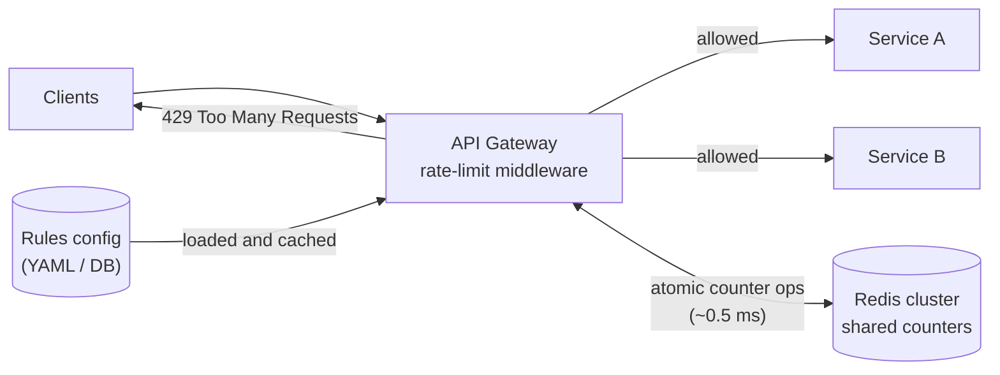
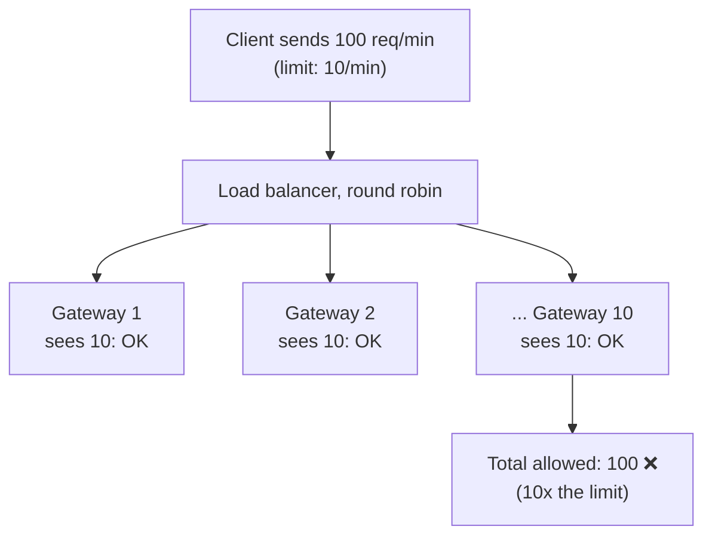
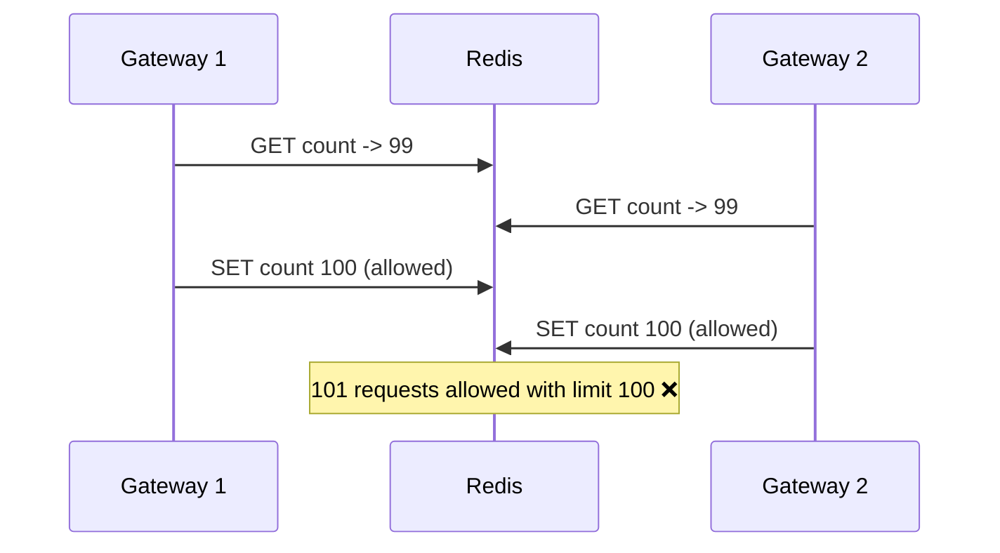

# HLD: Distributed Rate Limiter

Algorithms and single-machine code: see the [LLD rate limiter](../../lld/problems/rate_limiter/README.md). This page is about making it work across **many servers**.

---

## 1. Requirements
**Functional**
- Limit requests per **client** (user ID, API key or IP) and optionally per **endpoint**: e.g. 100 req/min on `/search`, 10 req/min on `/login`.
- Rules are **configurable** without redeploying.
- Rejected requests get **HTTP 429** with headers telling the client when to retry.

**Non-functional**
- **Low latency:** adds no more than a few ms per request.
- **Accurate across all servers:** the limit applies to the client's total traffic, not per server.
- **Highly available:** if the limiter breaks, the API shouldn't go down with it.
- Scales to millions of clients.

---

## 2. Where to put it



| Placement | Pros | Cons |
|---|---|---|
| Client side | Saves network | Can't be trusted: clients can bypass it |
| **API gateway / middleware** ✅ | One place protects every service; rejects early, before expensive work | The gateway needs access to shared state |
| Inside each service | Fine-grained, business-aware limits | Duplicated logic |

---

## 3. Why the counters must be shared


With **local** counters and N gateways, a client effectively gets N x the limit. The counters must live in a **central, fast store**: Redis is the standard choice (in-memory, sub-millisecond, atomic operations, built-in key expiry).

---

## 4. Redis implementations

### Fixed window: `INCR` + `EXPIRE`
```python
import time

def allow_fixed_window(client_id: str, limit: int = 100, window: int = 60) -> bool:
    window_id = int(time.time() // window)
    key = f"rl:{client_id}:{window_id}"
    pipe = redis.pipeline()               # MULTI/EXEC: both commands run atomically together
    pipe.incr(key)
    pipe.expire(key, window * 2)          # old windows clean themselves up
    count, _ = pipe.execute()
    return count <= limit
```
`INCR` is **atomic**, so concurrent gateways can't lose updates. Sending `INCR` and `EXPIRE` in one transaction ensures no key is left without an expiry. Weakness: the boundary burst (up to 2x the limit), as explained in the LLD notes.

### Sliding window log: sorted set
```python
import time
import uuid

SLIDING_LOG = """
local key, now, window, limit, member = KEYS[1], tonumber(ARGV[1]), tonumber(ARGV[2]), tonumber(ARGV[3]), ARGV[4]
redis.call('ZREMRANGEBYSCORE', key, 0, now - window)      -- drop entries outside the window
if redis.call('ZCARD', key) < limit then
    redis.call('ZADD', key, now, member)                  -- record only ALLOWED requests
    redis.call('PEXPIRE', key, math.ceil(window * 1000))
    return 1
end
return 0
"""

def allow_sliding_log(client_id: str, limit: int = 100, window: float = 60.0) -> bool:
    now = time.time()
    member = f"{now}-{uuid.uuid4().hex[:8]}"              # unique per request
    return redis.eval(SLIDING_LOG, 1, f"rl:log:{client_id}", now, window, limit, member) == 1
```
Exact, but stores one entry per request (memory-heavy for high limits). A **Lua script** makes the check-and-add **atomic**: Redis runs the whole script without interleaving other commands.

### Token bucket: Lua script
Store `{tokens, last_refill}` in a Redis hash. The script reads both, computes the refill from elapsed time, decides, and writes back, all atomically. This is the most common production choice: it's O(1) per client, burst-friendly and smooth.

```lua
-- KEYS[1] = bucket key; ARGV = capacity, refill_per_sec, now (seconds)
local b = redis.call('HMGET', KEYS[1], 'tokens', 'ts')
local capacity, rate, now = tonumber(ARGV[1]), tonumber(ARGV[2]), tonumber(ARGV[3])
local tokens = tonumber(b[1]) or capacity
local ts = tonumber(b[2]) or now
tokens = math.min(capacity, tokens + (now - ts) * rate)
local allowed = tokens >= 1
if allowed then tokens = tokens - 1 end
redis.call('HSET', KEYS[1], 'tokens', tokens, 'ts', now)
redis.call('EXPIRE', KEYS[1], math.ceil(capacity / rate) * 2)
return allowed and 1 or 0
```

---

## 5. The race condition (and why atomicity matters)


A separate read-then-write from each gateway is a check-then-act race. **Fixes:** single atomic commands (`INCR`), or a **Lua script** / `MULTI` for multi-step logic, so the read and write happen as one indivisible operation inside Redis.

---

## 6. Client-facing response
```
HTTP/1.1 429 Too Many Requests
Retry-After: 23
X-RateLimit-Limit: 100
X-RateLimit-Remaining: 0
X-RateLimit-Reset: 1767225600
```
Good clients use these to back off instead of retrying in a tight loop.

---

## 7. Deep-dive topics

| Topic | Discussion |
|---|---|
| **Redis is down or slow** | **Fail-open** (allow traffic: availability first, the usual choice for general APIs) or **fail-closed** (block: for security-critical endpoints like login or OTP). Add a short timeout on the Redis call and a **local in-memory fallback limiter**. |
| **Latency at very high QPS** | A Redis round trip per request adds up. Options: local token buckets that **sync to Redis periodically** (approximate but fast), or batching counter updates. |
| **Hot keys** | One huge client's key overloads one Redis shard. Shard counters by client (Redis Cluster hashes keys across nodes); give very large clients sub-keys. |
| **Multi-region** | Per-region limits (simplest), or asynchronously replicated global counters (approximate). Strict global limits need a single home region per client. |
| **Rules management** | Rules in a config store, cached in each gateway, refreshed every few seconds or pushed on change |
| **Different limit types** | Per user, per IP (anonymous traffic), per API key/plan, global per endpoint (protect a fragile backend) |
| **Monitoring** | Count 429s per rule and client; alert on spikes (abuse, or a rule set too low) |

## 8. Summary
- **Algorithm:** token bucket (or sliding window counter).
- **State:** Redis, updated atomically with `INCR` or Lua.
- **Placement:** API gateway / middleware.
- **Failure policy:** fail-open with a local fallback for most endpoints.
