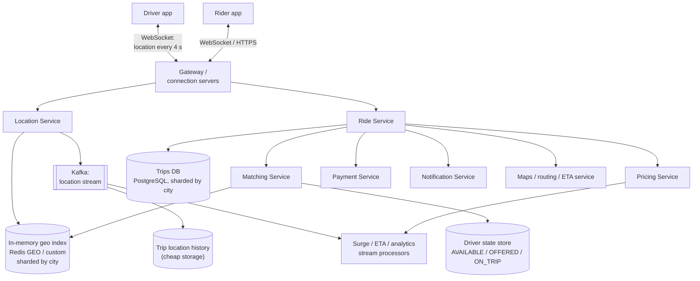
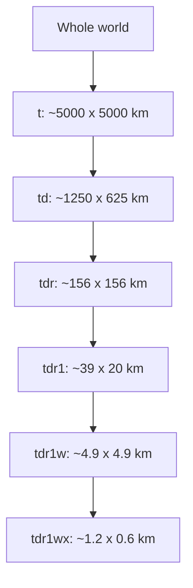
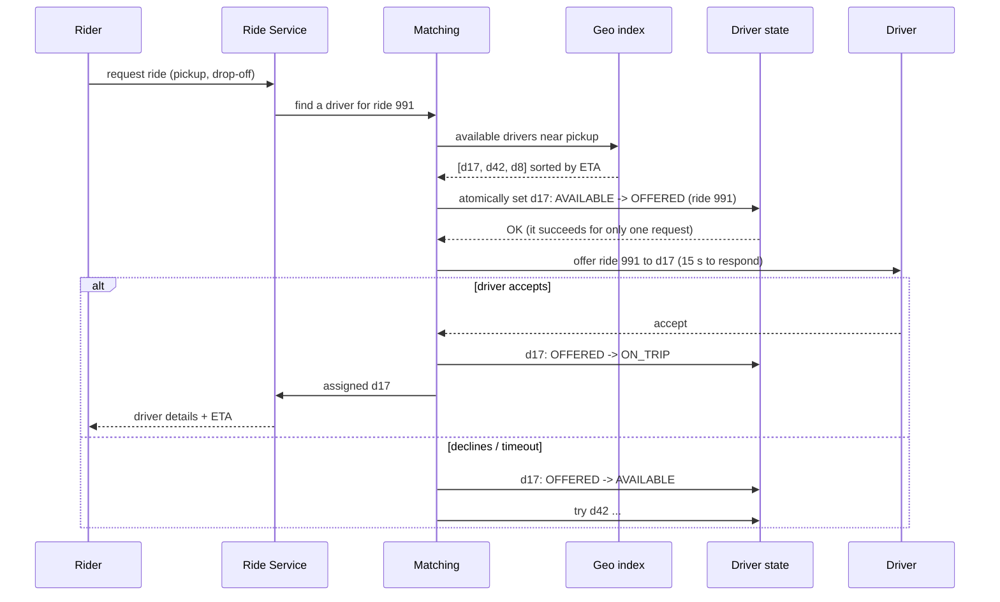
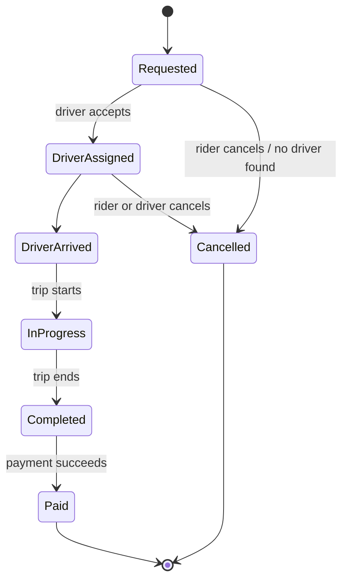

# HLD: Ride Sharing (Uber / Ola / Lyft)

Two hard problems: ingesting a **firehose of location updates** from drivers, and **matching** riders to nearby available drivers quickly **without double-assigning** a driver. The key tools are **geospatial indexing** (geohash / quadtree / H3), in-memory stores and careful **state management**.

---

## 1. Requirements

**Functional**
1. Riders see nearby drivers on a map and request a ride (pickup, drop-off).
2. The system **matches** the rider with a nearby available driver, who accepts or declines.
3. **Live tracking** of the driver's location during pickup and the trip.
4. Fare estimate, surge pricing, payment at the end, trip history and ratings.

**Non-functional**
- Matching within a few seconds.
- Drivers send their location every ~4 s, which is a huge write volume.
- **A driver must never be assigned to two rides** (strong consistency on driver state).
- Highly available. Location data can be slightly stale (seconds), but trip and payment data must be durable.

---

## 2. Estimation
- 5 M active drivers at peak, each sending an update every 4 s: 5 M / 4 ≈ **1.25 M location writes/s**.
- Each update is ~100 bytes, so ~125 MB/s of ingest.
- Ride requests: ~10-20 M/day -> ~200/s average, with peaks several times higher. **Matching is low-QPS but latency-sensitive.**

**Conclusion:** a regular disk-based database can't absorb 1M+ updates per second for "where is each driver *now*". Keep **current positions in memory** (Redis / in-memory geo index, sharded by region), and stream history to cheap storage.

---

## 3. Architecture



---

## 4. Finding nearby drivers: geospatial indexing

"Find available drivers within 3 km" can't be answered efficiently with ordinary indexes on `lat` and `lng` (a 2-D range query over a sphere). Spatial indexes solve it.

### Geohash
A geohash encodes (lat, lng) into a short string by repeatedly halving the world into a grid. **Each extra character makes the cell smaller**, and **locations that share a prefix are near each other** (usually).



**Query:** compute the rider's geohash at a suitable precision (6 characters ≈ 1 km cells), then fetch drivers in **that cell plus its 8 neighbours**. Neighbours matter because a driver 50 m away can sit just across a cell border with a completely different prefix. Then compute real distances (or road ETAs) and sort.

```python
# Redis implements geohash-based indexing for you:
redis.geoadd("drivers:bangalore", (77.5946, 12.9716, "driver:17"))      # (lng, lat, member)
nearby = redis.geosearch(
    "drivers:bangalore", longitude=77.60, latitude=12.97,
    radius=3, unit="km", sort="ASC", count=10, withdist=True,
)
```

### Alternatives
| Index | Idea | Pros | Cons |
|---|---|---|---|
| **Geohash** | Fixed grid encoded as strings | Simple; works in any key-value store; prefix queries | Fixed cell sizes regardless of density; border effects |
| **Quadtree** | Recursively split a cell into 4 when it holds too many points | **Adapts to density** (small cells downtown, big cells in the countryside) | In-memory tree; rebalancing as drivers move |
| **Google S2 / Uber H3** | Hierarchical cells on a sphere (H3 uses **hexagons**) | Uniform neighbour distances (hexagons), good for aggregation like surge per cell | More complex libraries |

**Driver updates:** every 4 s a driver's position changes, so update their entry in the index (remove from the old cell, add to the new one). Keep the index **sharded by city/region**: matching is always local, so each shard stays small and hot in memory.

---

## 5. Matching flow (and avoiding double assignment)



**The double-assignment race:** two riders' requests both find d17 as the nearest. Both must not offer him a ride. The fix is an **atomic conditional state change**, "set to OFFERED only if currently AVAILABLE":
- SQL: `UPDATE drivers SET state='OFFERED', ride_id=991 WHERE id=17 AND state='AVAILABLE'`, then check that **1 row** was updated.
- Redis: `SET driver:17:lock ride991 NX EX 15`, or a Lua script that checks and sets the state (and expires automatically if the matcher crashes).

Only one request wins; the loser moves on to the next candidate.

**Better matching** (a deep-dive option): instead of greedily taking the nearest driver per request, batch requests over a 1-2 s window and solve a small assignment problem that minimises total ETA across all riders and drivers in an area.

---

## 6. Trip lifecycle


Trips are stored in a **durable, consistent** database (PostgreSQL, sharded by city or trip ID). Every transition is validated (you can't go from `Requested` straight to `Completed`), which is the State pattern again.

---

## 7. Deep-dive topics
| Topic | Approach |
|---|---|
| **Location ingest at 1M+/s** | WebSocket connection servers -> Kafka (partitioned by driver ID) -> consumers update the in-memory geo index. The index holds only the **latest** position; history goes to cheap storage. |
| **Surge pricing** | A stream processor counts open requests vs available drivers per H3/geohash cell every minute; the ratio sets a multiplier |
| **ETA** | A routing service over the road graph plus live traffic (from the drivers' own GPS streams) |
| **Rider sees the driver moving** | The driver's updates are forwarded to the rider's connection (pub/sub on `trip:{id}`) |
| **Payments** | Charge at trip end via the payment service with an **idempotency key** = trip ID (never double-charge) |
| **Data-centre failure** | Driver apps keep a local copy of trip state and resend it; region failover rebuilds the in-memory index from the next location updates within seconds |

## 8. Trade-offs summary
- Current locations **in memory**, sharded by region; history streamed to storage.
- **Geohash / quadtree / H3** for "nearby" queries (always include neighbouring cells).
- **Atomic compare-and-set** on driver state prevents double assignment.
- Strong consistency for trips and payments; eventual consistency for locations and surge.
