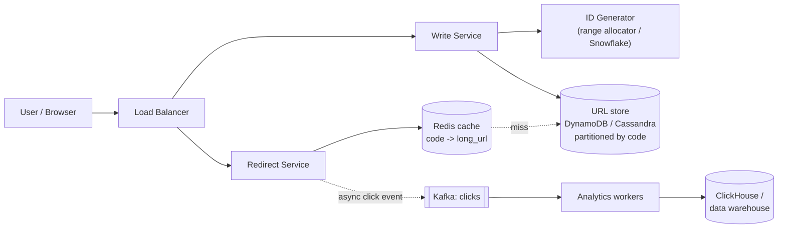
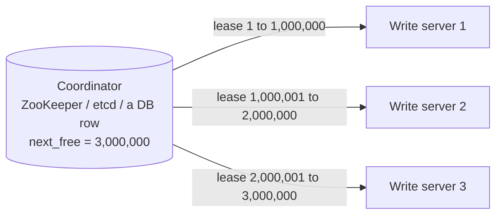
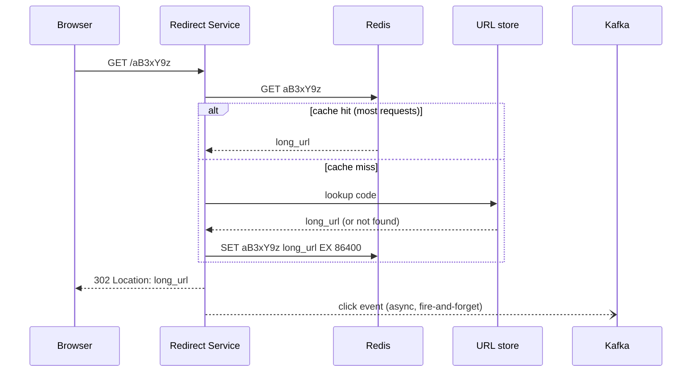

# HLD: URL Shortener (TinyURL / bit.ly)

The classic warm-up HLD question. Its logic is simple, so the interview focuses on **ID generation**, **read-heavy scaling** (caching) and **data-store choice**. Use this one to practise the framework from [chapter 10](../10-hld-interview-framework.md).

---

## 1. Requirements

**Functional**
1. Given a long URL, return a short URL (`https://sho.rt/aB3xY9z`).
2. Visiting the short URL **redirects** to the original.
3. Optional **custom alias** (`sho.rt/my-sale`) and **expiry**.
4. (Nice to have) click **analytics**.

**Non-functional**
- **Very low redirect latency** (p99 < ~50 ms). Redirects are on the user's critical path.
- **Highly available:** a broken redirect means a broken link in every email, tweet and QR code.
- **Durable:** never lose a mapping once created.
- Short codes **not easily guessable** in sequence (so people can't enumerate others' links).
- Read-heavy: about **100 reads per write**.

---

## 2. Estimation
| Quantity | Calculation | Result |
|---|---|---|
| New URLs | 100 M/day / 10^5 s | **~1,000 writes/s** (peak ~2-3k) |
| Redirects | 100 x writes | **~100,000 reads/s** (peak ~250k) |
| URLs over 5 years | 100 M x 365 x 5 | **~180 B** |
| Storage | 180 B x ~500 bytes | **~90 TB** (before replication) |
| Code length | 62^6 ≈ 57 B (too few), 62^7 ≈ 3.5 T | **7 Base62 characters** |
| Cache | hot 20% of daily distinct URLs | tens to ~100 GB of RAM: a small Redis cluster |

**Conclusions:** extremely read-heavy, so **cache aggressively**; 90 TB needs a **partitioned** store; the write rate is modest, so ID generation needn't be exotic, but it must be unique across servers.

---

## 3. API
```
POST /api/v1/urls
     { "long_url": "https://example.com/very/long/path?x=1",
       "custom_alias": "my-sale",            (optional)
       "expires_at": "2027-01-01T00:00:00Z" } (optional)
  -> 201 { "short_url": "https://sho.rt/aB3xY9z" }
  -> 409 Conflict if the alias is taken

GET /{code}
  -> 302 Found   Location: https://example.com/very/long/path?x=1
  -> 404 Not Found / 410 Gone (expired)
```

### 301 or 302?
| | 301 Moved Permanently | 302 Found (temporary) |
|---|---|---|
| Browser caching | Browsers **cache** it; later clicks skip our servers | Every click comes to us |
| Server load | Lower | Higher |
| Analytics | **Lost** after the first click | Every click is counted |
| Changing the destination later | Hard (cached in browsers) | Easy |

bit.ly-style services use **302** (or 307) because analytics is the product. If you don't need analytics, 301 saves load.

---

## 4. High-level architecture



- **Write and redirect paths are separate services.** They have very different load (1k vs 100k QPS) and scale independently.
- The **redirect path** is optimised for latency: cache first, DB on a miss, and analytics sent **asynchronously** so it never slows the redirect.

---

## 5. Generating the short code (the core deep dive)

### Option A: hash the long URL
`code = base62(md5(long_url))[:7]`
- ✅ The same URL always gives the same code (natural dedup).
- ❌ **Collisions:** truncating to 7 characters means different URLs can collide. On insert, check whether the code exists with a *different* URL; if so, rehash with a salt (`md5(url + "1")`) and retry. That's an extra DB read on every write.
- (Note: take 7 characters of the **Base62-encoded** hash. Seven *hex* characters would give only 16^7 ≈ 268 M combinations.)

### Option B: unique counter -> Base62 ✅ (common choice)
Get a unique integer ID, then encode it in Base62 (`0-9a-zA-Z`).
- ✅ **No collisions by construction**, no extra existence check.
- ❌ Sequential IDs give **guessable** codes (`aB3xY9z`, `aB3xY9A`, ...). Fix: run the ID through a reversible **bit-shuffle or encryption** (a Feistel network, or a library like Sqids/Hashids) before encoding.

```python
ALPHABET = "0123456789abcdefghijklmnopqrstuvwxyzABCDEFGHIJKLMNOPQRSTUVWXYZ"

def base62_encode(n: int) -> str:
    if n == 0:
        return ALPHABET[0]
    out = []
    while n:
        n, r = divmod(n, 62)
        out.append(ALPHABET[r])
    return "".join(reversed(out))

def base62_decode(s: str) -> int:
    n = 0
    for ch in s:
        n = n * 62 + ALPHABET.index(ch)
    return n

print(base62_encode(125))              # "21"     (2*62 + 1)
print(base62_encode(3_500_000_000))    # "3ORDSU" (6 chars)
assert base62_decode(base62_encode(987654321)) == 987654321
```

### Where does the unique counter come from?
A single DB auto-increment would be a bottleneck and a SPOF. **Range allocation** avoids both:


Each write server leases a block of IDs and hands them out **from memory**, so there's no coordination per request. When a block runs out, it leases the next one. If a server crashes, its unused IDs are simply skipped (gaps are fine). Alternatives: **Snowflake IDs** (no coordinator at all), or a **pre-generated key service** that fills a table with random unused codes offline.

### Custom aliases
Store them in the same table. Since a user picks them, check availability (`INSERT ... IF NOT EXISTS`, or a unique constraint) and return 409 if taken. To stop aliases colliding with future generated codes, either reserve a distinct format (e.g. require a length other than 7 or a character generated codes never use), or have the generator check the table.

---

## 6. Data model and storage
```
urls
  code        PK (partition key)
  long_url
  user_id     (secondary index, for "my links")
  created_at
  expires_at  (nullable)
```
- The access pattern is a **key-value lookup** (`code -> long_url`) at huge read volume, which suits **DynamoDB / Cassandra** partitioned by `code` (scales horizontally, highly available).
- PostgreSQL also works at moderate scale (with replicas + cache); at 90 TB you'd shard it by `code`.
- **Dedup of the same long URL?** Optional. Either return the existing code (needs an index on `hash(long_url)`) or always create a new one (simpler, and lets each user have their own analytics).

---

## 7. The redirect path (hot path)



**Caching details**
- Traffic is highly skewed (viral links), so an **LRU** cache of the hot set gives a very high hit ratio.
- Mappings almost never change, so invalidation is easy: delete on update/delete; use a TTL as a safety net.
- **Negative caching:** briefly cache "not found" for unknown codes, so a bot scanning random codes can't hammer the DB (cache penetration).
- The cache is **replicated**, so losing a node doesn't send all its traffic to the DB.

---

## 8. Other deep-dive topics
| Topic | Approach |
|---|---|
| **Expiry** | Check `expires_at` on read (return 410); a background job deletes expired rows in batches (or the DB's native TTL) |
| **Analytics** | Click events -> Kafka -> stream aggregation (counts per code per hour) -> OLAP store. Never on the redirect path. |
| **Abuse** | Rate-limit creation per user/IP; scan destinations against malware/phishing lists; allow reporting and disabling links |
| **High availability** | Multi-AZ replicas of the store and cache; stateless services behind the LB; multi-region read replicas for global latency |
| **Hot links** | Served from cache (or a CDN edge for extremely viral links); replicate hot keys if needed |

## 9. Trade-offs summary
- Hash vs counter: **counter + Base62** (no collisions), with shuffling so codes aren't guessable.
- 301 vs 302: **302** if analytics matters.
- SQL vs NoSQL: **key-value store** for scale; SQL fine at smaller scale.
- Sync vs async analytics: **async**, to keep redirects fast.
