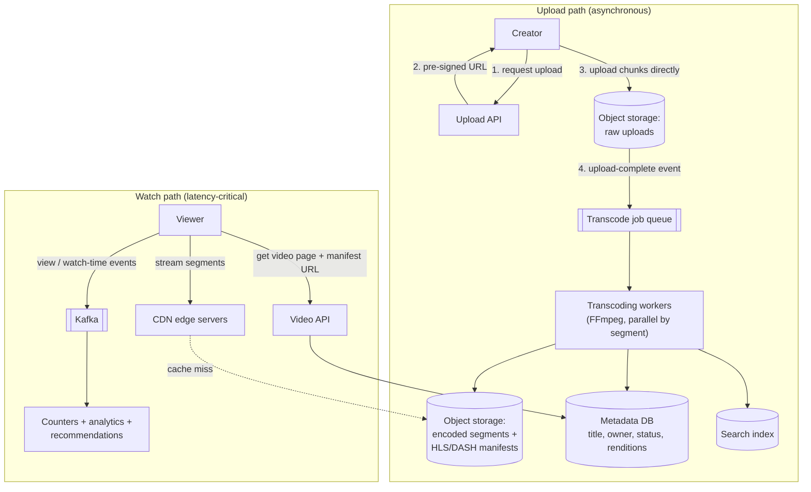
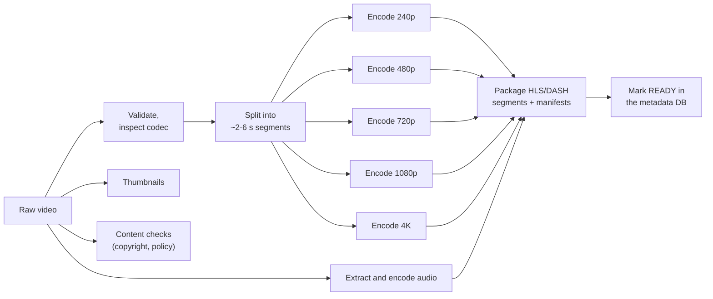
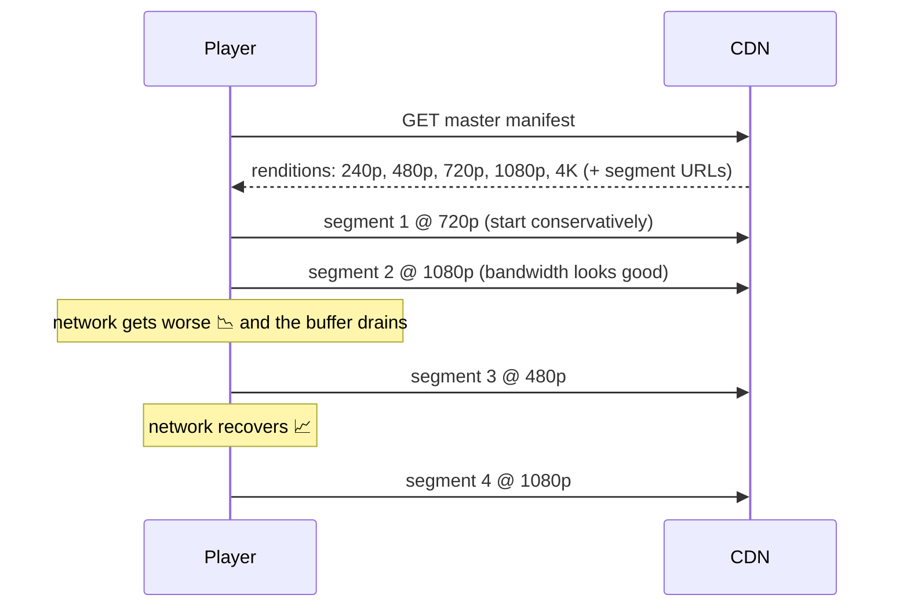

# HLD: Video Streaming (YouTube / Netflix)

Two very different paths: **upload and processing** (heavy, asynchronous, can take minutes) and **playback** (latency-sensitive, extremely high bandwidth, global). The core ideas are an **asynchronous transcoding pipeline**, **adaptive bitrate streaming** and **CDNs**.

---

## 1. Requirements

**Functional**
1. Creators **upload** videos (possibly several GB).
2. Viewers **watch** videos smoothly on any device and network, in multiple resolutions.
3. Video metadata: title, description, thumbnails; **search**; view counts and likes.

**Non-functional**
- **Playback starts fast** (< ~2 s) and doesn't stall (rebuffering is the #1 quality metric).
- Works on slow and fast networks, phones and TVs.
- Highly available playback; uploads may take minutes to become watchable.
- Massive storage and bandwidth at global scale, so **cost** matters.

---

## 2. Estimation (order of magnitude)
- Uploads: ~500 hours of video per minute (YouTube-scale public figure). Each source video is transcoded into ~5-10 renditions, which means **petabytes of new storage per day**.
- Views: billions per day. If 100 M concurrent viewers average 3 Mbps, that's **300 Tbps** of egress. No single data centre can serve that.

**Conclusion:** bandwidth dominates, so **CDNs are the core of the design**, not an add-on. Transcoding is compute-heavy, so it runs as a **parallel, asynchronous pipeline**.

---

## 3. Architecture

---

## 4. The upload path

### Direct-to-storage uploads
The client asks the API for a **pre-signed URL** (temporary permission to write one object) and uploads **straight to object storage**. Multi-GB uploads never pass through app servers, so those servers stay small and stateless.

### Resumable, chunked upload
Large files are split into chunks (e.g. 5-10 MB) uploaded independently (S3 multipart upload). After a network drop, only the missing chunks are retried. Chunks can also upload in parallel.

### Transcoding pipeline (a DAG of tasks)
Raw uploads come in arbitrary formats, resolutions and bitrates. Devices need standard formats in several qualities.

- **Split into segments, then encode in parallel** across many workers. A 2-hour film becomes thousands of small, independent jobs, so it finishes in minutes instead of hours.
- A workflow orchestrator tracks the DAG and **retries failed tasks**. Tasks are idempotent: re-encoding a segment just overwrites the same output.
- Renditions form a **bitrate ladder** (e.g. 240p@400 kbps ... 4K@15 Mbps). Netflix tunes the ladder per title, since cartoons need fewer bits than action films.
- Status goes `UPLOADED -> PROCESSING -> READY` (or `FAILED`); the creator is notified when it's ready.

---

## 5. The playback path: adaptive bitrate streaming (ABR)

Videos are **not** served as one big file. They're served as many **small segments** (a few seconds each) in several qualities, plus a **manifest** listing them (HLS `.m3u8` or DASH `.mpd`).

- The **player** decides quality per segment, based on measured throughput and how many seconds are buffered.
- Result: playback **adapts instead of stalling**. Lower quality for a few seconds is far better than a spinner.
- Segments are plain HTTP files, so **any CDN can cache them**, and the servers stay stateless.

---

## 6. CDN strategy (where the money goes)
| Content | Strategy |
|---|---|
| **Popular / new releases** | **Pre-position** (push) to edge caches before demand peaks, e.g. overnight before a premiere |
| **Long tail** (rarely watched) | Serve from regional caches or the origin; caching everything everywhere would waste storage |
| **Huge scale** | Put caches **inside ISPs' networks**: Netflix's Open Connect appliances sit in ISP data centres, so most traffic never crosses the wider internet |

Other cost levers: cheaper storage tiers for cold videos, generating rare renditions on demand, efficient codecs (VP9/AV1 save ~30-50% of bits vs H.264 but cost more CPU to encode).

---

## 7. Metadata, search and counters
- **Metadata DB** (sharded SQL or NoSQL by `video_id`): title, owner, status, renditions, duration. Heavily cached.
- **Search:** title, description and tags indexed in Elasticsearch, updated asynchronously when metadata changes.
- **View counts:** billions of increments. Send view events to Kafka, aggregate in a stream processor, write batched counts. The displayed count is **eventually consistent** (and needs fraud filtering).
- **Recommendations:** watch-history events feed offline and online ML pipelines (a whole separate design topic).

---

## 8. Deep-dive topics
| Topic | Approach |
|---|---|
| Upload fails halfway | Resumable multipart upload; retry only the missing chunks |
| A transcoding worker dies | The orchestrator retries the segment task (idempotent outputs) |
| Fast start | Small first segments, a low initial bitrate, pre-fetched manifests, CDN proximity |
| Live streaming | The same segment idea with very short segments (~1-2 s) and continuously updated manifests; low-latency HLS/DASH; WebRTC for sub-second latency |
| DRM / piracy | Encrypt segments; license servers hand out keys to authorised players (Widevine, FairPlay) |
| Copyright detection | Fingerprint uploads and compare against a reference database (Content ID) |

## 9. Trade-offs summary
- **Async pipeline** for uploads (segment-parallel transcoding); **CDN-first** for playback.
- **ABR with HLS/DASH segments:** plain HTTP files that cache well and adapt to the network.
- Push popular content to the edge; leave the long tail at the origin.
- Eventually consistent counters fed by event streams.
