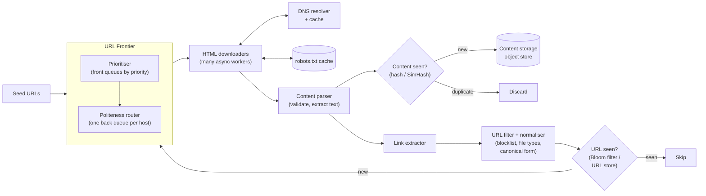
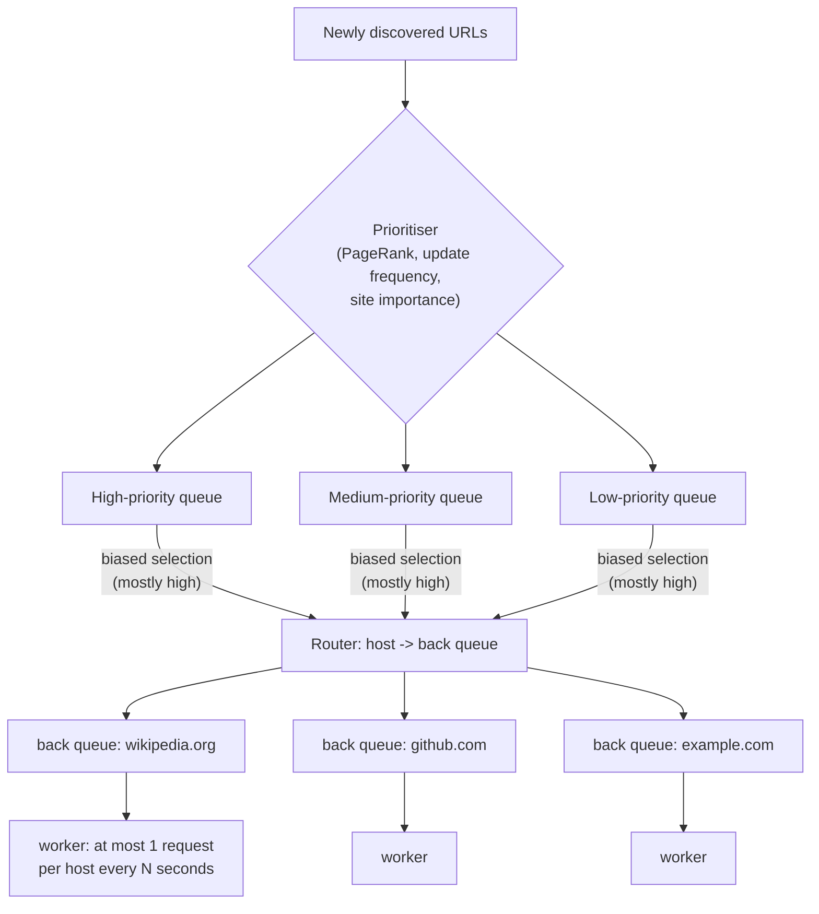
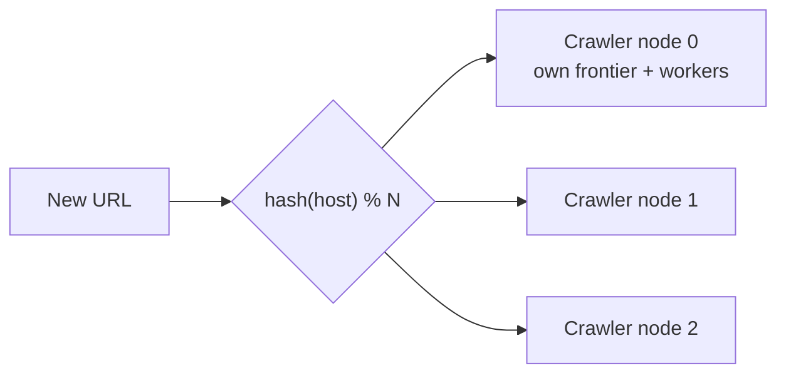

# HLD: Web Crawler

A crawler downloads web pages, extracts their links, and follows them, which is how search engines build their index. The interesting parts: the **URL frontier** (what to crawl next, **politely**), **deduplication** at billions of URLs, **robustness** against a hostile and messy web, and **distributing** the work.

---

## 1. Requirements

**Functional**
1. Start from **seed URLs**; download pages; **extract links**; add new links to the crawl queue.
2. **Store** page content for the indexer.
3. **Re-crawl** pages periodically to pick up changes.

**Non-functional**
- **Scale:** ~1 B pages per month.
- **Politeness:** never overload a website (limit request rate per host; obey `robots.txt`).
- **Robustness:** handle broken HTML, slow or unresponsive servers, redirect loops and spider traps.
- **Extensible:** add new content types (images, PDFs) later.
- **Priority:** important and frequently changing pages get crawled sooner.

---

## 2. Estimation
- 1 B pages / month / (2.6 x 10^6 s) ≈ **~400 pages/s** (peak ~800).
- Average page ~500 KB, so ~200 MB/s download bandwidth and **~500 TB/month** of raw content (compress it, and keep only what the indexer needs).
- URLs seen: tens of billions over time, so dedup needs a compact structure (Bloom filter) or a distributed key-value store.

---

## 3. Architecture



**One loop:** the frontier hands out a URL -> download (respecting robots.txt and the per-host rate) -> parse -> store if the content is new -> extract links -> normalise, filter and dedup them -> push new URLs back into the frontier.

---

## 4. The URL frontier (the heart of the crawler)

It's not a simple FIFO queue. It has to solve **priority** and **politeness** at the same time.



- **Front queues (priority):** URLs are sorted by importance. Selection is biased toward high priority but still samples low queues, so nothing starves.
- **Back queues (politeness):** each back queue holds URLs of **one host**, and each is consumed by a worker that waits between requests to that host (e.g. 1 s, or the `Crawl-delay` from robots.txt). A big site can never be hit by many workers at once.
- **Persistence:** the frontier holds billions of URLs, so it lives mostly **on disk** with in-memory buffers at the head and tail of each queue.

---

## 5. Deduplication

### URL dedup: "Have we already queued this URL?"
1. **Normalise** first, so equivalent URLs compare equal: lowercase the scheme and host, remove default ports, resolve `../`, drop `#fragments`, sort query parameters, remove tracking parameters (`utm_*`), respect `<link rel="canonical">`.
2. Check a **Bloom filter**. Billions of URLs fit in a few GB at ~1% false positives. A false positive means we *skip* a new URL, which is acceptable for a crawler. Alternatively use a distributed key-value store of URL hashes for exact answers.

### Content dedup: "Is this page a copy of one we already have?"
- An **exact hash** (SHA-256 of the normalised content) catches identical pages (mirrors, the same page under several URLs).
- **SimHash / MinHash** catch **near-duplicates** (the same article with a different ad or date): similar documents produce fingerprints that differ in only a few bits.

---

## 6. Robustness: the web is hostile

| Problem | Defence |
|---|---|
| **Spider traps** (infinite calendars `/2026/10/18/next/next/...`, session IDs in URLs) | Maximum URL length, maximum crawl depth, a per-domain page budget, URL pattern blacklists |
| Slow or hanging servers | Strict connect and read timeouts; per-host concurrency of 1 |
| Huge files | Abort downloads above a size limit; check `Content-Type` and `Content-Length` first |
| Redirect loops | Cap redirects (e.g. 5) |
| Malformed HTML | A tolerant parser; catch and log parse errors per page |
| DNS as a bottleneck | Local DNS cache; asynchronous resolution |
| Spam / low-quality sites | Domain reputation scores lower their priority |

---

## 7. Distributing the crawler


- Partition by **host**, not by URL. Each host is then owned by exactly one node, so **politeness stays local** (no cross-node coordination of request rates), and DNS and robots.txt caches stay hot.
- Use **consistent hashing** so adding nodes moves few hosts.
- Nodes forward discovered URLs that belong to other partitions (batched, through a queue).
- Place crawler nodes in several regions so they're closer to the sites they crawl.

---

## 8. A simple single-machine version (Python asyncio)

Good for showing the core loop in an interview, or for a weekend project. Requires `pip install aiohttp`.

```python
import asyncio
import re
from urllib.parse import urljoin, urldefrag, urlparse

import aiohttp

LINK_RE = re.compile(r'href="([^"#]+)"')

async def crawl(seed: str, max_pages: int = 50, concurrency: int = 10) -> set[str]:
    seen: set[str] = {seed}
    queue: asyncio.Queue[str] = asyncio.Queue()
    await queue.put(seed)
    host = urlparse(seed).netloc

    async def worker(session: aiohttp.ClientSession) -> None:
        while True:
            url = await queue.get()
            try:
                async with session.get(url, timeout=aiohttp.ClientTimeout(total=5)) as resp:
                    if "text/html" not in resp.headers.get("Content-Type", ""):
                        continue
                    html = await resp.text()
                for href in LINK_RE.findall(html):
                    link, _ = urldefrag(urljoin(url, href))     # absolute URL, no #fragment
                    same_site = urlparse(link).netloc == host  # stay on one site (politeness/scope)
                    if same_site and link not in seen and len(seen) < max_pages:
                        seen.add(link)
                        await queue.put(link)
            except Exception:
                pass                     # timeouts, bad pages: skip and move on
            finally:
                queue.task_done()        # only after new links are queued, so join() can't finish early

    async with aiohttp.ClientSession(headers={"User-Agent": "StudyCrawler/0.1"}) as session:
        workers = [asyncio.create_task(worker(session)) for _ in range(concurrency)]
        await queue.join()               # every queued URL has been processed
        for w in workers:
            w.cancel()
    return seen

# pages = asyncio.run(crawl("https://example.com"))
```
What it leaves out compared with the real design: robots.txt, per-host delay, persistence, priorities, content dedup and distribution. Saying so is part of a good answer.

---

## 9. Re-crawling (freshness)
- Track each page's **change history**: pages that changed on the last few visits are revisited sooner (news homepages hourly, old blog posts monthly).
- Use conditional requests (`If-Modified-Since` / `ETag`) so unchanged pages return a cheap **304 Not Modified**.
- Sitemaps (`sitemap.xml`) and RSS feeds tell you what changed.

## 10. Trade-offs summary
- Two-level **frontier**: priority front queues, per-host politeness back queues.
- **Normalise, then Bloom-filter** URL dedup; **SimHash** for near-duplicate content.
- Partition work **by host** with consistent hashing.
- Defensive limits everywhere (depth, size, time, redirects).
