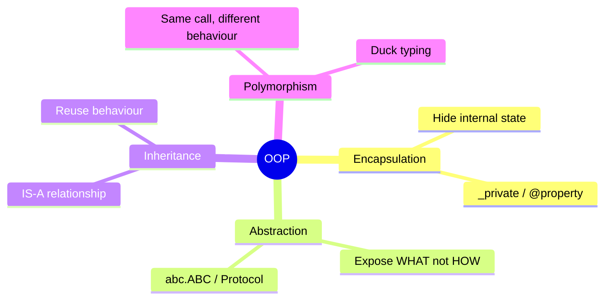
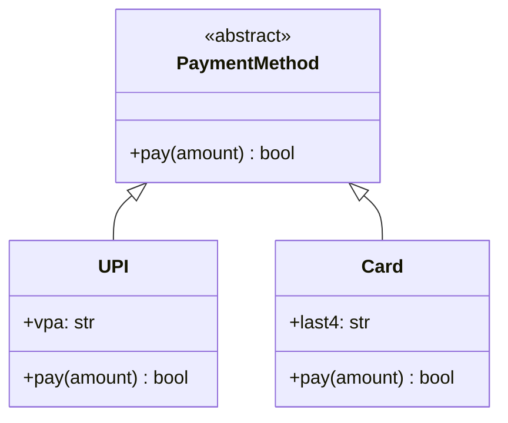
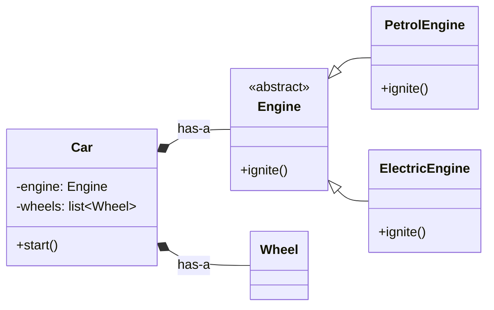

# 1. Python OOP Essentials for LLD

## Why this matters
A Low Level Design (LLD) interview is mostly about **modelling a problem with objects**: picking the right classes, giving each a clear job, and wiring them together so the design is easy to extend. The interviewer is not testing obscure Python tricks. They are checking that you can:

- turn a vague problem ("design a parking lot") into **well-named classes**,
- protect each object's internal state (**encapsulation**),
- hide details behind **interfaces** so parts can be swapped,
- write code that reads cleanly and would survive a code review.

This chapter covers the Python features you will use in almost every LLD answer.

## The 4 pillars at a glance



| Pillar | Plain-English meaning | What it buys you |
|---|---|---|
| Encapsulation | An object owns its data and controls how it changes | Invalid states become impossible (e.g. a negative balance) |
| Abstraction | Callers know *what* an object does, not *how* | You can change the "how" without breaking callers |
| Inheritance | A class reuses and specialises another class | Shared behaviour written once |
| Polymorphism | Same method call, different behaviour per object | No `if type == ...` chains |

---

## Encapsulation with `_name` and `@property`

Python has no truly private fields. Instead it uses **conventions**:

| Spelling | Meaning |
|---|---|
| `balance` | Public. Anyone may read or write it. |
| `_balance` | "Internal, please don't touch." Not enforced, but every Python developer respects it. |
| `__balance` | Name-mangled to `_BankAccount__balance`. Mainly used to avoid name clashes in subclasses, rarely needed. |

`@property` lets you expose a value **read-only**, or run validation when it is set, while callers still use simple attribute syntax.

```python
class BankAccount:
    def __init__(self, owner: str):
        self.owner = owner
        self._balance = 0.0          # internal: only methods of this class change it

    @property
    def balance(self) -> float:      # read-only view for the outside world
        return self._balance

    def deposit(self, amount: float) -> None:
        if amount <= 0:              # the class enforces its own rules
            raise ValueError("amount must be positive")
        self._balance += amount

acc = BankAccount("Aryan")
acc.deposit(100)
print(acc.balance)   # 100.0
# acc.balance = 5    # AttributeError: property has no setter -> state is protected
```

**Why it matters in interviews:** if `balance` were a plain public attribute, any code anywhere could set it to `-1_000_000`. With encapsulation, the *only* way to change it is through `deposit()`, which validates. Say this out loud when you model money, inventory counts or seat status.

> In real money code, use integers (paise/cents) or `decimal.Decimal`, never `float`. `0.1 + 0.2 != 0.3` in floating point.

---

## Abstraction with `abc.ABC`

An **abstract base class (ABC)** defines a contract: "every payment method must have a `pay()` method". You cannot create an instance of the ABC itself, and Python refuses to instantiate a subclass that forgets to implement an abstract method.

```python
from abc import ABC, abstractmethod

class PaymentMethod(ABC):
    @abstractmethod
    def pay(self, amount: float) -> bool:
        """Charge the amount. Return True on success."""

class UPI(PaymentMethod):
    def __init__(self, vpa: str):
        self.vpa = vpa

    def pay(self, amount: float) -> bool:
        print(f"Paid {amount} via UPI ({self.vpa})")
        return True

class Card(PaymentMethod):
    def __init__(self, last4: str):
        self.last4 = last4

    def pay(self, amount: float) -> bool:
        print(f"Paid {amount} with card ending {self.last4}")
        return True

# PaymentMethod()         -> TypeError: Can't instantiate abstract class
```



The rest of the system (e.g. `CheckoutService`) only knows about `PaymentMethod`. Adding `Wallet` later means writing one new class and changing nothing else. This is the **Open/Closed principle** you will meet in the next chapter.

### `Protocol`: an interface without inheritance

`typing.Protocol` describes a *shape*: "anything with a `send(msg)` method". Classes do **not** need to inherit from it. A type checker (mypy, Pyright) accepts any object with the right methods. This is called **structural typing**, the static-typing version of Python's duck typing ("if it walks like a duck...").

```python
from typing import Protocol

class Notifier(Protocol):
    def send(self, msg: str) -> None: ...

class EmailNotifier:                 # note: does NOT inherit from Notifier
    def send(self, msg: str) -> None:
        print("email:", msg)

class SlackNotifier:
    def send(self, msg: str) -> None:
        print("slack:", msg)

def alert(n: Notifier) -> None:      # accepts EmailNotifier and SlackNotifier
    n.send("server down")
```

| Use `ABC` when... | Use `Protocol` when... |
|---|---|
| You want Python to **enforce** implementation at runtime | You want **loose coupling**: no shared base class |
| Subclasses share some concrete helper methods | You're describing third-party classes you can't modify |
| Typical in interview answers (most familiar) | Common in modern typed Python codebases |

Either is fine in an interview. ABC is the safer default because the intent is obvious to every reader.

---

## Polymorphism

Polymorphism means **one interface, many behaviours**. The caller doesn't check types. It calls the method and each object responds in its own way.

```python
methods: list[PaymentMethod] = [UPI("aryan@okbank"), Card("4242")]
for m in methods:
    m.pay(50)      # no if/elif on type: each class decides HOW to pay
```

The alternative, an `if isinstance(m, UPI): ... elif isinstance(m, Card): ...` chain, has to be edited every time a new type appears. That is the code smell polymorphism removes.

---

## Composition vs Inheritance

- **Inheritance (IS-A):** `Dog` *is an* `Animal`. The subclass gets all of the parent's behaviour.
- **Composition (HAS-A):** `Car` *has an* `Engine`. The object holds other objects and delegates work to them.



```python
class Engine(ABC):
    @abstractmethod
    def ignite(self) -> None: ...

class PetrolEngine(Engine):
    def ignite(self): print("vroom")

class ElectricEngine(Engine):
    def ignite(self): print("hmmm (silent)")

class Car:
    def __init__(self, engine: Engine):   # the engine is passed in ("injected")
        self.engine = engine

    def start(self):
        self.engine.ignite()               # delegate the work

Car(PetrolEngine()).start()
Car(ElectricEngine()).start()             # new behaviour without a new Car subclass
```

**Why prefer composition?**
1. **Flexibility:** you can swap the engine at runtime or in tests. A class's parent is fixed forever.
2. **No class explosion:** with inheritance you'd need `PetrolSedan`, `ElectricSedan`, `PetrolSUV`, `ElectricSUV`, ... With composition, it's `Car(engine, body)`.
3. **Less coupling:** a subclass depends on every detail of its parent. Changing the parent can silently break subclasses (the "fragile base class" problem).

**When inheritance *is* right:** a genuine "is a" relationship where the subclass can be used anywhere the parent is expected (see Liskov in [SOLID](02-solid.md)), e.g. `Car(Vehicle)`, `UPI(PaymentMethod)`.

---

## Data modelling toolkit

Most LLD problems have two kinds of classes:
- **Entities / value objects:** mostly data (`Ticket`, `Seat`, `Money`).
- **Services / managers:** mostly behaviour (`BookingService`, `ParkingLot`).

Python's standard library makes the data classes short:

| Tool | Use for | Example |
|---|---|---|
| `@dataclass` | Data holders: auto-generates `__init__`, `__repr__`, `__eq__` | `User`, `Ticket` |
| `@dataclass(frozen=True)` | **Immutable** value objects. They are also hashable, so they can be dict keys | `Money`, `Point`, `Vehicle` |
| `Enum` | A fixed set of choices: types, states, statuses | `VehicleType.CAR`, `OrderStatus.SHIPPED` |
| `NamedTuple` | Lightweight immutable record that also behaves like a tuple | `Coord(x, y)` |

```python
from dataclasses import dataclass, field
from enum import Enum
from uuid import uuid4

class OrderStatus(Enum):
    PLACED = "placed"
    SHIPPED = "shipped"
    DELIVERED = "delivered"

@dataclass
class Order:
    customer: str
    items: list[str] = field(default_factory=list)   # a fresh list for every Order
    status: OrderStatus = OrderStatus.PLACED
    id: str = field(default_factory=lambda: uuid4().hex[:8])

o = Order("aryan", ["book"])
print(o)
# Order(customer='aryan', items=['book'], status=<OrderStatus.PLACED: 'placed'>, id='3f9c...')
```

**Two gotchas worth knowing:**
1. **Mutable defaults.** `items: list = []` would make *every* Order share one list. Dataclasses refuse it with a `ValueError`. Use `field(default_factory=list)`. The same bug in a normal function (`def f(x=[])`) is a classic interview question.
2. **Use `Enum`, not strings.** `status = "shiped"` (typo) silently works with strings. `OrderStatus.SHIPED` fails immediately. Enums also make the set of valid states explicit.

---

## Dunder ("double underscore") methods worth knowing

| Method | What it enables | Where it shows up in LLD |
|---|---|---|
| `__repr__` | Readable `print()` / debugger output | Every entity (free with `@dataclass`) |
| `__eq__` and `__hash__` | Equality and use as dict keys / set members | Value objects such as `Point`, `Seat` |
| `__lt__` | `<` comparison: sorting and `heapq` | Priority queues (elevator stops, task scheduler) |
| `__len__`, `__iter__`, `__contains__` | `len(x)`, `for item in x`, `item in x` | Custom collections such as a `Playlist` |
| `__enter__` / `__exit__` | `with` blocks | Locks, DB connections, files |

> **Rule:** if you define `__eq__`, Python sets `__hash__` to `None` (the object becomes unhashable) unless you also define `__hash__`. `@dataclass(frozen=True)` handles both for you.

---

## Interview checklist
- Name classes as **nouns** (`Ticket`), methods as **verbs** (`issue_ticket()`).
- Type-hint parameters and return values. It is free documentation and shows care.
- Keep **entities** (data) separate from **services** (logic): `Booking` vs `BookingService`.
- Validate in the class that owns the data (`deposit()` rejects negative amounts).
- Prefer composition, and inject dependencies through `__init__`.

## Check yourself
1. What is the difference between `_x` and `__x` in Python?
2. Why does `@dataclass` reject `items: list = []`?
3. When would you choose `Protocol` over `ABC`?
4. Give an example where inheritance would cause a "class explosion", and fix it with composition.
