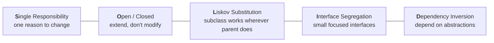
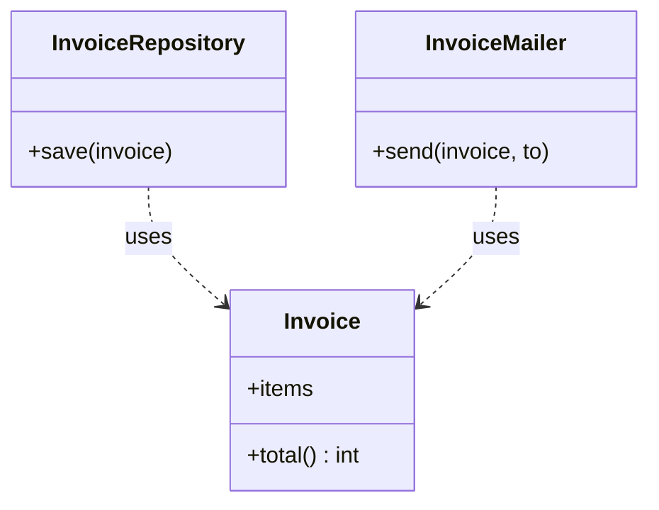
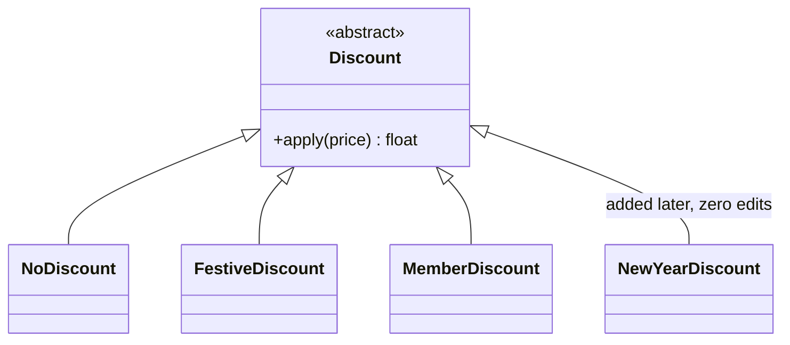
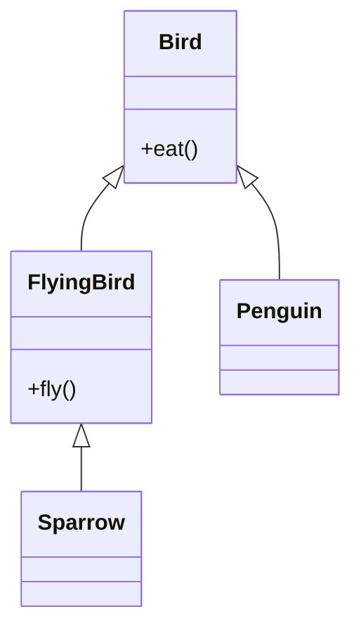
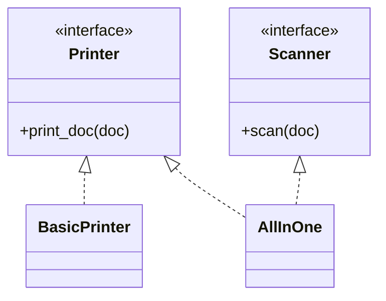
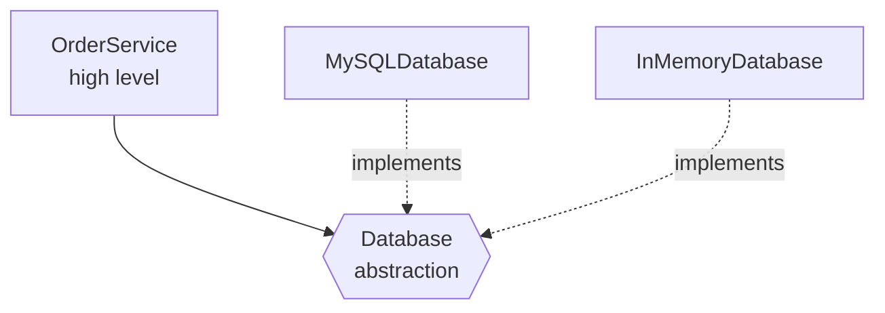

# 2. SOLID Principles

## Why this matters
SOLID is five guidelines (collected by Robert C. Martin) for writing object-oriented code that is **easy to change**. Requirements always change. A good design means a new feature needs **new code**, not risky edits all over existing code.

In an LLD interview you rarely recite SOLID. You **apply** it, and then name it when explaining a decision: *"I made pricing an interface so adding weekend pricing doesn't modify `ParkingLot`. That's Open/Closed."*



---

## S: Single Responsibility Principle (SRP)

> **A class should have only one reason to change.**

"Responsibility" means a *source of change*: a business rule, a storage technology, a notification channel. If a class would change when the tax rules change **and** when you switch from MySQL to Postgres **and** when the email template changes, it has three responsibilities.

**Bad:** one class does everything.
```python
class Invoice:
    def calculate_total(self): ...   # changes when pricing/tax rules change
    def save_to_db(self): ...        # changes when the database changes
    def send_email(self): ...        # changes when notification rules change
```
Problems: a change to email formatting forces you to retest invoice maths; you can't reuse the total calculation without dragging in DB code; the file grows forever (a "God class").

**Good:** split by reason to change.
```python
class Invoice:
    def __init__(self, items: list[tuple[str, int]]):
        self.items = items
    def total(self) -> int:
        return sum(price for _, price in self.items)

class InvoiceRepository:
    def save(self, invoice: Invoice) -> None: ...

class InvoiceMailer:
    def send(self, invoice: Invoice, to: str) -> None: ...
```


**Don't overdo it:** SRP does not mean "one method per class". Group things that change *together*.

---

## O: Open/Closed Principle (OCP)

> **Software should be open for extension but closed for modification.**

You should be able to add new behaviour (a new discount type, a new vehicle, a new payment method) **by adding code**, without editing code that already works and is tested.

**Bad:** every new discount means editing this function.
```python
def discount(kind: str, price: float) -> float:
    if kind == "festive":
        return price * 0.8
    elif kind == "member":
        return price * 0.9
    # every new discount = another elif in this tested, shipped function
    return price
```

**Good:** each discount is its own class behind a common interface.
```python
from abc import ABC, abstractmethod

class Discount(ABC):
    @abstractmethod
    def apply(self, price: float) -> float: ...

class NoDiscount(Discount):
    def apply(self, price): return price

class FestiveDiscount(Discount):
    def apply(self, price): return price * 0.8

class MemberDiscount(Discount):
    def apply(self, price): return price * 0.9

def checkout(price: float, discount: Discount) -> float:
    return discount.apply(price)       # never changes when new discounts arrive
```


**How OCP is achieved in practice:** polymorphism plus patterns such as **Strategy**, **Decorator** and **Factory with a registry**. OCP is the principle; those patterns are the tools.

---

## L: Liskov Substitution Principle (LSP)

> **Objects of a subclass must be usable anywhere the parent is expected, without the caller noticing.**

A subclass must keep the parent's **promises**: it can't demand more (stricter inputs), deliver less (weaker results), or surprise callers with new exceptions or side effects. If callers need `if isinstance(x, Subclass)` to stay safe, LSP is broken.

**Classic violation: Square extends Rectangle.**
```python
class Rectangle:
    def __init__(self, w: int, h: int):
        self.w, self.h = w, h
    def set_width(self, w: int):  self.w = w
    def set_height(self, h: int): self.h = h
    def area(self) -> int:        return self.w * self.h

class Square(Rectangle):
    def set_width(self, w: int):  self.w = self.h = w   # keeps it square...
    def set_height(self, h: int): self.w = self.h = h   # ...but breaks a promise

def stretch(r: Rectangle):
    r.set_width(5)
    r.set_height(4)
    assert r.area() == 20          # true for every Rectangle...

stretch(Rectangle(1, 1))           # OK
stretch(Square(1, 1))              # AssertionError: area is 16
```
Mathematically a square *is* a rectangle, but a **mutable** `Square` can't keep the promise "setting width doesn't change height". Fix: don't inherit. Make both implement a `Shape` interface with `area()`, or make them immutable.

**Second example: birds.** If `Bird` has `fly()`, then `Penguin(Bird)` must raise an exception, and code looping over birds calling `fly()` crashes. Fix the hierarchy so that only things that can fly promise to fly:


**Red flags that suggest an LSP violation:** a subclass method that raises `NotImplementedError`, does nothing, or needs a type check by the caller.

---

## I: Interface Segregation Principle (ISP)

> **Clients should not be forced to depend on methods they don't use.**

Prefer several small, focused interfaces over one "fat" interface.

**Bad:** a fat interface forces dummy implementations.
```python
class Machine(ABC):
    @abstractmethod
    def print_doc(self, doc): ...
    @abstractmethod
    def scan(self, doc): ...
    @abstractmethod
    def fax(self, doc): ...

class BasicPrinter(Machine):
    def print_doc(self, doc): print("printing", doc)
    def scan(self, doc): raise NotImplementedError   # forced to exist
    def fax(self, doc):  raise NotImplementedError   # forced to exist
```
`BasicPrinter` now *claims* it can scan, and every caller has to guess which methods really work. Notice this also breaks LSP.

**Good:** small interfaces; a class implements only what it supports.
```python
class Printer(ABC):
    @abstractmethod
    def print_doc(self, doc): ...

class Scanner(ABC):
    @abstractmethod
    def scan(self, doc): ...

class BasicPrinter(Printer):
    def print_doc(self, doc): print("printing", doc)

class AllInOne(Printer, Scanner):        # combine interfaces as needed
    def print_doc(self, doc): print("printing", doc)
    def scan(self, doc): print("scanning", doc)
```


---

## D: Dependency Inversion Principle (DIP)

> **High-level modules should not depend on low-level modules. Both should depend on abstractions.**

- **High-level** = business logic (`OrderService`: "place an order").
- **Low-level** = technical details (`MySQLDatabase`, `SmtpEmailSender`).

If business logic creates its own database object, you can't test it without a real database, and you can't switch databases without editing business code.

**Bad:** the high-level class constructs the low-level one.
```python
class OrderService:
    def __init__(self):
        self.db = MySQLDatabase()          # hard-wired: untestable, unswappable
```

**Good:** depend on an interface and receive the implementation from outside. Passing it in is called **dependency injection**.
```python
class Database(ABC):
    @abstractmethod
    def save(self, data: dict) -> None: ...

class MySQLDatabase(Database):
    def save(self, data): print("INSERT INTO orders ...")

class InMemoryDatabase(Database):          # perfect for unit tests
    def __init__(self): self.rows = []
    def save(self, data): self.rows.append(data)

class OrderService:
    def __init__(self, db: Database):      # injected
        self.db = db
    def place(self, order: dict):
        self.db.save(order)

OrderService(MySQLDatabase())              # production
OrderService(InMemoryDatabase())           # tests, no real DB needed
```

The "inversion": normally the arrow goes *business logic -> MySQL*. Now **both** point at the abstraction, and the business layer owns that abstraction.

> **DIP vs DI:** Dependency *Inversion* is the principle (depend on abstractions). Dependency *Injection* is a technique (pass dependencies in through the constructor) that helps you follow it.

---

## Other principles worth naming

| Principle | Meaning | Example |
|---|---|---|
| **DRY** (Don't Repeat Yourself) | Each piece of knowledge has one source of truth | Fee rates in one table, not copied into 3 methods |
| **KISS** (Keep It Simple) | Choose the simplest design that meets the requirements | A dict instead of a custom registry class |
| **YAGNI** (You Aren't Gonna Need It) | Don't build for imaginary future requirements | No plugin system for a tic-tac-toe game |
| **Law of Demeter** | Talk to direct collaborators only; avoid `order.customer.address.city.name` | Add `order.shipping_city()` instead |
| **Composition over inheritance** | Build behaviour by combining objects | `Car(engine)` instead of `PetrolCar(Car)` |

**Balance matters.** Applying every principle everywhere leads to over-engineering. Interviewers penalise a 20-class design for a 5-class problem just as much as a God class.

## Check yourself
1. Your `ReportGenerator` class fetches data, formats a PDF and emails it. Which principle does it break, and how would you split it?
2. Why is `Square(Rectangle)` an LSP violation even though every square is a rectangle?
3. How does the Strategy pattern help you follow Open/Closed?
4. What is the difference between Dependency Inversion and Dependency Injection?
