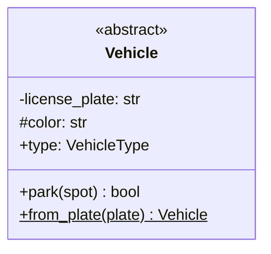
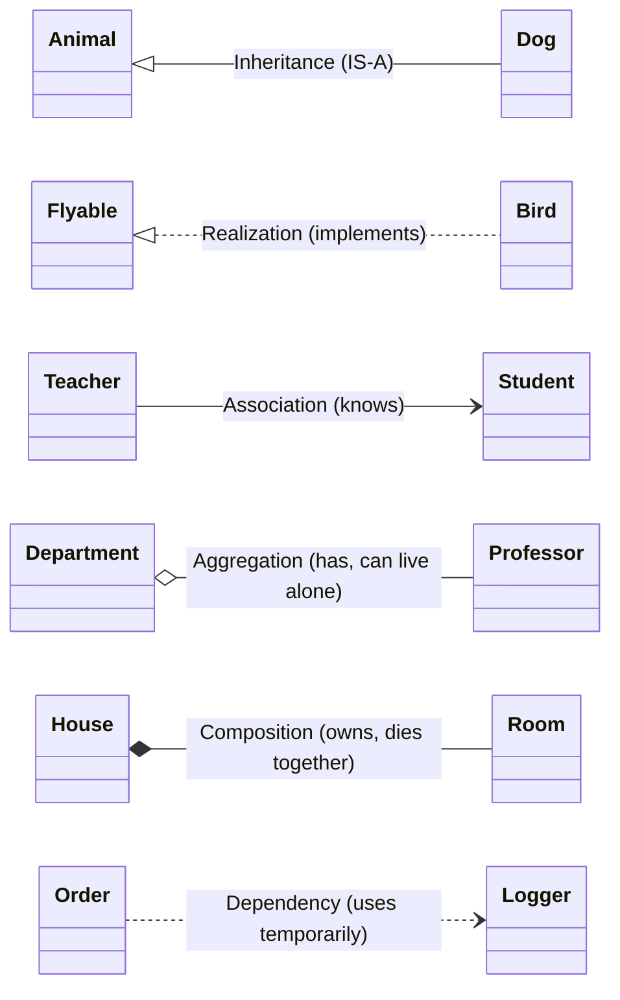
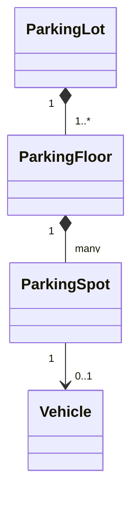
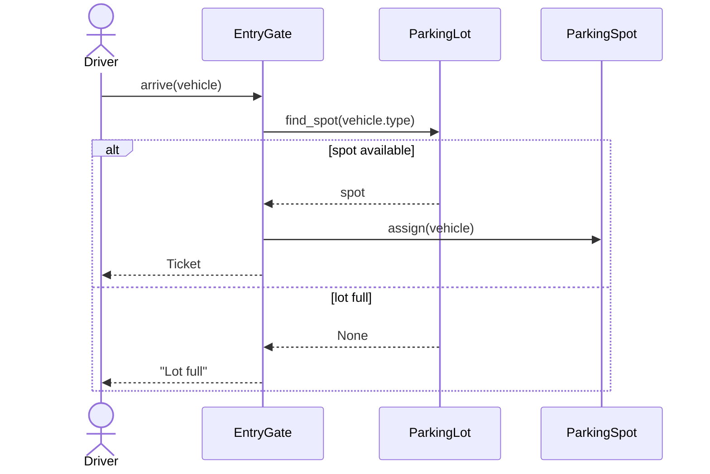

# 3. UML Class & Sequence Diagrams

## Why this matters
In most LLD interviews you'll sketch a **class diagram** before writing code. It's the fastest way to show the interviewer your classes, their key fields and methods, and how they relate. You don't need the full UML standard. You need the ~10 symbols below, used consistently.

Two diagram types cover 95% of interviews:
- **Class diagram:** the *structure* (what exists and how it's connected).
- **Sequence diagram:** the *behaviour* of one flow (who calls whom, in what order).

---

## Anatomy of a class



A class box has three parts: **name**, **attributes** (fields), **methods**.

| Symbol | Meaning | Python equivalent |
|---|---|---|
| `+` | public | `name` |
| `-` | private | `_name` (by convention) or `__name` |
| `#` | protected (visible to subclasses) | `_name` (Python doesn't distinguish private vs protected) |
| `$` (rendered underlined) | static / class-level member | `@staticmethod`, `@classmethod`, or a class attribute |
| `<<abstract>>` | can't be instantiated | `class X(ABC)` |
| `<<interface>>` | only method signatures | `ABC` with only abstract methods, or `Protocol` |
| `<<enumeration>>` | fixed set of values | `class X(Enum)` |

Write types after a colon (`plate: str`) and return types after the parentheses (`park(spot) bool`). In an interview, include only the **important** fields and methods; nobody needs getters drawn.

---

## The 6 relationships



From weakest to strongest coupling: **Dependency < Association < Aggregation < Composition < Inheritance**.

| Relationship | Line in UML | Mermaid syntax | Python looks like | Lifetime of the "part" |
|---|---|---|---|---|
| **Inheritance** (generalisation) | solid line, hollow triangle | `Parent <\|-- Child` | `class Dog(Animal)` | n/a |
| **Realization** (implements) | dashed line, hollow triangle | `Interface <\|.. Class` | subclass of an abstract ABC / matches a Protocol | n/a |
| **Association** | solid line, arrow | `A --> B` | `self.student = student` (long-lived reference) | independent |
| **Aggregation** | solid line, hollow diamond at the whole | `Whole o-- Part` | parts created elsewhere and **passed in** | part **outlives** the whole |
| **Composition** | solid line, filled diamond at the whole | `Whole *-- Part` | parts **created inside** the whole | part **dies with** the whole |
| **Dependency** | dashed line, arrow | `A ..> B` | `B` used only as a parameter or local variable | temporary |

### Aggregation vs composition (most confused pair)

Ask: **"If I delete the whole, should the parts be deleted too?"**

```python
class Room: ...

class House:
    def __init__(self):
        # COMPOSITION: the house creates its rooms; nobody else references them.
        # Demolish the house -> the rooms are gone too.
        self.rooms = [Room(), Room()]

class Professor: ...

class Department:
    def __init__(self, profs: list[Professor]):
        # AGGREGATION: professors exist independently and are passed in.
        # Close the department -> professors still exist (they move elsewhere).
        self.profs = profs
```

More examples:
| Composition (filled diamond) | Aggregation (hollow diamond) |
|---|---|
| `Order *-- OrderLine` | `Team o-- Player` |
| `ParkingFloor *-- ParkingSpot` | `Playlist o-- Song` |
| `Document *-- Paragraph` | `Library o-- Book` (if books can be transferred) |

> In interviews the composition/aggregation distinction is a **bonus**, not a requirement. If unsure, a plain association arrow is never "wrong".

### Association vs dependency
- **Association:** a long-lived link stored in a field (`self.driver`).
- **Dependency:** a short-lived use. The object is a parameter or a local and isn't stored (`def print(self, logger): logger.log(...)`).

---

## Multiplicity: how many?

Put numbers on each end of a line to show how many objects take part.



Read it as: *"A parking lot has one or more floors. A floor has many spots. A spot holds zero or one vehicle."*

| Notation | Meaning |
|---|---|
| `1` | exactly one |
| `0..1` | optional (zero or one): becomes `Optional[...]` / `X \| None` in Python |
| `*` or `many` / `0..*` | any number: becomes a `list` or `dict` |
| `1..*` | at least one |

Multiplicity directly shapes your code: `0..1` means a field that can be `None`; `*` means a collection.

---

## Sequence diagrams: one flow, step by step

Use a sequence diagram for the **1-2 most important flows** (e.g. "park a vehicle", "book a seat"). Time flows downward.



| Element | Meaning |
|---|---|
| `actor` / `participant` | a person / an object (column) |
| solid arrow `->>` | a call (request) |
| dashed arrow `-->>` | a return value (response) |
| `alt / else` box | branching (if/else) |
| `loop` box | repetition |
| `Note over` | a comment |

---

## A practical whiteboard routine
1. Draw the **5-8 core classes** as boxes with just their names.
2. Connect them with relationships and multiplicity.
3. Add the **key** fields and methods (the ones the use cases need).
4. Mark abstractions (`<<interface>>`) where behaviour varies, and name the pattern.
5. Draw one sequence diagram for the main flow if time allows.

## Check yourself
1. `Order` and `OrderLine`: composition or aggregation? What about `Team` and `Player`?
2. What does `0..1` on an association become in Python code?
3. What's the difference between `..>` and `-->`?
