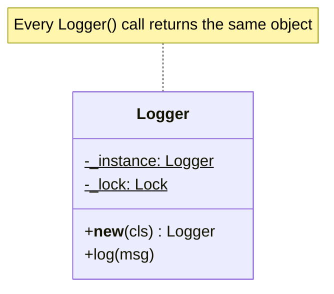
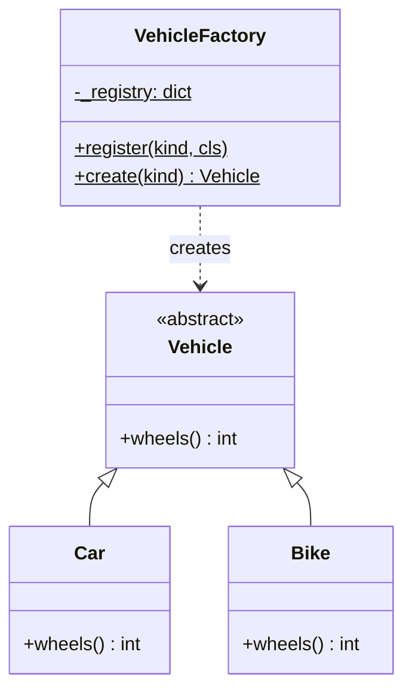
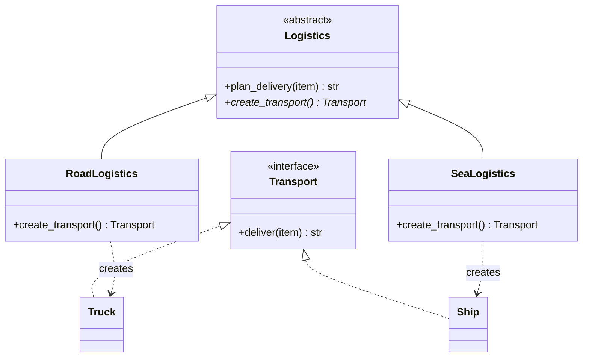
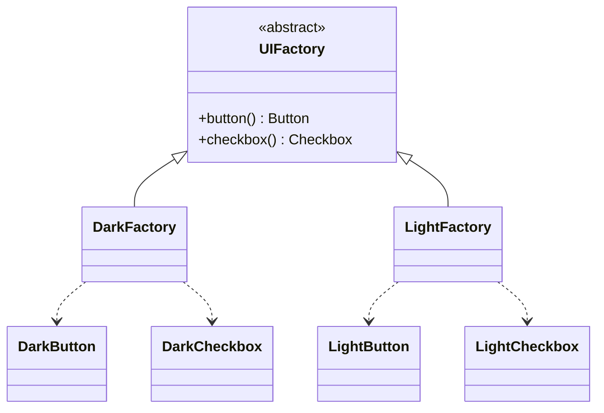
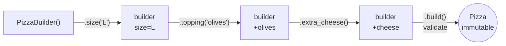
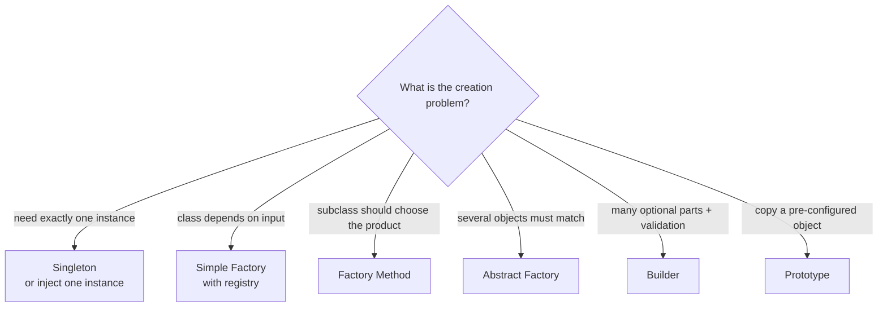

# 4. Creational Patterns: *how objects get created*

> Good illustrations: https://refactoring.guru/design-patterns/creational-patterns

## Why this matters
Writing `Car()` directly everywhere ties your code to that exact class. Creational patterns put object creation **in one place**, so that:
- callers don't need to know which concrete class they get,
- complex construction and validation logic isn't repeated,
- you can control *how many* instances exist.

| Pattern | Core idea | Typical use |
|---|---|---|
| **Singleton** | Exactly one instance, globally reachable | Config, logger, connection pool |
| **Simple Factory** | One function/class decides which class to instantiate | Create a `Vehicle` from the string `"car"` |
| **Factory Method** | A *subclass* decides which product a method creates | Frameworks where subclasses plug in their own products |
| **Abstract Factory** | Create *families* of related objects that must match | UI themes, cloud-provider SDKs |
| **Builder** | Build a complex object step by step, validate at the end | Objects with many optional parts |
| **Prototype** | Create new objects by copying an existing one | Expensive setup, templates |

---

## Singleton

**Problem:** some things should exist once per process: a configuration object, a logger, a pool of DB connections. Creating several would waste resources or cause inconsistent state.

**Solution:** the class itself controls instantiation and always hands back the same object.



```python
import threading

class Logger:
    _instance = None
    _lock = threading.Lock()

    def __new__(cls):
        # Fast path: no locking once the instance exists.
        if cls._instance is None:
            with cls._lock:
                # Check again inside the lock: two threads might both have
                # passed the first check before either created the instance.
                if cls._instance is None:
                    cls._instance = super().__new__(cls)
                    cls._instance.lines = []      # one-time initialisation here
        return cls._instance

    def log(self, msg: str) -> None:
        self.lines.append(msg)
        print(f"[LOG] {msg}")

a, b = Logger(), Logger()
assert a is b                 # same object
```

**How it works:** `__new__` *creates* an object and `__init__` *initialises* it. Overriding `__new__` lets us return the existing object instead of a new one. The two `if` checks are **double-checked locking**: without the lock, two threads could create two instances at the same moment.

> **Gotcha:** Python still calls `__init__` on *every* `Logger()` call, even though `__new__` returned the old object. Put one-time setup inside `__new__` (as above), or guard `__init__`, otherwise each call resets your state.

**Pythonic alternatives**
- A **module** is already a singleton: Python imports it once and caches it. A `logger.py` with module-level functions is often all you need.
- Create one instance at startup and **pass it in** (dependency injection).

**Trade-offs to mention:** singletons are global state in disguise. They hide dependencies (a function secretly uses the logger), make unit tests harder (state leaks between tests) and complicate concurrency. Say: *"I'd make it a singleton, or better, create one instance and inject it."*

---

## Simple Factory (not a GoF pattern, but the most used)

**Problem:** the class to create depends on runtime input (`"car"`, `"bike"`, a config value), and you don't want `if/elif` chains copied around the codebase.

**Solution:** one function or class owns the decision.



```python
from abc import ABC, abstractmethod

class Vehicle(ABC):
    @abstractmethod
    def wheels(self) -> int: ...

class Car(Vehicle):
    def wheels(self): return 4

class Bike(Vehicle):
    def wheels(self): return 2

class VehicleFactory:
    _registry: dict[str, type[Vehicle]] = {"car": Car, "bike": Bike}

    @classmethod
    def register(cls, kind: str, vehicle_cls: type[Vehicle]) -> None:
        cls._registry[kind] = vehicle_cls          # new types without editing create()

    @classmethod
    def create(cls, kind: str) -> Vehicle:
        try:
            return cls._registry[kind]()
        except KeyError:
            raise ValueError(f"unknown vehicle type: {kind}") from None

class Truck(Vehicle):
    def wheels(self): return 6

VehicleFactory.register("truck", Truck)
print(VehicleFactory.create("truck").wheels())    # 6
```

The **registry dict** replaces an `if/elif` chain, which keeps the factory open for extension (Open/Closed).

---

## Factory Method (the GoF pattern)

**Problem:** a base class contains a general algorithm that needs to *create* an object, but which concrete object depends on the subclass.

**Solution:** the base class calls an abstract **creation method**; each subclass overrides it to return its own product. The difference from Simple Factory: the decision is made by **inheritance (overriding)**, not by an `if` or a lookup.



```python
class Transport(ABC):
    @abstractmethod
    def deliver(self, item: str) -> str: ...

class Truck(Transport):
    def deliver(self, item): return f"{item} delivered by road"

class Ship(Transport):
    def deliver(self, item): return f"{item} delivered by sea"

class Logistics(ABC):
    @abstractmethod
    def create_transport(self) -> Transport:      # <- the "factory method"
        ...

    def plan_delivery(self, item: str) -> str:    # shared algorithm, written once
        transport = self.create_transport()       # subclass decides WHAT is created
        return transport.deliver(item)

class RoadLogistics(Logistics):
    def create_transport(self): return Truck()

class SeaLogistics(Logistics):
    def create_transport(self): return Ship()

print(SeaLogistics().plan_delivery("containers"))   # containers delivered by sea
```

> **Interview tip:** if you say "factory", the interviewer may ask which one. *Simple factory* = one place picks the class from input. *Factory method* = a subclass overrides a creation method. Both hide concrete classes from the client.

---

## Abstract Factory

**Problem:** you create **several related objects** that must be compatible, e.g. a Dark theme's button, checkbox and scrollbar. Mixing a dark button with a light checkbox is a bug.

**Solution:** one factory interface with a method per product. Each concrete factory produces a whole matching family.



```python
class Button(ABC):
    @abstractmethod
    def render(self) -> str: ...

class Checkbox(ABC):
    @abstractmethod
    def render(self) -> str: ...

class DarkButton(Button):
    def render(self): return "[dark button]"
class DarkCheckbox(Checkbox):
    def render(self): return "[dark checkbox]"
class LightButton(Button):
    def render(self): return "[light button]"
class LightCheckbox(Checkbox):
    def render(self): return "[light checkbox]"

class UIFactory(ABC):
    @abstractmethod
    def button(self) -> Button: ...
    @abstractmethod
    def checkbox(self) -> Checkbox: ...

class DarkFactory(UIFactory):
    def button(self): return DarkButton()
    def checkbox(self): return DarkCheckbox()

class LightFactory(UIFactory):
    def button(self): return LightButton()
    def checkbox(self): return LightCheckbox()

def build_screen(factory: UIFactory) -> str:
    # This code never names a concrete class, and can't mix families by accident.
    return factory.button().render() + " " + factory.checkbox().render()

print(build_screen(DarkFactory()))   # [dark button] [dark checkbox]
```

Real-world analogies: database drivers (connection + cursor + types per DB), cloud SDK wrappers (`AWSFactory` vs `GCPFactory` producing storage + queue + compute clients).

---

## Builder

**Problem:** an object has many optional parts and some rules ("a pizza needs at least one topping", "a URL needs a host"). A constructor with 10 parameters is unreadable, and validation gets scattered.

**Solution:** a separate builder object collects the parts step by step, then `build()` validates once and returns the finished, ideally immutable, object.



```python
from dataclasses import dataclass

@dataclass(frozen=True)
class Pizza:
    size: str
    toppings: tuple[str, ...]
    extra_cheese: bool

class PizzaBuilder:
    SIZES = {"S", "M", "L"}

    def __init__(self):
        self._size = "M"
        self._toppings: list[str] = []
        self._cheese = False

    def size(self, s: str) -> "PizzaBuilder":
        self._size = s
        return self                       # returning self enables chaining

    def topping(self, t: str) -> "PizzaBuilder":
        self._toppings.append(t)
        return self

    def extra_cheese(self) -> "PizzaBuilder":
        self._cheese = True
        return self

    def build(self) -> Pizza:
        # All validation lives in one place:
        if self._size not in self.SIZES:
            raise ValueError(f"invalid size {self._size}")
        if not self._toppings:
            raise ValueError("at least one topping required")
        return Pizza(self._size, tuple(self._toppings), self._cheese)

pizza = PizzaBuilder().size("L").topping("olives").extra_cheese().build()
print(pizza)  # Pizza(size='L', toppings=('olives',), extra_cheese=True)
```

**Python note:** keyword arguments with defaults (`Pizza(size="L", extra_cheese=True)`) already solve the "too many constructor params" problem. Reach for Builder when construction has **multiple steps**, **cross-field validation**, or the same process should build **different representations** (e.g. a query builder producing SQL for different databases).

---

## Prototype

**Problem:** creating an object is expensive (loading templates, heavy computation) or you want many variations of a pre-configured object.

**Solution:** keep a ready-made prototype and **clone** it.

```python
import copy

class Document:
    def __init__(self, title: str, sections: list[str]):
        self.title = title
        self.sections = sections

    def clone(self) -> "Document":
        return copy.deepcopy(self)

template = Document("Monthly Report", ["Intro", "Metrics"])
mine = template.clone()
mine.sections.append("Appendix")
print(template.sections)   # ['Intro', 'Metrics']: the template is unaffected
```

**Shallow vs deep copy:**
| | `copy.copy(obj)` (shallow) | `copy.deepcopy(obj)` (deep) |
|---|---|---|
| Top-level object | new | new |
| Nested lists/objects | **shared** with the original | copied recursively |
| Risk | editing `clone.sections` also edits the original | slower for big object graphs |

---

## Choosing quickly


## Check yourself
1. Why does the Singleton above check `_instance is None` twice?
2. Explain the difference between Simple Factory and Factory Method in one sentence each.
3. When is a Builder overkill in Python?
4. What bug appears if `Document.clone()` uses `copy.copy` instead of `copy.deepcopy`?
