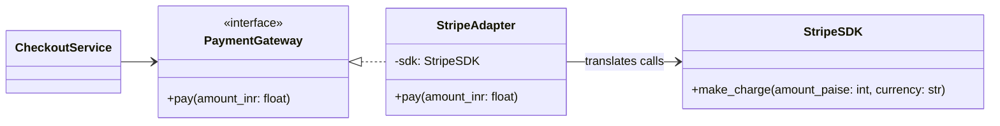
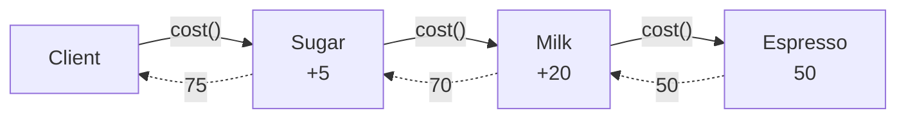
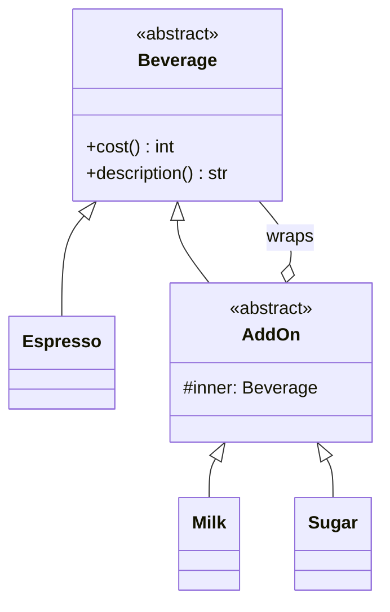
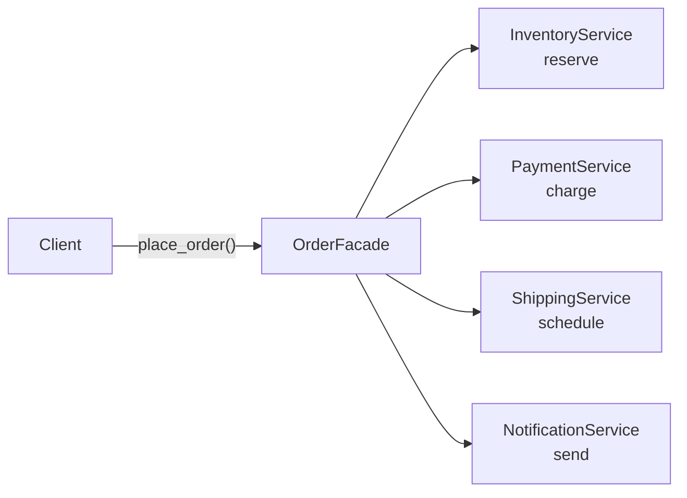
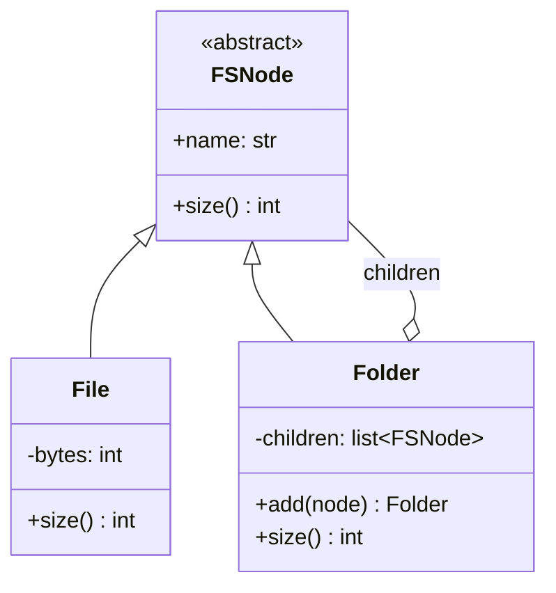
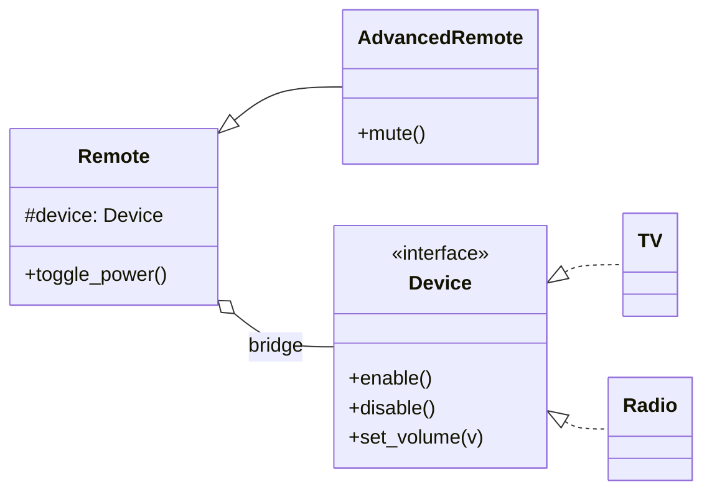

# 5. Structural Patterns: *how objects are combined*

> Good illustrations: https://refactoring.guru/design-patterns/structural-patterns
> Code snippets assume `from abc import ABC, abstractmethod`.

## Why this matters
Structural patterns describe how to **assemble** classes and objects into larger structures while keeping them flexible. Most of them work by **wrapping** one object in another that offers a different or richer interface. Learn to tell the wrappers apart by their *intent*:

| Pattern | Wraps an object to... | Real-world analogy |
|---|---|---|
| **Adapter** | **convert** its interface into the one the client expects | Travel plug adapter |
| **Decorator** | **add** behaviour while keeping the same interface | Coffee + milk + sugar |
| **Proxy** | **control access** to it, same interface | Security guard / receptionist |
| **Facade** | **simplify** a whole subsystem behind one easy interface | Hotel concierge |
| **Composite** | treat a **tree** of objects like a single object | Folders containing files and folders |
| **Bridge** | separate an abstraction from its implementation so both vary independently | Remote control x TV/Radio |
| **Flyweight** | **share** common state among huge numbers of objects | Font glyphs in a text editor |

> Adapter, Decorator and Proxy all "wrap" an object. Interviewers love asking how they differ. **Adapter changes the interface. Decorator keeps it and adds features. Proxy keeps it and controls access.**

---

## Adapter

**Problem:** you want to use an existing class (often a third-party SDK) whose interface doesn't match what your code expects, and you can't or shouldn't modify it.

**Solution:** write an adapter that implements *your* interface and translates each call into the other class's API.



```python
class StripeSDK:                                   # third-party: we can't change it
    def make_charge(self, amount_paise: int, currency: str) -> None:
        print(f"Stripe charged {amount_paise} {currency} (smallest unit)")

class PaymentGateway(ABC):                         # the interface OUR code uses
    @abstractmethod
    def pay(self, amount_inr: float) -> None: ...

class StripeAdapter(PaymentGateway):
    def __init__(self, sdk: StripeSDK):
        self.sdk = sdk

    def pay(self, amount_inr: float) -> None:
        # Translate: rupees -> paise, add the currency code the SDK needs.
        self.sdk.make_charge(round(amount_inr * 100), "INR")

class CheckoutService:
    def __init__(self, gateway: PaymentGateway):   # knows nothing about Stripe
        self.gateway = gateway
    def checkout(self, total: float):
        self.gateway.pay(total)

CheckoutService(StripeAdapter(StripeSDK())).checkout(499.0)
```

**Why it's valuable:** switching to Razorpay later means writing a `RazorpayAdapter`; `CheckoutService` doesn't change. The adapter also **isolates** vendor quirks in one place.

---

## Decorator

**Problem:** you want to add optional features (milk, sugar, logging, caching, retries) to objects in any combination. Subclassing every combination (`EspressoWithMilkAndSugar`...) explodes.

**Solution:** a decorator **is-a** component (same interface) and **has-a** component (the wrapped one). It forwards the call and adds its own behaviour before or after. Decorators can be stacked.





```python
class Beverage(ABC):
    @abstractmethod
    def cost(self) -> int: ...
    @abstractmethod
    def description(self) -> str: ...

class Espresso(Beverage):
    def cost(self): return 50
    def description(self): return "Espresso"

class AddOn(Beverage, ABC):                 # IS-A Beverage...
    def __init__(self, inner: Beverage):    # ...and HAS-A Beverage
        self.inner = inner

class Milk(AddOn):
    def cost(self): return self.inner.cost() + 20
    def description(self): return self.inner.description() + " + milk"

class Sugar(AddOn):
    def cost(self): return self.inner.cost() + 5
    def description(self): return self.inner.description() + " + sugar"

drink = Sugar(Milk(Espresso()))
print(drink.description(), drink.cost())   # Espresso + milk + sugar 75
```

**Python connection:** function decorators (`@functools.lru_cache`, `@retry`, a `@timed` logger) use the same idea applied to *functions*: wrap a callable, keep its signature, add behaviour.

```python
import functools, time

def timed(fn):
    @functools.wraps(fn)                      # keeps fn's name and docstring
    def wrapper(*args, **kwargs):
        start = time.perf_counter()
        try:
            return fn(*args, **kwargs)
        finally:
            print(f"{fn.__name__} took {time.perf_counter() - start:.4f}s")
    return wrapper
```

---

## Proxy

**Problem:** you need to control access to an object: create it lazily because it's expensive, check permissions, cache results, or hide that it lives on another machine.

**Solution:** a proxy has the **same interface** as the real object and decides when and whether to forward calls.

```python
class Image(ABC):
    @abstractmethod
    def show(self) -> None: ...

class RealImage(Image):
    def __init__(self, path: str):
        print(f"loading {path} from disk (slow)...")
        self.path = path
    def show(self): print(f"showing {self.path}")

class LazyImageProxy(Image):
    def __init__(self, path: str):
        self.path = path
        self._real: RealImage | None = None     # nothing loaded yet

    def show(self):
        if self._real is None:                  # load on first use only
            self._real = RealImage(self.path)
        self._real.show()

gallery = [LazyImageProxy(f"img{i}.png") for i in range(1000)]  # instant: nothing loaded
gallery[0].show()                                               # only this one loads
```

| Proxy type | What it controls | Example |
|---|---|---|
| Virtual | *When* the object is created | Lazy-loaded images, ORM lazy relations |
| Protection | *Who* may call it | Permission check before `delete()` |
| Caching | *Whether* the real call is needed | Cache API responses |
| Remote | *Where* it runs | gRPC/RPC client stubs look like local objects |

**Proxy vs Decorator:** the code looks almost identical. The difference is intent: a decorator *adds features* and is usually stacked by the client; a proxy *manages access* to the real object and often controls its lifecycle.

---

## Facade

**Problem:** a task requires coordinating many subsystems (inventory, payment, shipping, notifications), and every caller repeats that choreography.

**Solution:** a facade offers one simple, high-level method and handles the coordination internally. The subsystems remain available for advanced use.



```python
class OrderFacade:
    def __init__(self, inventory, payment, shipping, notifier):
        self.inventory, self.payment = inventory, payment
        self.shipping, self.notifier = shipping, notifier

    def place_order(self, user: str, item: str, amount: int) -> None:
        self.inventory.reserve(item)
        try:
            self.payment.charge(user, amount)
        except Exception:
            self.inventory.release(item)       # the facade owns the error handling too
            raise
        self.shipping.schedule(user, item)
        self.notifier.send(user, "Order placed!")
```

**Facade vs Adapter:** an adapter makes *one* interface fit another; a facade *simplifies* many interfaces into one new, easier interface.

---

## Composite

**Problem:** you have a tree (files in folders, employees in departments, UI widgets in panels) and want clients to treat a single item and a group of items the **same way**.

**Solution:** leaves and containers share one interface. A container implements operations by delegating to its children, recursively.



```python
class FSNode(ABC):
    def __init__(self, name: str):
        self.name = name
    @abstractmethod
    def size(self) -> int: ...

class File(FSNode):
    def __init__(self, name: str, nbytes: int):
        super().__init__(name)
        self.nbytes = nbytes
    def size(self): return self.nbytes

class Folder(FSNode):
    def __init__(self, name: str):
        super().__init__(name)
        self.children: list[FSNode] = []
    def add(self, node: FSNode) -> "Folder":
        self.children.append(node)
        return self
    def size(self):                       # recursion does the work
        return sum(child.size() for child in self.children)

root = Folder("root").add(File("a.txt", 10)).add(Folder("docs").add(File("b.pdf", 5)))
print(root.size())   # 15: the client never checks "is this a file or a folder?"
```

---

## Bridge

**Problem:** two independent dimensions of variation multiply into a class explosion. 2 remote types x 3 device types = 6 classes; add one more of either and it keeps growing.

**Solution:** split the dimensions into **two hierarchies** and connect them with composition (the "bridge"). Now it's 2 + 3 classes.



```python
class Device(ABC):
    @abstractmethod
    def set_volume(self, v: int): ...

class TV(Device):
    def set_volume(self, v): print("TV volume", v)

class Radio(Device):
    def set_volume(self, v): print("Radio volume", v)

class Remote:
    def __init__(self, device: Device):
        self.device = device

class AdvancedRemote(Remote):
    def mute(self): self.device.set_volume(0)

AdvancedRemote(Radio()).mute()      # any remote works with any device
```
Bridge is basically "composition over inheritance" applied deliberately to two axes of change.

---

## Flyweight

**Problem:** millions of similar objects (characters in a document, trees in a game, map markers) use too much memory because each stores identical data.

**Solution:** split state into
- **intrinsic** state: shared and immutable (font, glyph shape, tree texture). Stored once, in a flyweight.
- **extrinsic** state: unique per object (position, colour). Kept outside, passed in.

```python
from dataclasses import dataclass

@dataclass(frozen=True)
class TreeType:                 # flyweight: intrinsic, shared
    name: str
    texture: str

class TreeFactory:
    _cache: dict[tuple[str, str], TreeType] = {}
    @classmethod
    def get(cls, name: str, texture: str) -> TreeType:
        key = (name, texture)
        if key not in cls._cache:
            cls._cache[key] = TreeType(name, texture)
        return cls._cache[key]

# 1 million trees share 2 TreeType objects; each tree stores only (x, y, type ref)
forest = [(x, x * 2, TreeFactory.get("oak" if x % 2 else "pine", "bark.png")) for x in range(1_000_000)]
print(len(TreeFactory._cache))  # 2
```
Python itself uses this idea: small integers and interned strings are shared objects.

---

## Check yourself
1. Adapter, Decorator and Proxy all wrap an object. How do their intents differ?
2. Why does `AddOn` both inherit from `Beverage` *and* hold a `Beverage`?
3. Which pattern would you use to model an org chart where `size()` returns the headcount under any node?
4. What's the difference between intrinsic and extrinsic state?
