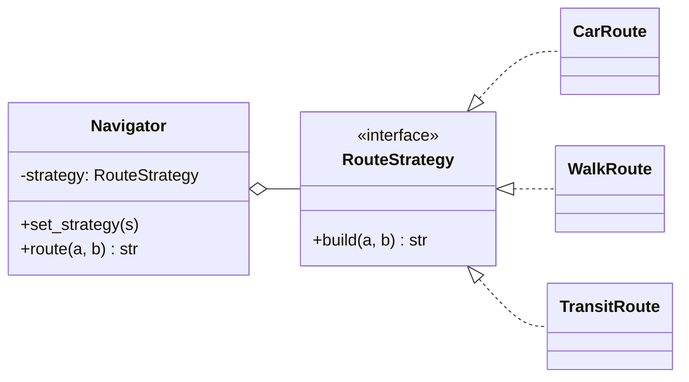
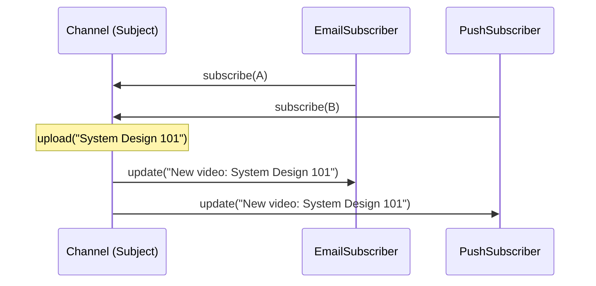
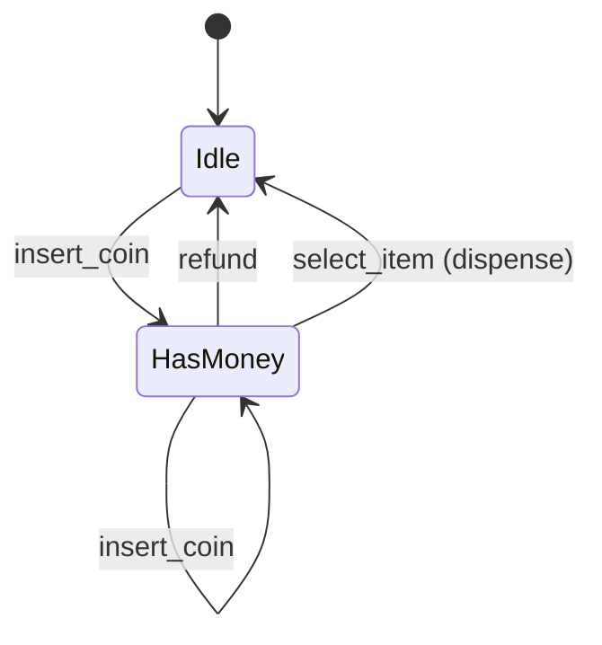
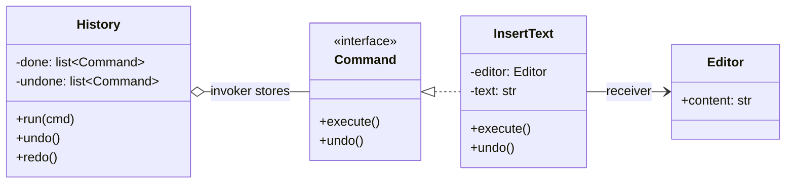
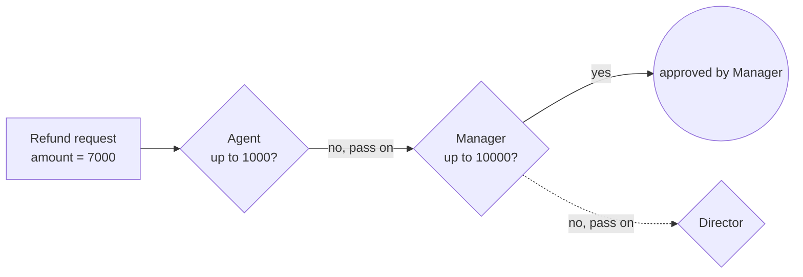
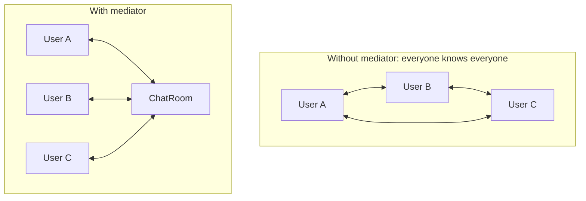

# 6. Behavioral Patterns: *how objects communicate and share work*

> Good illustrations: https://refactoring.guru/design-patterns/behavioral-patterns
> Code snippets assume `from abc import ABC, abstractmethod`.

## Why this matters
Behavioral patterns are about **who is responsible for what** and **how objects talk** without being tightly coupled. They are the most frequently used patterns in LLD interviews. Strategy, State and Observer alone appear in maybe 70% of problems.

| Pattern | Core idea | Shows up in |
|---|---|---|
| **Strategy** | Make an algorithm a swappable object | Parking spot allocation, pricing, payment, routing |
| **Observer** | Subscribers get notified when a subject changes | Notifications, stock prices, display boards |
| **State** | An object's behaviour depends on its current state; each state is a class | Vending machine, ATM, order lifecycle, traffic light |
| **Command** | Wrap a request as an object | Undo/redo, job queues, remote controls |
| **Chain of Responsibility** | Pass a request along a chain of handlers | Middleware, approvals, logging levels, cash dispensers |
| **Template Method** | Fixed algorithm skeleton; subclasses fill in steps | Parsers, report generators, game turns |
| **Iterator** | Traverse a collection without exposing its internals | Custom collections (`__iter__`) |
| **Mediator** | Objects talk through a central hub, not to each other | Chat rooms, air-traffic control, UI form logic |
| **Memento** | Capture and restore an object's state | Editor undo, game save points |
| **Visitor** | Add new operations to a class hierarchy without editing it | Compilers (AST), export to many formats |

---

## Strategy *(most asked)*

**Problem:** there are several ways to do one task (shortest route vs cheapest route, nearest spot vs cheapest spot) and you want to pick or swap the algorithm **without changing the class that uses it**.

**Solution:** put each algorithm in its own class behind a common interface. The *context* holds a strategy object and delegates to it.



```python
class RouteStrategy(ABC):
    @abstractmethod
    def build(self, a: str, b: str) -> str: ...

class CarRoute(RouteStrategy):
    def build(self, a, b): return f"drive {a} -> {b} via highway"

class WalkRoute(RouteStrategy):
    def build(self, a, b): return f"walk {a} -> {b} through the park"

class Navigator:                                   # the "context"
    def __init__(self, strategy: RouteStrategy):
        self.strategy = strategy

    def set_strategy(self, strategy: RouteStrategy) -> None:
        self.strategy = strategy                   # swap at runtime

    def route(self, a: str, b: str) -> str:
        return self.strategy.build(a, b)           # delegate, no if/else

nav = Navigator(CarRoute())
print(nav.route("Home", "Office"))
nav.set_strategy(WalkRoute())
print(nav.route("Home", "Office"))
```

**Why it's good:** Open/Closed (new algorithm = new class), each algorithm is unit-testable in isolation, and no `if mode == "car"` chains.

**Pythonic shortcut:** functions are first-class objects, so a strategy can just be a callable: `Navigator(strategy=lambda a, b: f"{a}->{b}")`. In an interview, show the class version (it is clearer and extensible) and *mention* this shortcut.

**Strategy vs State:** the structure is the same. In Strategy the **client** chooses the algorithm; in State the **object switches itself** as its state changes.

---

## Observer (Publish/Subscribe)

**Problem:** when one object changes (a new video, a price update, a spot freed), several other objects need to react, and the subject shouldn't know their concrete classes.

**Solution:** the subject keeps a list of observers behind an interface and calls `update()` on each when something happens. Observers subscribe and unsubscribe themselves.



```python
class Subscriber(ABC):
    @abstractmethod
    def update(self, event: str) -> None: ...

class Channel:
    def __init__(self, name: str):
        self.name = name
        self._subscribers: list[Subscriber] = []

    def subscribe(self, s: Subscriber) -> None:
        self._subscribers.append(s)

    def unsubscribe(self, s: Subscriber) -> None:
        self._subscribers.remove(s)

    def upload(self, title: str) -> None:
        # Iterate over a copy: an observer may unsubscribe while being notified.
        for s in list(self._subscribers):
            s.update(f"[{self.name}] New video: {title}")

class EmailSubscriber(Subscriber):
    def __init__(self, email: str): self.email = email
    def update(self, event): print(f"email to {self.email}: {event}")

class PushSubscriber(Subscriber):
    def update(self, event): print(f"push: {event}")

ch = Channel("TechTalks")
ch.subscribe(EmailSubscriber("a@x.com"))
ch.subscribe(PushSubscriber())
ch.upload("System Design 101")
```

**Things interviewers probe:**
- **Push vs pull:** pass the data in `update(event)` (push), or pass the subject so observers fetch what they need (pull).
- **Slow observers:** notifications run synchronously in the subject's thread, so one slow observer blocks everyone. Fix with a queue or thread pool. At system scale this becomes a **message broker** (Kafka, SNS); see [HLD messaging](../hld/06-messaging.md).
- **Memory leaks:** forgotten subscriptions keep objects alive. Always provide `unsubscribe`, or use `weakref`.

---

## State

**Problem:** an object behaves differently depending on its state, and every method turns into a big `if state == ...: elif ...:` block. Adding a state means editing every method.

**Solution:** make each state a class with the same interface. The *context* holds the current state object and delegates to it; states trigger transitions by setting the context's next state.



```python
class State(ABC):
    """Default behaviour: reject the action. Subclasses override what's valid."""
    def insert_coin(self, m: "Machine") -> None:
        print(f"{type(self).__name__}: can't insert coin now")
    def select(self, m: "Machine") -> None:
        print(f"{type(self).__name__}: can't select now")
    def refund(self, m: "Machine") -> None:
        print(f"{type(self).__name__}: nothing to refund")

class Idle(State):
    def insert_coin(self, m):
        m.coins += 1
        print("coin accepted")
        m.state = HasMoney()

class HasMoney(State):
    def insert_coin(self, m):
        m.coins += 1
        print("another coin accepted")
    def select(self, m):
        print(f"dispensing (paid {m.coins} coins)")
        m.coins = 0
        m.state = Idle()
    def refund(self, m):
        print(f"refunding {m.coins} coins")
        m.coins = 0
        m.state = Idle()

class Machine:                           # the context
    def __init__(self):
        self.state: State = Idle()
        self.coins = 0
    def insert_coin(self): self.state.insert_coin(self)
    def select(self):      self.state.select(self)
    def refund(self):      self.state.refund(self)

m = Machine()
m.select()        # Idle: can't select now
m.insert_coin()   # coin accepted
m.select()        # dispensing (paid 1 coins)
```

**Why it's good:** each state's rules live in one small class; invalid actions are handled by the default; adding `MaintenanceState` touches no existing state. A full version is in [problems/vending_machine](problems/vending_machine/README.md).

**Interview tip:** always draw the **state diagram first**. It *is* the specification, and the code follows from it mechanically.

---

## Command

**Problem:** you want to queue, log, schedule or **undo** operations. A plain method call disappears once it has run.

**Solution:** turn each request into an object with `execute()` (and often `undo()`). An *invoker* runs commands and can store them.



```python
class Editor:                                  # the "receiver": does the real work
    def __init__(self): self.content = ""

class Command(ABC):
    @abstractmethod
    def execute(self) -> None: ...
    @abstractmethod
    def undo(self) -> None: ...

class InsertText(Command):
    def __init__(self, editor: Editor, text: str):
        self.editor, self.text = editor, text
    def execute(self):
        self.editor.content += self.text
    def undo(self):
        self.editor.content = self.editor.content[: -len(self.text)]

class History:                                  # the "invoker"
    def __init__(self):
        self.done: list[Command] = []
        self.undone: list[Command] = []
    def run(self, cmd: Command):
        cmd.execute()
        self.done.append(cmd)
        self.undone.clear()                     # a new action invalidates the redo stack
    def undo(self):
        if self.done:
            cmd = self.done.pop()
            cmd.undo()
            self.undone.append(cmd)
    def redo(self):
        if self.undone:
            cmd = self.undone.pop()
            cmd.execute()
            self.done.append(cmd)

ed, h = Editor(), History()
h.run(InsertText(ed, "Hello "))
h.run(InsertText(ed, "World"))
h.undo();  print(repr(ed.content))   # 'Hello '
h.redo();  print(repr(ed.content))   # 'Hello World'
```

Other uses: task queues (a serialised command is a "job"), macros (a list of commands), transactional rollback.

---

## Chain of Responsibility

**Problem:** a request might be handled by one of several handlers (or by several in turn), and the sender shouldn't need to know which.

**Solution:** link handlers into a chain. Each handler either handles the request, passes it to the next, or both.

**Classic form** (exactly one handler takes it), e.g. a support escalation:


```python
class Approver(ABC):
    def __init__(self, limit: int, nxt: "Approver | None" = None):
        self.limit, self.next = limit, nxt

    def approve(self, amount: int) -> str:
        if amount <= self.limit:
            return f"approved by {type(self).__name__}"
        if self.next is None:
            return "rejected: exceeds every limit"
        return self.next.approve(amount)        # pass along the chain

class Agent(Approver): pass
class Manager(Approver): pass
class Director(Approver): pass

chain = Agent(1_000, Manager(10_000, Director(100_000)))
print(chain.approve(7_000))     # approved by Manager
```

**Variant** where every handler does part of the work, e.g. an ATM dispensing notes:
```python
class NoteDispenser:
    def __init__(self, note: int, nxt: "NoteDispenser | None" = None):
        self.note, self.next = note, nxt
    def dispense(self, amount: int) -> None:
        count, rest = divmod(amount, self.note)
        if count:
            print(f"{count} x {self.note}")
        if rest:
            if self.next is None:
                raise ValueError(f"cannot dispense remaining {rest}")
            self.next.dispense(rest)

NoteDispenser(2000, NoteDispenser(500, NoteDispenser(100))).dispense(3700)
# 1 x 2000, 3 x 500, 2 x 100
```
(A real ATM checks note availability and feasibility *before* dispensing anything.)

Python web frameworks' **middleware** (auth -> logging -> rate limit -> handler) is a chain of responsibility.

---

## Template Method

**Problem:** several classes follow the same overall algorithm but differ in a few steps. Copying the skeleton into each one duplicates code.

**Solution:** the base class defines the algorithm (the *template method*) and calls abstract "hook" steps that subclasses implement.

```python
class DataImporter(ABC):
    def run(self, path: str) -> list[dict]:     # the template: fixed order of steps
        raw = self.read(path)
        rows = self.parse(raw)                  # varies per subclass
        valid = [r for r in rows if self.validate(r)]
        print(f"imported {len(valid)}/{len(rows)} rows")
        return valid

    def read(self, path: str) -> str:           # shared default step
        with open(path, encoding="utf-8") as f:
            return f.read()

    @abstractmethod
    def parse(self, raw: str) -> list[dict]: ...

    def validate(self, row: dict) -> bool:      # optional hook with a default
        return bool(row)

class CSVImporter(DataImporter):
    def parse(self, raw):
        header, *lines = raw.splitlines()
        keys = header.split(",")
        return [dict(zip(keys, line.split(","))) for line in lines]

class JSONImporter(DataImporter):
    def parse(self, raw):
        import json
        return json.loads(raw)
```

**Template Method vs Strategy:** Template Method varies steps through **inheritance** (subclasses override). Strategy varies the whole algorithm through **composition** (inject an object). Composition is usually more flexible, but Template Method is simpler when the skeleton is truly fixed.

---

## Iterator

**Problem:** clients need to loop over a collection without knowing whether it's a list, a tree or a paginated API.

**Solution in Python:** implement `__iter__`. A **generator** function (using `yield`) is the easiest way to write an iterator.

```python
class Playlist:
    def __init__(self, songs: list[str]):
        self._songs = songs

    def __iter__(self):                     # supports: for s in playlist
        yield from self._songs

    def shuffled(self):                     # alternative traversal order
        import random
        order = self._songs[:]
        random.shuffle(order)
        yield from order

for song in Playlist(["a", "b", "c"]):
    print(song)
```

---

## Mediator

**Problem:** many objects talk directly to each other, creating a tangled web of dependencies (N objects means up to N x (N-1) links).

**Solution:** objects talk only to a **mediator**, which routes messages. Each object depends on just one thing.



```python
class ChatRoom:                                  # the mediator
    def __init__(self): self.users: dict[str, "User"] = {}
    def join(self, user: "User"):
        self.users[user.name] = user
        user.room = self
    def send(self, sender: str, msg: str, to: str | None = None):
        targets = [self.users[to]] if to else [u for n, u in self.users.items() if n != sender]
        for u in targets:
            u.receive(sender, msg)

class User:
    def __init__(self, name: str):
        self.name, self.room = name, None
    def say(self, msg: str, to: str | None = None):
        self.room.send(self.name, msg, to)       # users never reference each other
    def receive(self, sender: str, msg: str):
        print(f"{self.name} got from {sender}: {msg}")
```

**Mediator vs Observer:** Observer is one-to-many broadcasting. Mediator centralises *many-to-many* coordination logic.

---

## Memento

**Problem:** you need undo or snapshots, but exposing an object's internals so others can save them breaks encapsulation.

**Solution:** the object itself produces an opaque **memento** (snapshot) and can restore from one. A *caretaker* stores mementos without looking inside.

```python
from dataclasses import dataclass

@dataclass(frozen=True)
class EditorMemento:            # immutable snapshot
    content: str
    cursor: int

class TextEditor:
    def __init__(self): self.content, self.cursor = "", 0
    def type(self, s: str):
        self.content += s
        self.cursor = len(self.content)
    def save(self) -> EditorMemento:
        return EditorMemento(self.content, self.cursor)
    def restore(self, m: EditorMemento):
        self.content, self.cursor = m.content, m.cursor

ed, snapshots = TextEditor(), []       # snapshots = the caretaker
ed.type("Hello"); snapshots.append(ed.save())
ed.type(" World")
ed.restore(snapshots.pop())
print(ed.content)   # Hello
```

**Memento vs Command for undo:** Memento stores **state** snapshots (simple, but memory-heavy). Command stores **operations** and knows how to reverse them (compact, but each command needs a correct `undo`).

---

## Visitor

**Problem:** you have a stable class hierarchy (shapes, AST nodes, invoice items) and keep needing new operations on it (area, export to JSON, tax). Adding a method to every class each time violates Open/Closed.

**Solution:** put each operation in a **visitor** class with one method per element type. Elements just `accept(visitor)`, which calls the right method (double dispatch).

```python
class Shape(ABC):
    @abstractmethod
    def accept(self, v: "ShapeVisitor"): ...

class Circle(Shape):
    def __init__(self, r): self.r = r
    def accept(self, v): return v.visit_circle(self)

class Rect(Shape):
    def __init__(self, w, h): self.w, self.h = w, h
    def accept(self, v): return v.visit_rect(self)

class ShapeVisitor(ABC):
    @abstractmethod
    def visit_circle(self, c: Circle): ...
    @abstractmethod
    def visit_rect(self, r: Rect): ...

class AreaVisitor(ShapeVisitor):                  # a new operation = a new visitor
    def visit_circle(self, c): return 3.14159 * c.r ** 2
    def visit_rect(self, r): return r.w * r.h

class JSONVisitor(ShapeVisitor):
    def visit_circle(self, c): return {"type": "circle", "r": c.r}
    def visit_rect(self, r): return {"type": "rect", "w": r.w, "h": r.h}

shapes = [Circle(1), Rect(2, 3)]
print([s.accept(AreaVisitor()) for s in shapes])   # [3.14159, 6]
```

**Trade-off:** adding operations is easy; adding a new *element type* means updating every visitor. Use it when the types are stable and the operations keep growing. Python alternative: `functools.singledispatch`.

---

## Check yourself
1. Strategy and State have the same class structure. What is the real difference?
2. Why does `Channel.upload()` iterate over `list(self._subscribers)` instead of the list itself?
3. How would you add *redo* to an undo system built with Command?
4. When would you pick Memento over Command for undo?
5. Name a pattern from this page that Python web-framework middleware uses.
