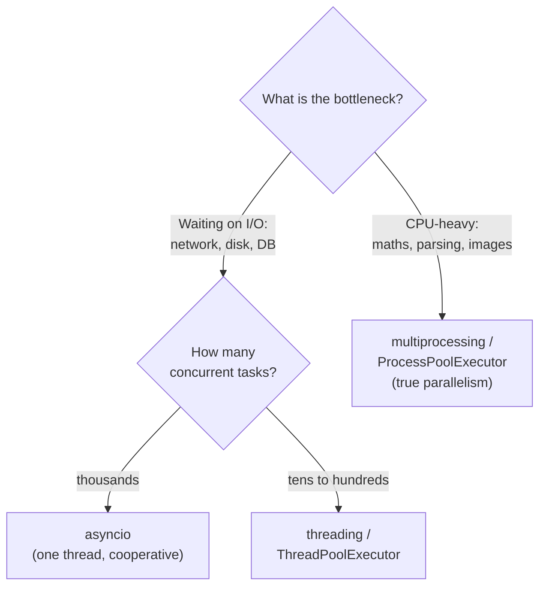
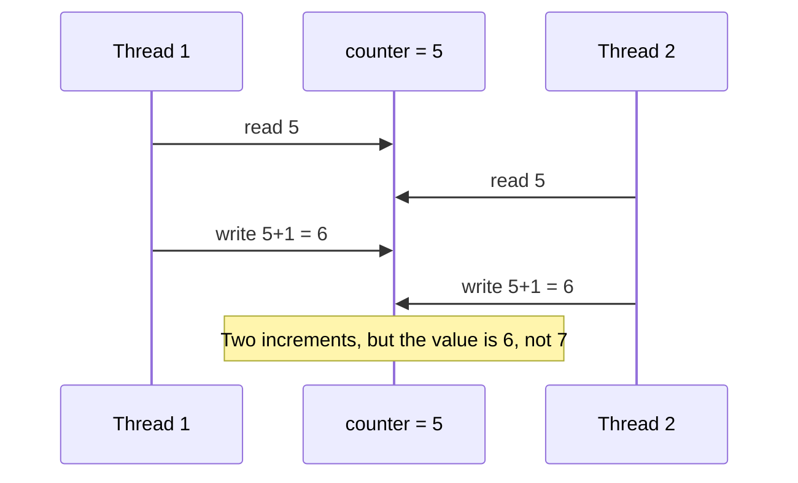
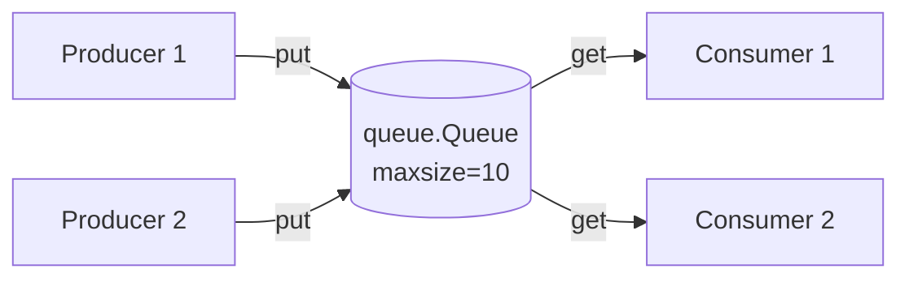
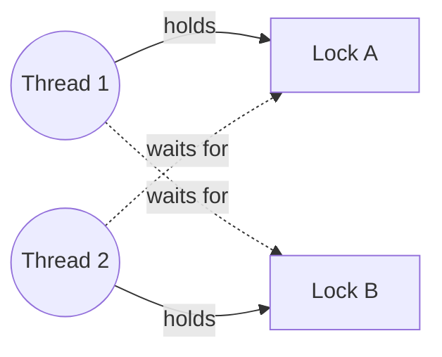

# 7. Concurrency in Python

## Why this matters
Almost every LLD interview ends with **"What if two users do this at the same time?"** Two drivers at different gates grab the same parking spot; two users book the same seat; two threads increment a counter. You need to:
1. **spot** the shared mutable state,
2. explain the **race condition**,
3. fix it with the **right primitive** at the **right granularity**.

---

## Concurrency vs parallelism
- **Concurrency:** several tasks are *in progress* at once and take turns (one cook juggling three pans).
- **Parallelism:** several tasks *execute at the same instant* on different CPU cores (three cooks).

Python offers three models:



| Model | How it runs | Best for | Shared memory? |
|---|---|---|---|
| `threading` | OS threads, one process | I/O-bound work, blocking libraries | Yes, so you need locks |
| `asyncio` | One thread; tasks voluntarily yield at `await` | Huge numbers of network connections | Yes, but switches only happen at `await` |
| `multiprocessing` | Separate processes, each with its own interpreter | CPU-bound work | No; communicate via queues/pipes |

### The GIL (Global Interpreter Lock)
In standard CPython, only **one thread executes Python bytecode at a time**. Consequences:
- Threads do **not** speed up CPU-bound Python code; use processes for that.
- Threads **do** help I/O-bound code, because the GIL is released while waiting on the network or disk.
- **The GIL does not make your code thread-safe.** The interpreter can switch threads *between* bytecode instructions, and `count += 1` is several instructions (read, add, write). Race conditions are real.

> Python 3.13 introduced an optional **free-threaded build** (no GIL, PEP 703), experimental at first and officially supported from 3.14. The default build still has the GIL. Either way, correct code needs locks around shared state.

---

## Race conditions

A **race condition** happens when the result depends on the unlucky timing of threads. The classic case is the **lost update**:



Another classic is **check-then-act**: `if spot.is_free(): spot.assign(car)`. Two threads both see "free", and both assign. This is exactly the parking-lot and seat-booking bug.

The fix is to make the read-modify-write or check-then-act sequence **atomic**: only one thread can be inside it at a time. That protected region is the **critical section**.

```python
import threading

class Counter:
    def __init__(self):
        self.value = 0
        self._lock = threading.Lock()

    def increment(self) -> None:
        with self._lock:            # acquire... (released automatically, even on exception)
            self.value += 1         # critical section

c = Counter()
threads = [threading.Thread(target=lambda: [c.increment() for _ in range(100_000)]) for _ in range(4)]
for t in threads: t.start()
for t in threads: t.join()
print(c.value)                      # always 400000 with the lock
```

Always use `with lock:` rather than manual `acquire()`/`release()`. If an exception happens between manual calls, the lock is never released and every other thread hangs.

---

## The toolkit

| Primitive | What it does | LLD use case |
|---|---|---|
| `Lock` | Only one holder at a time | Protect a seat, a balance, a spot assignment |
| `RLock` | Re-entrant: the *same* thread can acquire it again | A locked method that calls another locked method on the same object |
| `Semaphore(n)` | Up to *n* holders at a time | Connection pool of size n, limiting concurrent downloads |
| `Condition` | Wait until some condition becomes true, with notification | Bounded buffers, "wait until an elevator arrives" |
| `Event` | A one-shot flag threads can wait on | Shutdown signal, "initialisation done" |
| `queue.Queue` | Thread-safe FIFO with blocking `put`/`get` | Producer-consumer, job queues, async logging |
| `ThreadPoolExecutor` | Reusable pool of worker threads | Fan out many I/O calls in parallel |

### Semaphore example: limit concurrent access
```python
import threading, time

pool = threading.Semaphore(3)        # at most 3 "connections" in use

def query(i: int):
    with pool:                       # blocks if 3 threads are already inside
        print(f"query {i} running")
        time.sleep(0.1)

ts = [threading.Thread(target=query, args=(i,)) for i in range(10)]
for t in ts: t.start()
for t in ts: t.join()
```

---

## Producer-consumer

A very common pattern: some threads **produce** work items, others **consume** them, and a **bounded queue** sits in between. The queue handles all the locking for you, and its size limit applies **back-pressure**: fast producers block instead of using unlimited memory.



```python
import queue, threading

jobs: queue.Queue[int | None] = queue.Queue(maxsize=10)   # put() blocks when full

def producer(n: int):
    for i in range(n):
        jobs.put(i)

def consumer(name: str):
    while True:
        item = jobs.get()           # blocks while empty
        if item is None:            # "poison pill" = shutdown signal
            jobs.task_done()
            break
        print(f"{name} processed {item}")
        jobs.task_done()

workers = [threading.Thread(target=consumer, args=(f"C{i}",)) for i in range(2)]
for w in workers: w.start()
producer(5)
for _ in workers: jobs.put(None)    # one pill per consumer
jobs.join()                         # wait until every item is marked done
for w in workers: w.join()
```

---

## Lock granularity

| Approach | Example | Pro | Con |
|---|---|---|---|
| **Coarse-grained**: one big lock | One lock for the whole cinema | Simple, hard to get wrong | Every booking waits on every other booking |
| **Fine-grained**: many small locks | One lock per show, or per seat | High concurrency | More complex; risk of deadlock when taking several locks |

```python
class Seat:
    def __init__(self, seat_id: str):
        self.id = seat_id
        self.booked_by: str | None = None
        self.lock = threading.Lock()          # one lock PER seat

    def try_book(self, user: str) -> bool:
        with self.lock:                       # check-then-act is now atomic
            if self.booked_by is None:
                self.booked_by = user
                return True
            return False
```

**Interview answer template:** *"The shared state is X. The race is check-then-act on X. I'll protect it with a lock per Y, so unrelated Ys don't block each other."*

---

## Deadlock

A deadlock happens when threads wait for each other forever. Thread 1 holds lock A and wants B; thread 2 holds B and wants A.



It needs **all four Coffman conditions**. Break any one to prevent it:
1. **Mutual exclusion:** a resource is held by one thread at a time.
2. **Hold and wait:** a thread holds one lock while waiting for another.
3. **No preemption:** locks can't be taken away.
4. **Circular wait:** a cycle of threads each waiting on the next.

**Practical fixes**
- **Global lock ordering** (breaks circular wait). When booking seats A5 and A6, always lock in sorted order:
  ```python
  def book_many(seats: list[Seat], user: str) -> bool:
      ordered = sorted(seats, key=lambda s: s.id)      # same order for every thread
      for s in ordered: s.lock.acquire()
      try:
          if any(s.booked_by for s in ordered):
              return False                              # all-or-nothing
          for s in ordered: s.booked_by = user
          return True
      finally:
          for s in reversed(ordered): s.lock.release()
  ```
- **Timeouts:** `lock.acquire(timeout=1)`; back off and retry if it fails.
- **Fewer locks:** a single coarse lock can't deadlock with itself (unless you re-acquire a non-reentrant `Lock`).

---

## Thread-safe Singleton & other idioms
- Double-checked locking for singletons: see [creational patterns](04-creational-patterns.md).
- Immutable objects (`@dataclass(frozen=True)`) are automatically thread-safe to share.
- Prefer passing messages through a `Queue` over sharing mutable objects.

---

## asyncio in brief

`asyncio` runs many tasks on **one thread**. A task runs until it hits `await`, then the event loop switches to another ready task. Because switches happen only at `await`, code between awaits can't be interrupted. You still need `asyncio.Lock` if a critical section contains an `await`.

```python
import asyncio

async def fetch(i: int) -> int:
    await asyncio.sleep(1)          # simulated network call: yields control while waiting
    return i * 2

async def main():
    results = await asyncio.gather(*(fetch(i) for i in range(100)))
    print(sum(results))             # takes ~1 second total, not 100

asyncio.run(main())
```

Rules of thumb:
- Never call blocking functions (`time.sleep`, `requests.get`) inside async code. They freeze the whole event loop. Use `await asyncio.sleep`, `aiohttp`/`httpx`, or `await asyncio.to_thread(blocking_fn)`.
- Use `asyncio.Lock`, `asyncio.Queue` and `asyncio.Semaphore`, not their `threading` versions.

---

## Check yourself
1. Why is `count += 1` unsafe across threads even with the GIL?
2. What is a check-then-act race? Give an example from a parking lot.
3. When would you use `RLock` instead of `Lock`?
4. Two threads each need locks on seats A3 and A7. How do you guarantee no deadlock?
5. Why would `time.sleep(1)` inside an `async def` be a bug?
