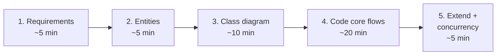

# 8. LLD Interview Framework (45 minutes)

## Why a framework?
Under interview pressure it's tempting to start coding immediately. That usually produces a tangled design that collapses at the first follow-up question. A fixed routine keeps you calm, makes your thinking visible, and gets you to working code within the time limit.



---

## Step 1: Clarify requirements (~5 min)

The problem statement is deliberately vague. Your first job is to **narrow the scope** and **write it down**, so you and the interviewer agree on what "done" means.

Questions to ask:
- **Actors:** who uses the system? (customer, admin, the system itself)
- **Core use cases:** what are the 3-5 must-have operations?
- **Out of scope:** payments? authentication? UI? persistence?
- **Rules and constraints:** sizes, limits, pricing rules, edge cases
- **Concurrency:** is it multi-threaded? (assume yes if there are multiple entry points, such as gates, users or ATMs)

Write the result as a numbered list, for example for a parking lot:
```
1. Multiple floors; spot types: motorcycle, compact, large.
2. Vehicle types: bike, car, truck. Each fits a specific spot type.
3. On entry: assign a spot, issue a ticket. On exit: charge by hours, free the spot.
4. Spot allocation policy should be changeable.
5. Several gates operate concurrently.
Out of scope: payment gateway integration, reservations.
```

---

## Step 2: Identify entities (~5 min)

**The noun/verb trick:** describe the main use cases in sentences. **Nouns become candidate classes; verbs become methods.**

> "A **driver** *parks* a **vehicle** in a **spot** on a **floor**, receives a **ticket**, and *pays* a **fee** at the **exit gate**."

- Candidate classes: `Vehicle, ParkingSpot, ParkingFloor, ParkingLot, Ticket, ExitGate`
- Methods: `park()`, `unpark()`, `calculate_fee()`

Then filter:
- Some nouns are just **attributes** (`fee` is a number on the ticket; `color` is a field).
- Some nouns are **enums** (vehicle type, spot type, status).
- Some nouns are **actors** outside the system (`driver` might not need a class).
- Things that **vary** (allocation policy, pricing) become **interfaces** (Strategy).

---

## Step 3: Class diagram (~10 min)

Draw boxes for the core classes, then:
- **Relationships and multiplicity** (who owns whom, one vs many). See [UML](03-uml.md).
- **Enums** for fixed sets (`VehicleType`, `SpotStatus`).
- **Interfaces** for variation points, with the pattern named out loud: *"Spot allocation is a Strategy, so we can swap nearest-first for cheapest-first without touching ParkingLot."*
- **Entities vs services:** `Ticket` holds data; `ParkingLot` coordinates.

Pause and ask: *"Does this structure look reasonable before I start coding?"* It's much cheaper to fix a diagram than code.

---

## Step 4: Code the core flows (~20 min)

Write code in this order. Each layer only depends on the ones before it:
1. **Enums**
2. **Entities / value objects** (`@dataclass`)
3. **Interfaces** (`ABC`): strategies, observers
4. **Concrete implementations** of those interfaces
5. **Service / orchestrator** class with the main use-case methods
6. A tiny **`main` demo** that exercises the happy path

Tips:
- Get the **happy path** working end to end first, then add edge cases.
- Validate inputs and raise clear exceptions (`raise RuntimeError("lot full")`).
- If time is short, leave `# TODO: handle X` comments and *say* how you'd handle X.
- Narrate as you code. Silence makes the interviewer guess.

---

## Step 5: Extensibility & concurrency (~5 min)

Run through this checklist and mention each point:
- [ ] **New type** (vehicle, payment, discount) = **new class only**? (Open/Closed)
- [ ] **Shared mutable state** identified and protected? Which lock, at what granularity?
- [ ] **Edge cases:** full capacity, double booking, invalid IDs, negative amounts, timeouts
- [ ] **Testability:** can dependencies be replaced with fakes? (Dependency Inversion)
- [ ] **Scaling up:** what changes if this ran on multiple servers? (locks move to DB/Redis; this is the bridge to HLD)

---

## Pattern lookup by problem wording

| If the problem mentions... | Reach for | Why |
|---|---|---|
| "different algorithms / policies / pricing / strategies" | **Strategy** | Swap behaviour without editing the context |
| "states", "lifecycle", "machine", "status transitions" | **State** | Each state's rules in its own class |
| "notify", "subscribe", "alert", "display board" | **Observer** | Decouple the event source from its reactions |
| "undo", "redo", "queue requests", "macro" | **Command** | Requests become storable objects |
| "create different kinds based on input/config" | **Factory** | Centralise creation |
| "exactly one manager / config / registry" | **Singleton** (mention the DI caveat) | One shared instance |
| "add features / toppings / wrappers / middleware" | **Decorator** | Stackable optional behaviour |
| "integrate a third-party API" | **Adapter** | Translate to your interface |
| "tree", "hierarchy", "nested folders/menus" | **Composite** | Treat leaf and group alike |
| "approval levels", "pipeline", "handlers in sequence" | **Chain of Responsibility** | Decouple sender from handler |
| "simplify a complex subsystem" | **Facade** | One easy entry point |

## Common LLD problems and their key ideas

| Problem | Key ideas |
|---|---|
| Parking Lot | Strategy (allocation, pricing), enum mapping, lock on assignment |
| Vending Machine / ATM | State pattern, Chain of Responsibility for cash |
| Elevator | State, Strategy (dispatch), SCAN/LOOK scheduling |
| Movie / Hotel Booking | Seat holds with expiry, locking, all-or-nothing |
| LRU / LFU Cache | HashMap + doubly linked list, O(1) operations |
| Rate Limiter | Strategy (token bucket, sliding window), time-based logic |
| Splitwise | Strategy (split types), net-balance graph simplification |
| Logger | Singleton, Chain of Responsibility (levels), Observer (sinks) |
| Chess / Tic-Tac-Toe | Board/Piece hierarchy, Strategy for move rules, Command for undo |
| Library / Inventory | Entities + services, Observer for reservation notifications |
| Pub-Sub / Message Queue | Observer, producer-consumer, thread-safe queues |

## Common mistakes
- Jumping into code before agreeing on requirements.
- A **God class** (`ParkingLotManager` that does everything).
- Strings instead of enums for types and statuses.
- Forgetting concurrency entirely, or wrapping *everything* in one global lock without explaining why.
- **Over-engineering:** ten patterns for tic-tac-toe. Use a pattern only when it solves a stated requirement.
- Storing money as `float`.
- Not testing the code mentally with one example before saying "done".
