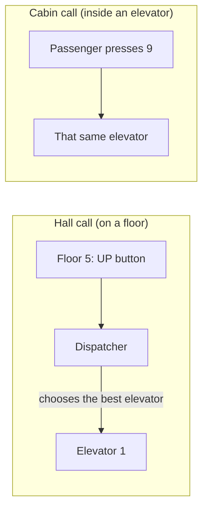
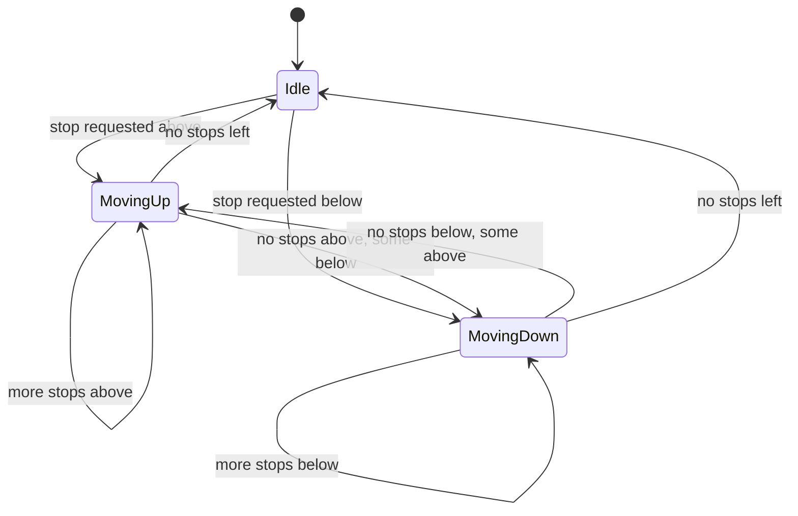
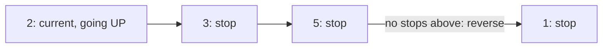
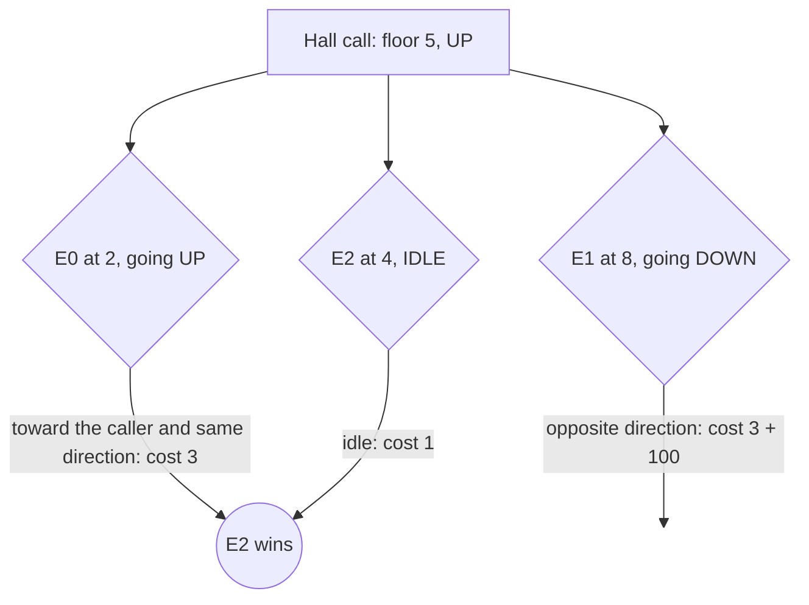
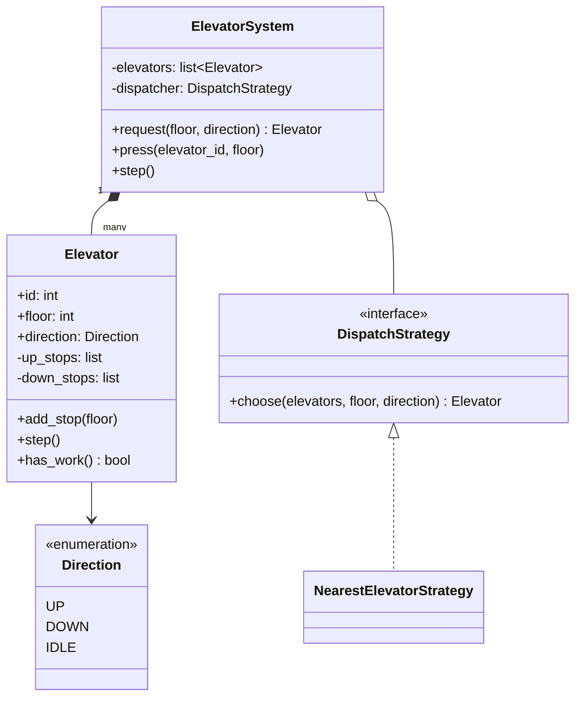

# LLD: Elevator System

Code: [elevator.py](elevator.py)

The elevator problem tests **state modelling**, a **scheduling algorithm** and a **dispatch policy**, which makes it a natural fit for State + Strategy. It's open-ended, so scoping the requirements matters even more than usual.

---

## 1. Requirements
1. A building with **N floors** and **M elevators**.
2. **Hall call (external request):** a person on floor *f* presses UP or DOWN.
3. **Cabin call (internal request):** a passenger inside presses a destination floor.
4. A **dispatcher** decides which elevator answers each hall call. The policy must be pluggable.
5. Each elevator serves stops in its current direction before reversing (the **LOOK** algorithm).

**Out of scope (mention as extensions):** weight limits, door timing, emergency mode, VIP or express floors.

---

## 2. Two kinds of requests

The difference matters for the design. A **hall call** needs a *decision* (which elevator?), so it goes through the dispatcher. A **cabin call** goes straight to the elevator the passenger is in.

---

## 3. Elevator states

The code models this with a `Direction` enum (`UP`, `DOWN`, `IDLE`), because the behaviour per state is small. If each state had rich behaviour (doors opening and closing, maintenance, emergency), you'd upgrade to the full **State pattern** with one class per state, as in the [vending machine](../vending_machine/README.md).

---

## 4. Scheduling: why LOOK?

| Algorithm | Rule | Problem |
|---|---|---|
| FCFS (first come, first served) | Serve requests in arrival order | Zig-zags up and down; terrible throughput |
| SSTF (shortest seek time first) | Always go to the nearest stop | Far floors can **starve** forever |
| SCAN ("elevator algorithm") | Sweep to the top floor, then to the bottom | Travels to the ends even with no requests there |
| **LOOK** | Sweep in one direction while there are stops ahead, then reverse | ✅ No starvation, no wasted travel |

These come from disk-head scheduling in operating systems, which is literally where the name "elevator algorithm" comes from.

### Example
The elevator is at floor 2 going **UP**, with stops at 5, 3 and 1:

Order served: **3 -> 5 -> 1**. It does not go to 1 first even though 1 is close, because it is already heading up.

### Data structure: two heaps
- `up_stops`: a **min-heap** of floors above the elevator. The next stop going up is the *smallest*.
- `down_stops`: a **max-heap** of floors below. Python's `heapq` is a min-heap only, so we store negated floors (`-floor`) to get max-heap behaviour.

When a stop arrives, it goes in `up_stops` if it's above the current floor, or `down_stops` if below. Each step, the elevator moves one floor in its direction and pops the heap top if it has arrived. When the heap for the current direction is empty, it reverses (or goes idle). Adding a stop is O(log n); peeking at the next stop is O(1).

---

## 5. Dispatch strategy: which elevator answers a hall call?

`NearestElevatorStrategy` computes a **cost** per elevator and picks the cheapest:
- **Idle** elevator: cost = distance.
- Moving **toward** the caller **in the requested direction** (e.g. going up from below for an UP call): cost = distance. It can pick them up on the way.
- Otherwise (moving away, or in the opposite direction): distance + a large penalty, because it must finish its sweep first.

Because it's a **Strategy**, other policies plug in without touching `ElevatorSystem`: zone-based (elevator A serves floors 1-10), round-robin, or energy-saving.

---

## 6. Class diagram

---

## 7. Simulation in the code
Real elevators run continuously, but a **discrete step simulation** (`system.step()` moves every elevator one floor) is far easier to reason about and test in an interview. The demo:
- E0 starts at floor 0 and E1 at floor 8.
- Hall call at 3 (UP): E0 is closer, so E0 takes it. Hall call at 7 (DOWN): E1 takes it.
- Cabin presses: E0 -> 6, E1 -> 1.
- E0 serves 3 then 6. E1 serves 7 then 1. Both go idle.

**A simplification to state out loud:** the hall-call direction is used only by the dispatcher. Once assigned, the call is a plain stop. A fuller version tags hall calls with their direction and, while sweeping up, skips a DOWN call on the way, serving it on the return sweep.

---

## 8. Concurrency (if asked)
In a real controller, button presses arrive on other threads while elevators move. Typical design:
- Each elevator runs in its **own thread**, consuming requests from a thread-safe `queue.Queue`.
- The dispatcher reads elevator positions. Protect each elevator's `floor`, `direction` and heaps with a lock, or have the elevator thread own its state exclusively and receive commands only through its queue (the **actor model**, with no shared mutable state).

## 9. Follow-up questions
| Question | Answer sketch |
|---|---|
| Capacity / overweight | Elevator tracks its load; the dispatcher skips full elevators |
| Floor display panels | **Observer**: the elevator notifies displays on every floor change |
| Emergency / fire mode | A system-wide state: all elevators go to the ground floor and ignore calls (State pattern) |
| Peak hours (morning rush) | A different dispatch strategy: park idle elevators at the lobby |
| Doors | Add a `DoorsOpen` state with a timer; the elevator can't move while the doors are open |
