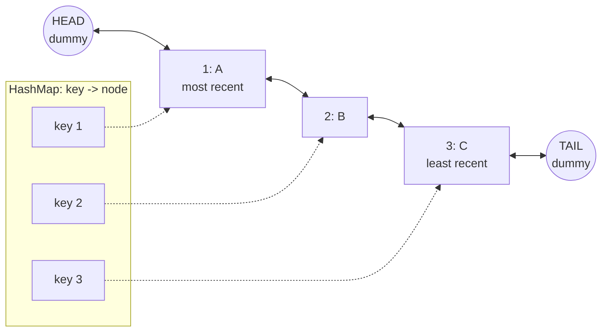
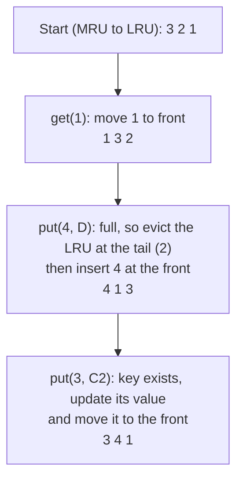
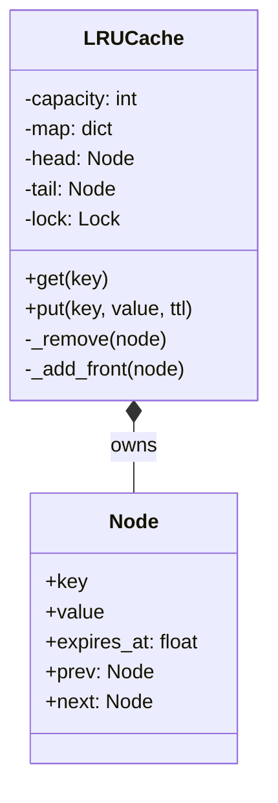

# LLD: LRU Cache

Code: [lru_cache.py](lru_cache.py)

This is one of the most frequently asked LLD/DSA hybrid questions (it's also LeetCode 146). It tests whether you can **combine two data structures** so that each covers the other's weakness.

---

## 1. Requirements
- `get(key)`: return the value, or `None` if absent. Counts as a "use".
- `put(key, value)`: insert or update. Counts as a "use".
- Fixed **capacity**. When full, evict the **Least Recently Used** entry (the one untouched for the longest time).
- Both operations in **O(1)** time.
- **Thread-safe**, because a cache is shared by request threads.
- Bonus: optional **TTL** (time-to-live) per entry.

### What "least recently used" means
Think of a stack of books on your desk. Every time you use a book, you put it on **top**. When the desk is full, you remove the book at the **bottom**: the one you haven't touched for the longest time.

---

## 2. Choosing the data structures

| Need | Hash map alone | Linked list alone | Hash map + doubly linked list |
|---|---|---|---|
| Find a key | O(1) ✅ | O(n) ❌ | O(1) via the map ✅ |
| Track usage order | ❌ no order | ✅ | ✅ list order = recency |
| Move an entry to "most recent" | n/a | O(n) to find, O(1) to move | O(1): the map gives the node, the list moves it |
| Evict the least recent | n/a | O(1) at the tail | O(1) ✅ |

So the **map** stores `key -> node`, and the **doubly linked list** keeps nodes ordered from most to least recently used.

**Why *doubly* linked?** To remove a node from the middle in O(1) you must update its *previous* node's `next` pointer. A singly linked list would need an O(n) walk to find that previous node.



**Dummy (sentinel) head and tail nodes** sit at both ends permanently. Because every real node always has a real `prev` and `next`, insert and remove never need `if node is None` special cases. This trick removes most of the bugs people write in interviews.

---

## 3. Operations step by step

Start with capacity 3, holding `1:A, 2:B, 3:C` (most recent first is `3, 2, 1`).



| Operation | Steps | Cost |
|---|---|---|
| `get(key)` | map lookup -> if missing return `None` -> unlink node -> insert after HEAD -> return value | O(1) |
| `put` (existing key) | update value -> unlink -> insert after HEAD | O(1) |
| `put` (new key, full) | node before TAIL is the LRU -> unlink it and delete its key from the map -> create node -> insert after HEAD -> add to map | O(1) |

> The node stores its **key** as well as the value. Why? When evicting the tail node, you need its key to delete it from the map.

### The two pointer helpers
```python
def _remove(self, node):            # unlink: neighbours point at each other
    node.prev.next = node.next
    node.next.prev = node.prev

def _add_front(self, node):         # insert right after the dummy head
    node.prev = self.head
    node.next = self.head.next
    self.head.next.prev = node
    self.head.next = node
```
Draw these four pointer changes on paper once; then you'll never get them wrong.

---

## 4. Class diagram


---

## 5. Thread safety
`get` is **not** read-only: it moves the node, which mutates the list. So both `get` and `put` take the same lock. A read-write lock wouldn't help, because every operation writes.

Under very heavy contention, real systems **shard** the cache: N independent LRU caches, each with its own lock, and `hash(key) % N` picks the shard.

## 6. TTL (expiry)
Each node stores `expires_at` (from `time.monotonic()`, which never jumps when the system clock changes). We use **lazy expiry**: on `get`, an expired node is deleted and treated as a miss. Expired entries that are never read again are eventually evicted by the normal LRU rule. Redis combines this lazy approach with periodic background sampling.

---

## 7. The Pythonic shortcut
`collections.OrderedDict` remembers insertion order and supports `move_to_end(key)` and `popitem(last=...)` in O(1). It is a hash map plus a doubly linked list internally, so the whole cache is about 10 lines (see `OrderedDictLRU` in the code).

```python
from collections import OrderedDict

class LRU:
    def __init__(self, cap): self.cap, self.d = cap, OrderedDict()
    def get(self, k):
        if k not in self.d: return None
        self.d.move_to_end(k)                 # most recent at the END here
        return self.d[k]
    def put(self, k, v):
        self.d[k] = v
        self.d.move_to_end(k)
        if len(self.d) > self.cap:
            self.d.popitem(last=False)        # evict from the FRONT (least recent)
```
**In an interview:** mention it, then implement the linked list manually, because that's usually what the question is testing. Also know `functools.lru_cache`, which memoises function calls.

---

## 8. Follow-ups
| Question | Answer sketch |
|---|---|
| **LFU** (least *frequently* used) | Map `key -> node`, map `freq -> doubly linked list`, track `min_freq`. Evict the LRU within the `min_freq` list. All O(1). |
| Cache **stampede** when a hot key expires | Single-flight: only one thread recomputes while the others wait (see [HLD caching](../../../hld/05-caching.md)) |
| Distributed cache | Shard keys across nodes with **consistent hashing** (see [HLD databases](../../../hld/03-databases.md)) |
| Size-based capacity (bytes, not count) | Track total bytes and evict until under the limit |
