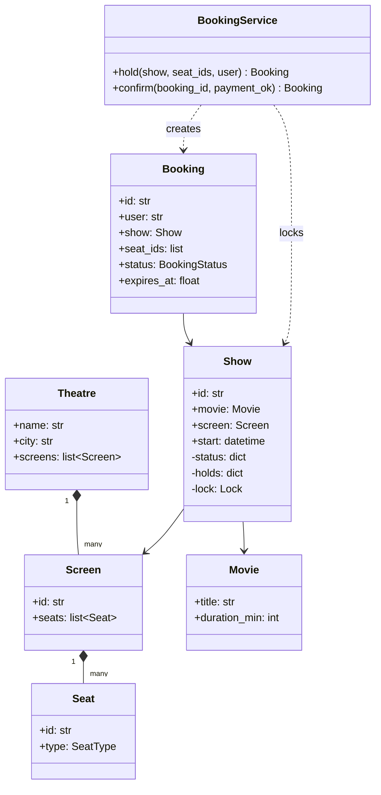
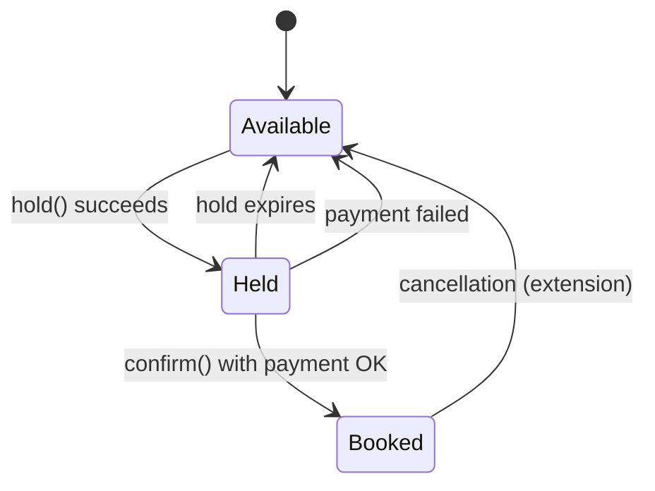
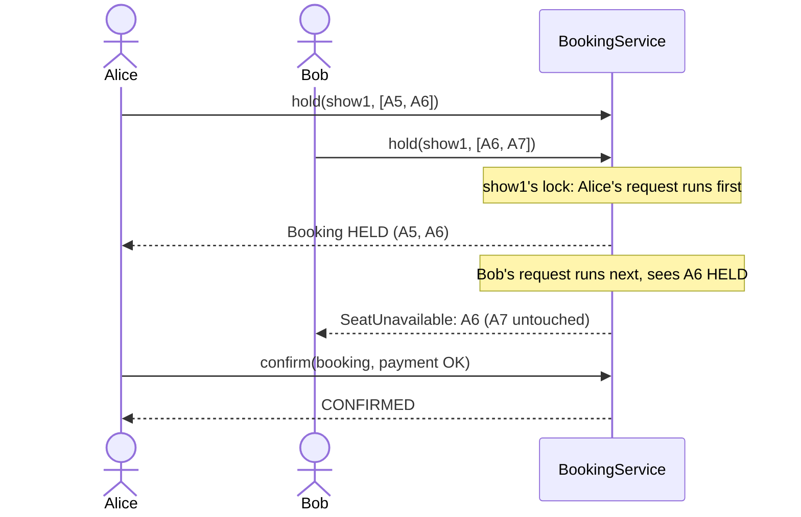

# LLD: Movie Ticket Booking (BookMyShow-style)

Code: [movie_booking.py](movie_booking.py)

This problem tests **domain modelling** (cities, theatres, screens, shows, seats) and, above all, **concurrency**: thousands of people try to grab the same seats when bookings open for a big release. The same ideas apply to hotel rooms, flight seats and event tickets.

---

## 1. Requirements

**Functional**
1. Browse movies by city; see the **shows** (movie + screen + start time) in each theatre.
2. See a show's **seat map** with seat status.
3. Select one or more seats. They are **temporarily held** (e.g. 5 minutes) while the user pays.
4. Payment success **confirms** the booking. Payment failure or timeout **releases** the seats.

**Non-functional**
- **No double booking, ever**, even with many concurrent users.
- Multi-seat selection is **all-or-nothing**: you never end up with 2 of the 3 seats you asked for.
- Bookings for different shows should not slow each other down.

---

## 2. Domain model

The key insight: **a seat's status belongs to a show, not to the seat**. Seat A5 in Screen 1 is a physical chair that exists for years; it's *booked* only for the 7 pm show of a particular movie. So `Seat` is static layout and `Show` holds the per-seat status.



(The code simplifies `Theatre`/`Screen` away and gives `Show` a seat list directly, to focus on the booking logic.)

---

## 3. Seat lifecycle



**Why a HELD state?** Payment takes time (OTPs, bank redirects). Without holds, either two users pay for the same seat, or you'd lock seats indefinitely. A hold with an **expiry** reserves the seat for a limited time and releases it automatically if the user abandons checkout.

---

## 4. The concurrency problem



Without the lock, both requests could check "is A6 available?", both see **yes**, and both hold it. This is the classic **check-then-act race** (see [concurrency](../../07-concurrency.md)).

### How the code prevents it
```python
with show.lock:                                   # 1. exclusive access to this show
    self._release_expired(show)                   # 2. free timed-out holds first
    taken = [s for s in seat_ids if show.status[s] != SeatStatus.AVAILABLE]
    if taken:                                     # 3. check ALL seats before touching any
        raise SeatUnavailable(...)
    for s in seat_ids:                            # 4. then mark them all
        show.status[s] = SeatStatus.HELD
```
- **Lock per show** (fine-grained): Avengers bookings don't block Barbie bookings. A lock per *seat* would allow even more concurrency, but multi-seat booking would then need several locks taken in a consistent order to avoid deadlock. Per show is the sweet spot.
- **All-or-nothing** comes from checking every seat before modifying any, inside the same critical section.

### Expiry: lazy cleanup
Instead of a background thread, expired holds are released **lazily** at the start of the next `hold()` on that show. Each show keeps only its active holds (`show.holds`), so this scan is cheap. `confirm()` also checks the expiry: a user who pays after the deadline is rejected, because their seats may already belong to someone else.

### Idempotent confirm
Payment gateways retry callbacks. Calling `confirm()` twice on a confirmed booking simply returns it instead of failing or double-charging. **Idempotency** is a theme you'll meet again in HLD.

---

## 5. Scaling beyond one process

An in-process `threading.Lock` only works when every request hits the same server. With many servers you move the guarantee into shared storage:

| Approach | How it works | Good for |
|---|---|---|
| **DB pessimistic lock** | `SELECT ... FROM show_seats WHERE show_id=? AND seat_id IN (...) FOR UPDATE` inside a transaction | Moderate traffic; strong guarantees |
| **DB optimistic / conditional update** | `UPDATE show_seats SET status='HELD', user=?, hold_until=? WHERE show_id=? AND seat_id IN (...) AND status='AVAILABLE'`, then check that the affected row count equals the number of seats requested (otherwise roll back) | High read/low conflict; no long-held locks |
| **Redis holds** | `SET hold:{show}:{seat} {user} NX EX 300` per seat (atomic, auto-expiring). Release all if any fails | Very hot shows; holds expire by themselves |
| **Unique constraint** | `UNIQUE(show_id, seat_id)` on confirmed bookings: the DB rejects the second insert | A final safety net, always worth having |

**Interview line:** *"Single process: a lock per show. Multiple servers: a conditional UPDATE in the database (or Redis SET NX with TTL for holds), with a unique constraint as the last line of defence."*

---

## 6. What the demo shows
1. Alice holds A5+A6; Bob's request for A6+A7 is rejected, and **A7 stays available** (all-or-nothing).
2. Carol's hold expires; Dave can then hold the same seat; Carol's late payment is rejected.
3. A failed payment releases the seats.
4. 20 threads race for one seat: **exactly 1** wins.

## 7. Follow-up questions
| Question | Answer sketch |
|---|---|
| Different seat prices (recliner, premium) | `SeatType` enum + a `PricingStrategy`; dynamic pricing as another strategy |
| Notify the user when the hold is about to expire | Scheduler / delayed queue; **Observer** for notifications |
| Cancellations and refunds | `Booked -> Available` transition + a refund workflow; the booking keeps a status history |
| Waitlist for sold-out shows | Queue per show; when seats free up, notify the next user (Observer) |
| Prevent bots grabbing every seat | Rate limiting + a cap on seats per user per show |
| Seat map read traffic is huge | Cache the seat map with a very short TTL; the hold path always checks the source of truth |
