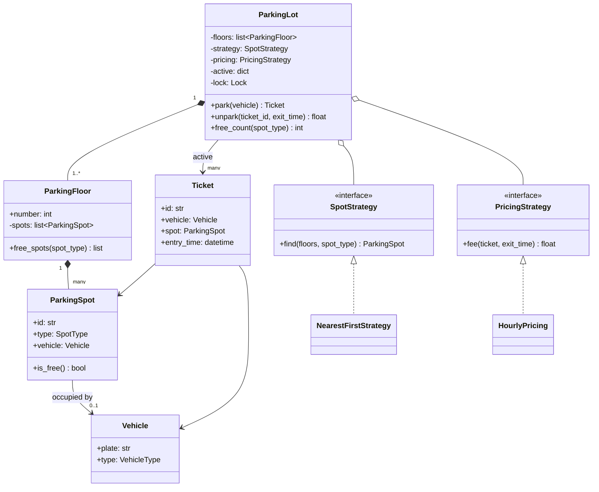
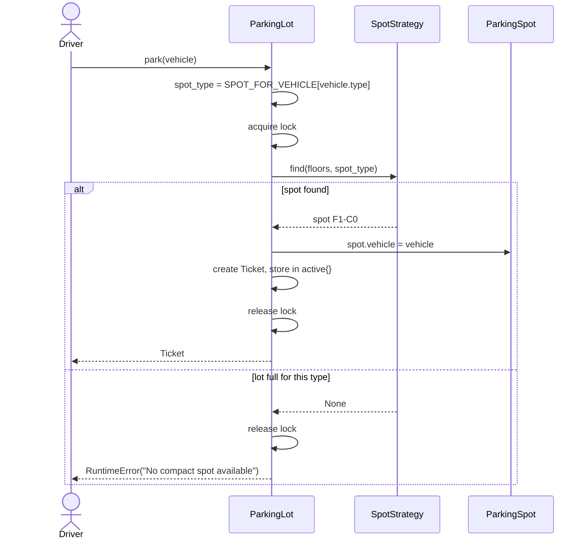
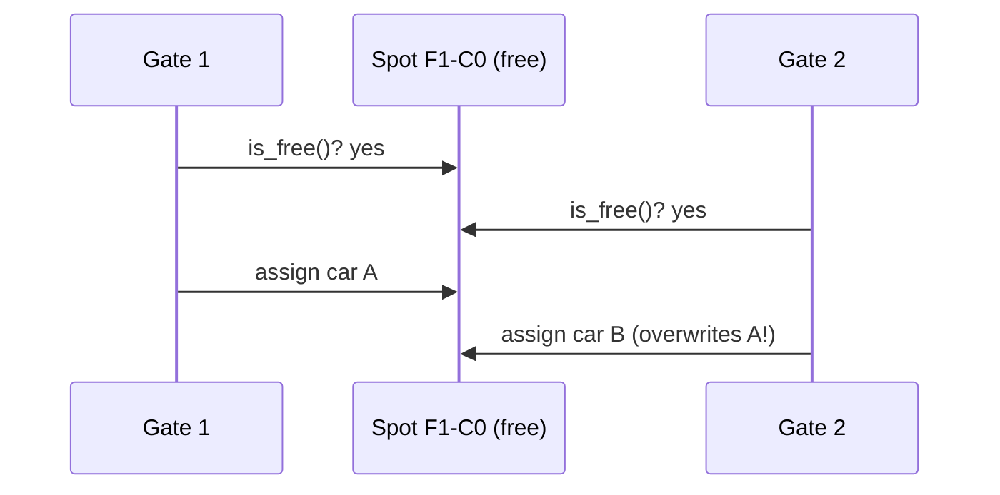

# LLD: Parking Lot

Code: [parking_lot.py](parking_lot.py). Run it with `python parking_lot.py`.

The parking lot is the "hello world" of LLD interviews. It looks simple, but it tests everything: modelling entities, choosing enums vs classes, using Strategy for policies, and handling concurrency at the gates.

---

## 1. Requirements (agree on these first)

**Functional**
1. The lot has multiple **floors**; each floor has **spots** of three types: `MOTORCYCLE`, `COMPACT`, `LARGE`.
2. Vehicles: **bike** needs a motorcycle spot, **car** a compact spot, **truck** a large spot.
3. **Entry:** find a free spot of the right type, mark it occupied, issue a **ticket**.
4. **Exit:** given the ticket, compute the **fee** from the parked duration and free the spot.
5. The **spot-finding policy** and the **pricing policy** must be easy to change.

**Non-functional**
- Multiple entry and exit gates operate **concurrently**: two cars must never get the same spot.
- Lookups at exit should be fast (O(1) by ticket id).

**Out of scope:** payment gateways, reservations, license-plate cameras.

> Clarifying questions worth asking: can a car use a large spot if compact ones are full? Is pricing per hour or flat? Are there EV/handicapped spots? Here we keep a strict mapping and hourly pricing, and mention the alternatives as extensions.

---

## 2. Finding the entities

> "A **vehicle** enters at a **gate**. The **lot** finds a free **spot** on some **floor**, and issues a **ticket**. At exit, the lot computes a **fee** using a **pricing policy** and frees the spot."

| Noun | Becomes | Why |
|---|---|---|
| Vehicle | `@dataclass(frozen=True) Vehicle` | Pure data; immutable and hashable |
| Vehicle type, spot type | `Enum` | Fixed sets of values; typos impossible |
| Spot | `ParkingSpot` dataclass | Has state (occupied by which vehicle) |
| Floor | `ParkingFloor` | Groups spots, answers "free spots of type X" |
| Ticket | `Ticket` dataclass | Records vehicle, spot and entry time |
| Lot | `ParkingLot` service | Orchestrates park/unpark, owns the lock |
| "finds a spot" policy | `SpotStrategy` interface | It varies, so make it a Strategy |
| "pricing policy" | `PricingStrategy` interface | It varies, so make it a Strategy |

The **vehicle -> spot type** rule lives in one dictionary (`SPOT_FOR_VEHICLE`) instead of being scattered through `if` statements. That is DRY, and a new vehicle type only needs one new line.

---

## 3. Class diagram

How to read it: the lot **composes** floors (filled diamond: floors don't exist without the lot), floors compose spots, and a spot holds **zero or one** vehicle. The two strategies are **aggregated** (hollow diamond): they are created outside and injected, so they can be swapped.

---

## 4. Key flows

### Park

### Unpark
1. Under the lock: pop the ticket from `active` (an invalid or reused ticket fails here), then set `spot.vehicle = None`.
2. Outside the lock: compute the fee with the pricing strategy. It's pure computation on the ticket, so it doesn't need to hold the lock.

---

## 5. Design decisions (say these out loud)

| Decision | Reason |
|---|---|
| **Strategy** for spot allocation | Nearest-first today; "cheapest floor first" or "spread load evenly" tomorrow, with no change to `ParkingLot` (Open/Closed) |
| **Strategy** for pricing | Hourly, flat, weekend and EV pricing are each one new class |
| **Enums** for types | Typos impossible; the set of valid values is explicit |
| **Mapping dict** vehicle -> spot type | One source of truth for the fitting rule |
| **One lock** around find + assign | Finding and assigning must be **atomic**; otherwise two gates see the same free spot (a check-then-act race) |
| Tickets in a **dict** by id | O(1) lookup at exit, and a ticket can't be used twice |
| `frozen=True` `Vehicle` | Immutable value object; safe to share and hash |

### Why the lock is needed

With `with self._lock:` around find + assign, gate 2 waits until gate 1 has finished, then sees the spot as taken.

**Is one global lock OK?** For a single lot, yes: the critical section takes microseconds. If it ever became a bottleneck, you could lock **per floor**, or keep a thread-safe queue of free spots per type and `pop` from it, which is O(1) and atomic.

---

## 6. Code tour ([parking_lot.py](parking_lot.py))

| Section | What to notice |
|---|---|
| `VehicleType`, `SpotType`, `SPOT_FOR_VEHICLE` | Enums + one mapping table |
| `ParkingSpot.is_free()` | Behaviour lives next to the data it uses |
| `NearestFirstStrategy.find` | Floors are sorted, so the first free spot is the nearest |
| `HourlyPricing.fee` | Rounds **up** to whole hours, minimum 1 hour |
| `ParkingLot.park/unpark` | Lock held only for the state change |
| Demo at the bottom | 10 threads race for 4 compact spots: exactly 4 succeed, all on unique spots |

**Complexity:** `park` is O(total spots) in the worst case because the strategy scans floors. Fine for interviews; the optimisation is to keep a **set/queue of free spots per (floor, type)** for O(1) allocation.

---

## 7. Edge cases
- Lot full for that vehicle type -> clear error (or a waiting queue as an extension).
- Invalid or already-used ticket -> `KeyError`.
- Exit time before entry time -> clamp to the minimum charge (the code charges at least 1 hour).
- The same vehicle parked twice -> could be rejected by tracking active plates (good follow-up).

## 8. Follow-up questions interviewers ask
| Question | Answer sketch |
|---|---|
| Add EV charging spots | New `SpotType.EV`, update the mapping, plus an `EVPricing` strategy |
| Allow a car in a large spot when compact is full | A strategy that tries a list of compatible spot types in order |
| Show free spots per floor on a display board | **Observer**: the lot notifies `DisplayBoard` observers after each park/unpark |
| Multiple payment methods | `PaymentMethod` interface (UPI, card, cash), called at exit |
| Make it distributed (many lots, one backend) | Spot state moves to a DB; use a row lock / conditional update (`UPDATE spot SET vehicle=? WHERE id=? AND vehicle IS NULL`) instead of an in-process lock |
