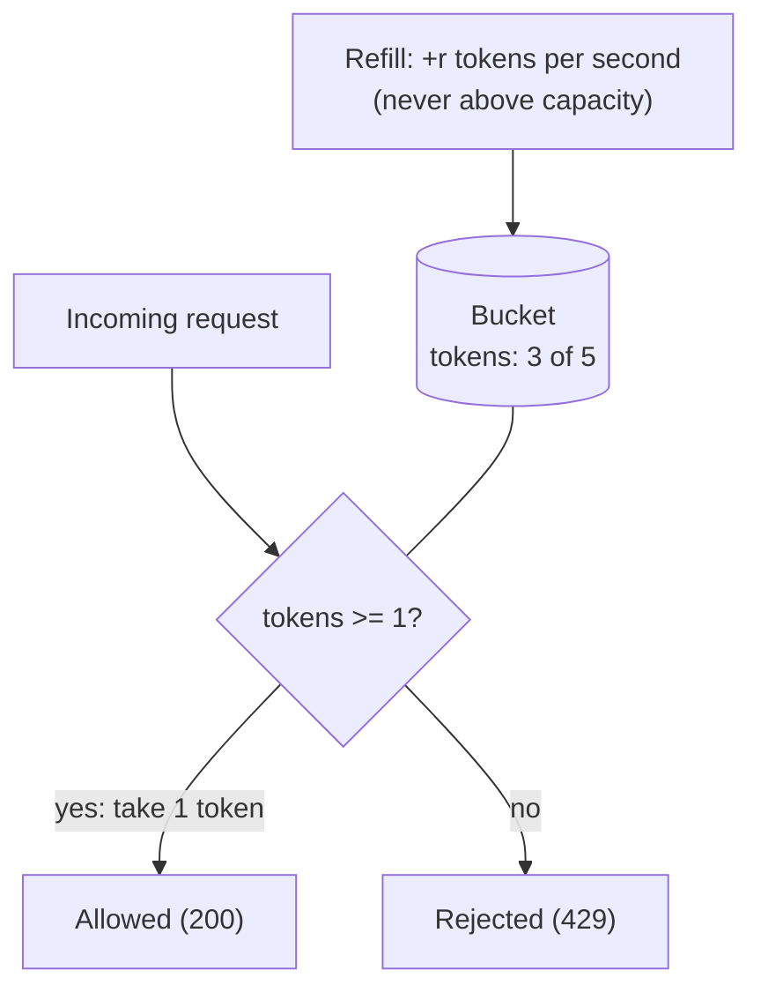
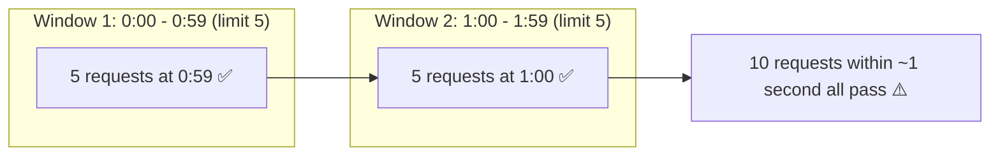
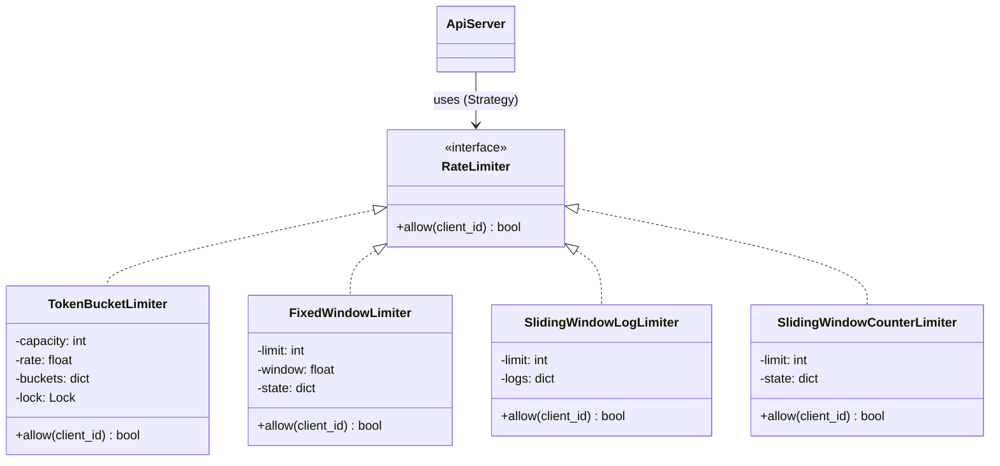

# LLD: Rate Limiter

Code: [rate_limiter.py](rate_limiter.py). For the multi-server version see the [HLD case study](../../../hld/case-studies/rate-limiter.md).

A rate limiter caps how many requests a client may make in a period ("100 requests per minute per API key"). It protects services from abuse, accidental retry storms and noisy neighbours, and it enforces pricing tiers. The question comes up in both LLD (design the classes and algorithms) and HLD (make it work across many servers).

---

## 1. Requirements
- `allow(client_id) -> bool`: True means serve the request; False means reject it with **HTTP 429 Too Many Requests**.
- Limits are **per client** (user id, API key or IP).
- The **algorithm must be pluggable** (different endpoints may need different behaviour).
- **Thread-safe:** many request threads call `allow` at once.
- Low overhead: O(1) per call where possible.

---

## 2. The algorithms, with intuition

### a) Token bucket *(most popular; used by AWS and Stripe)*
Imagine a bucket that holds up to **capacity** tokens. Tokens drip in at a fixed **refill rate**. Each request takes one token; if the bucket is empty, the request is rejected.



- **Bursts allowed:** a client that was idle has a full bucket, so it can fire `capacity` requests at once. Real traffic is bursty, so this is usually what you want.
- **Long-run rate** is limited to `refill_rate`.
- **Lazy refill:** no background thread. On each call, compute `tokens += elapsed_seconds * rate`, then cap it at capacity.
- Memory: two numbers per client.

### b) Leaky bucket
Requests enter a FIFO queue that **drains at a constant rate**; when the queue is full, new requests are dropped. Output is perfectly smooth, which suits workloads that need a steady rate (e.g. sending to a downstream with a strict limit), but bursts are delayed or dropped.

### c) Fixed window counter
Count requests in aligned windows (`12:00:00-12:00:59`, `12:01:00-12:01:59`, ...). Reset the count when a new window starts.

- Very simple, and O(1) memory per client.
- **Boundary problem:** a client can send `limit` requests at the very end of one window and `limit` more at the very start of the next. That is **2x the limit in a few seconds**:



### d) Sliding window log
Store the **timestamp of every allowed request**. On each call, drop timestamps older than `now - window`, then allow if fewer than `limit` remain.

- **Exact:** no boundary problem.
- Memory is O(limit) per client, which is expensive at high limits or with many clients.

### e) Sliding window counter *(a good compromise)*
Keep only the counts of the **current** and **previous** fixed windows, and estimate how many requests happened in the last `window` seconds:

```
estimated = previous_count x (fraction of the previous window still inside the sliding window)
          + current_count
```
Example: limit 100/min, previous minute had 80 requests, current minute has 30 so far, and we are 25% into the current minute. Then `estimated = 80 x 0.75 + 30 = 90`, which is under 100, so the request is allowed.

O(1) memory per client, smooths the boundary burst, and is accurate enough in practice (Cloudflare uses it).

### Comparison

| Algorithm | Bursts | Accuracy | Memory per client | Complexity |
|---|---|---|---|---|
| Token bucket | Allowed up to capacity | Good | O(1) | Low |
| Leaky bucket | Smoothed out | Good | O(queue size) | Low |
| Fixed window | Up to 2x at edges | Weak at edges | O(1) | Lowest |
| Sliding log | No | Exact | O(limit) | Medium |
| Sliding counter | Mostly smoothed | Approximate | O(1) | Medium |

**Default interview answer:** *"Token bucket. It's O(1), allows reasonable bursts, and has two intuitive parameters: burst size and sustained rate."*

---

## 3. Class diagram


This is the **Strategy** pattern: the API server depends only on `RateLimiter`, and an algorithm is chosen per endpoint through configuration.

---

## 4. Implementation notes
- **`time.monotonic()`, not `time.time()`:** wall-clock time can jump backwards or forwards (NTP corrections, manual changes), which would corrupt the elapsed-time maths. The monotonic clock only moves forward.
- **One lock per limiter** makes read-modify-write atomic. Under heavy contention you could shard: N locks, picked by `hash(client_id) % N`.
- **Memory hygiene:** the fixed-window limiter stores `(window_id, count)` per client and overwrites it, so memory doesn't grow with time. A production limiter would also evict clients that have been idle for a long time (e.g. with a TTL cache).
- The sliding log records **only allowed** requests, so rejected requests don't push the client further into the penalty.

## 5. What the demo shows
- A burst of 5 requests against limit 3: every algorithm allows 3 and rejects 2.
- The token bucket refills over time (after 0.25 s at 10 tokens/s, about 2 more requests pass).
- The sliding log forgets requests once they leave the window.
- 50 threads x 10 requests against a limit of 100: **exactly 100** are allowed, so there are no race conditions.

## 6. Follow-up questions
| Question | Answer sketch |
|---|---|
| Multiple servers? | Counters must be shared: Redis with atomic `INCR` or a Lua script. See the HLD case study. |
| Different limits per plan (free vs paid)? | Rule config: `plan -> (capacity, rate)`; the limiter looks up the client's plan |
| Tell the client when to retry? | Return `Retry-After` and `X-RateLimit-Remaining` headers |
| Per-endpoint limits? | Key the bucket by `(client_id, endpoint)` |
| Where should it run? | API gateway / middleware, before expensive work |
