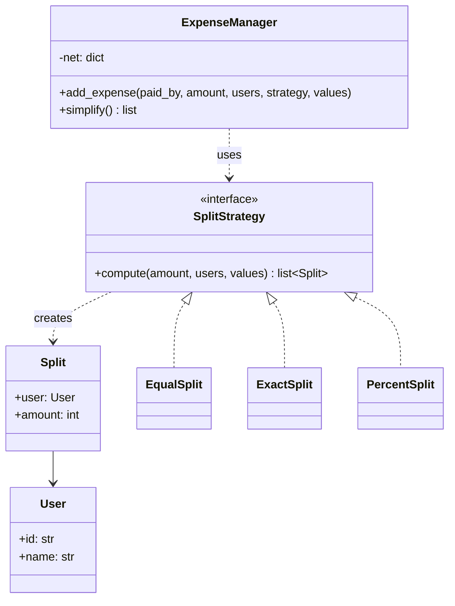
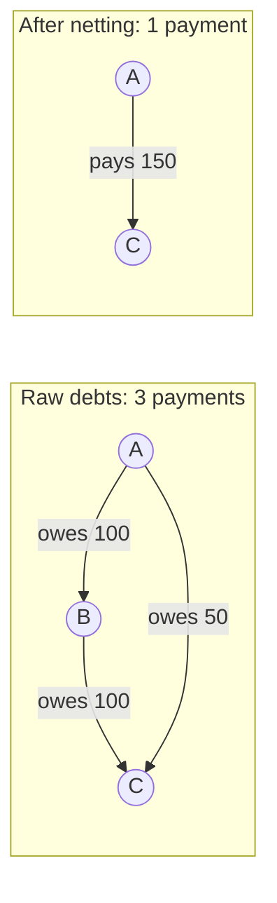

# LLD: Splitwise (Expense Sharing)

Code: [splitwise.py](splitwise.py)

Splitwise combines clean **domain modelling**, the **Strategy** pattern (split types), careful **money handling** and a small **graph algorithm** (simplifying debts). It's popular because it has an algorithmic twist at the end.

---

## 1. Requirements
1. **Users** (and optionally **groups**, such as a trip or flatmates).
2. **Add an expense:** one user pays an amount, split among some users:
   - **EQUAL:** everyone owes the same share.
   - **EXACT:** specific amounts that must add up to the total.
   - **PERCENT:** percentages that must add up to 100.
3. **Show balances:** how much each user owes or is owed overall.
4. **Settle up:** suggest a short list of payments that clears all debts (**simplify debts**).

---

## 2. Money: use integers

```pycon
>>> 0.1 + 0.2
0.30000000000000004
```
Floats can't represent most decimal fractions exactly, and the errors add up across thousands of expenses. Store amounts as **integer paise/cents** (`120000` = ₹1200.00), or use `decimal.Decimal`. The code uses integers.

That raises a **rounding** question: ₹100 split three ways is 3333 + 3333 + 3333 = 9999 paise. **One paisa is lost.** The code gives the remainder to the first participants (3334 + 3333 + 3333), so the shares **always sum to the total exactly**. Interviewers like it when you notice this.

---

## 3. The key modelling idea: net balances

Instead of storing "A owes B ₹200, A owes C ₹50, B owes C ₹100, ...", keep one number per user:

```
net[user] = total paid by user  -  total of user's shares
```
- **positive** -> others owe this user (a creditor)
- **negative** -> this user owes others (a debtor)
- **The sum of all nets is always 0** (money is only moved around). This makes a useful sanity check.

### Worked example (from the demo)
| Expense | Paid by | Split | Effect on net |
|---|---|---|---|
| Dinner ₹1200 | A | EQUAL among A, B, C, D (₹300 each) | A +1200-300 = +900; B, C, D -300 each |
| Taxi ₹500 | B | EXACT: A ₹200, C ₹300 | B +500; A -200; C -300 |
| Movie ₹300 | C | PERCENT: B 60%, D 40% | C +300; B -180; D -120 |

Final nets: **A +700, B +20, C -300, D -420** (sum = 0 ✅).

---

## 4. Class diagram


**Why Strategy?** Each split type has its own calculation **and its own validation** (exact amounts must sum to the total; percents must sum to 100). Putting each in its own class keeps `ExpenseManager` free of `if split_type == ...` chains, and adding "split by shares" (2:1:1) is one new class.

A production version would also keep an `Expense` entity (description, date, payer, splits, group) for history and editing, and recompute balances from it. The demo keeps only the running `net` dictionary to stay focused.

---

## 5. Simplifying debts

**Goal:** turn the nets into a short list of "X pays Y amount" transactions.


Nets here: A = -150, B = 0 (B receives 100 and pays 100), C = +150. B doesn't need to be involved at all.

### Greedy algorithm (what the code does)
1. Compute every user's net balance.
2. Put creditors in a **max-heap** (largest credit first) and debtors in another (largest debt first).
3. Repeatedly pop the biggest debtor and the biggest creditor. The debtor pays `min(debt, credit)`.
4. Whoever still has a balance left goes back into its heap.
5. Stop when the heaps are empty.

Each round settles at least one person completely, so there are **at most n - 1 transactions** for n people with non-zero balances. Running time is O(n log n).

For the example nets (A +700, B +20, C -300, D -420):
| Round | Biggest debtor | Biggest creditor | Payment | Remaining |
|---|---|---|---|---|
| 1 | D (-420) | A (+700) | D pays A 420 | A +280 |
| 2 | C (-300) | A (+280) | C pays A 280 | C -20 |
| 3 | C (-20) | B (+20) | C pays B 20 | all zero ✅ |

> **Correctness note:** greedy guarantees at most n - 1 payments, but **not the true minimum**. Finding the minimum number of transactions is NP-hard (it involves finding subsets of people whose balances cancel to zero). Greedy is the standard, accepted interview answer; mention the caveat.

---

## 6. Validation and edge cases
- EXACT amounts that don't sum to the total -> `ValueError`.
- Percentages that don't sum to 100 -> `ValueError`.
- The payer may or may not be among the participants (both work with the net formula).
- Rounding leftovers are assigned deterministically, so the total is always preserved.
- Thread safety: if many requests add expenses concurrently, protect `net` with a lock (each update is a read-modify-write).

## 7. Follow-up questions
| Question | Answer sketch |
|---|---|
| Groups | `Group` with members and its own nets; a user's overall balance sums across groups |
| Who owes whom pairwise (not just net)? | Keep `balance[(a, b)]` for each pair, updated per expense; simplify on demand |
| Split by shares (2:1:1) | New `ShareSplit` strategy: `amount * share / total_shares`, with the same remainder rule |
| Multiple currencies | Store the currency per expense; convert at settlement time with a rate service |
| Edit or delete an expense | Store `Expense` objects; recompute nets (or apply the reverse delta) |
| Notifications | **Observer**: notify participants when an expense involving them is added |
