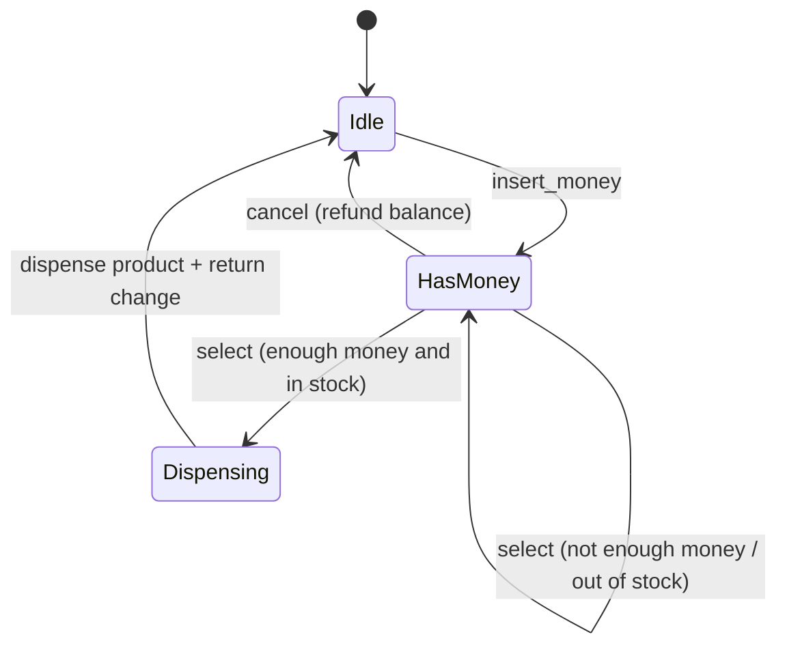
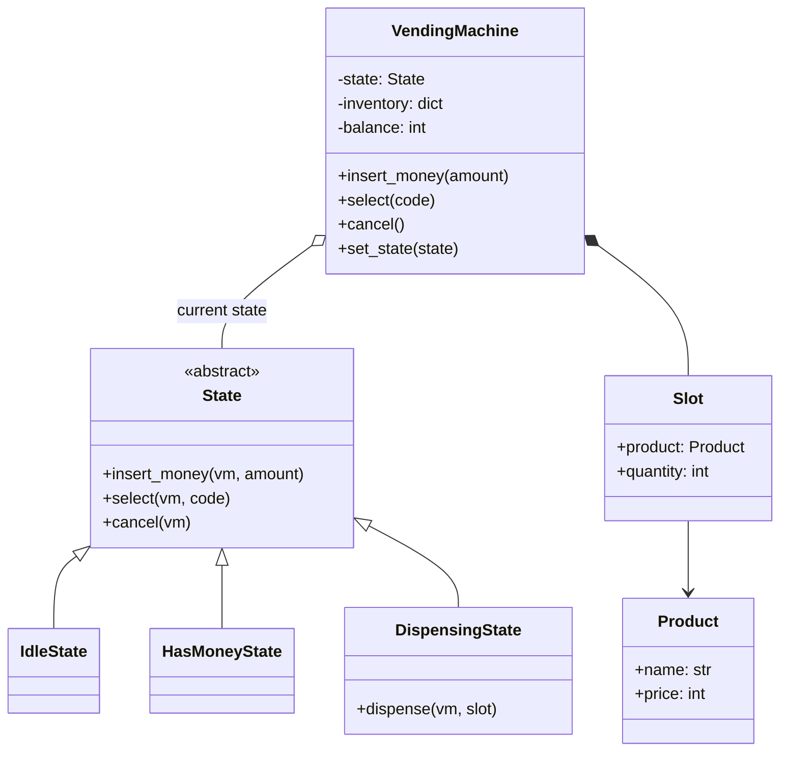

# LLD: Vending Machine

Code: [vending_machine.py](vending_machine.py)

The vending machine is **the** State-pattern problem. ATMs, traffic lights, order lifecycles and document workflows are the same exercise in disguise. Master this one and those become easy.

---

## 1. Requirements
1. The machine has **slots** (`A1`, `B1`, ...), each holding a **product** with a price and a quantity.
2. A user **inserts money** (possibly several times), then **selects** a product.
3. If the balance covers the price and the product is in stock, the machine **dispenses** it and **returns change**.
4. The user can **cancel** at any time before dispensing and get a **refund**.
5. Actions that make no sense in the current situation are **rejected** with a clear message (e.g. selecting before paying).

**Out of scope:** coin denominations and change-making with limited coins (mentioned as an extension), admin restocking.

---

## 2. Why the State pattern?

Without it, every public method needs a branch for every state:
```python
def select(self, code):
    if self.state == "IDLE":
        print("insert money first")
    elif self.state == "HAS_MONEY":
        ...                                  # the real logic
    elif self.state == "DISPENSING":
        print("busy")
    # ...and insert_money() and cancel() repeat the same if/elif ladder
```
With 3 methods and 3 states that's 9 branches spread across 3 methods. Adding a state (e.g. `Maintenance`) means editing **every** method. That violates Open/Closed and is easy to get wrong.

**With State:** each state is a class that knows only what is valid *in that state*. The machine (the *context*) delegates every call to its current state object, and states switch the machine to the next state.

| | if/elif version | State pattern |
|---|---|---|
| Where are a state's rules? | Scattered across all methods | One class |
| Adding a state | Edit every method | Add one class |
| Invalid actions | Must remember to handle each one | Default "reject" behaviour in the base class |

---

## 3. State diagram (draw this first)



The diagram **is** the specification. Every arrow becomes one overridden method in the code; every missing arrow falls back to the default "not allowed now".

| State \ action | `insert_money` | `select` | `cancel` |
|---|---|---|---|
| **Idle** | add to balance -> HasMoney | reject | reject |
| **HasMoney** | add to balance | dispense if possible -> Dispensing -> Idle | refund -> Idle |
| **Dispensing** | reject | reject | reject |

---

## 4. Class diagram


**Design notes**
- Every state method receives the machine (`vm`) as a parameter, so state objects can be **stateless** and cheap to create. They read and modify the machine's data (`balance`, `inventory`) and call `vm.set_state(...)`.
- The base `State` implements every action as "reject". Each subclass overrides **only** the valid ones. This is the Template/default-behaviour trick that keeps state classes small.
- Money is an `int` (e.g. rupees or paise), never a `float`.
- `Product` is a frozen dataclass (an immutable value object); `Slot` is mutable because its quantity changes.

---

## 5. Walkthrough of the demo

| Step | State before | Action | Result | State after |
|---|---|---|---|---|
| 1 | Idle | `select("A1")` | "cannot select now" | Idle |
| 2 | Idle | `insert_money(20)` | balance 20 | HasMoney |
| 3 | HasMoney | `select("A1")` (Coke costs 40) | "need 20 more" | HasMoney |
| 4 | HasMoney | `insert_money(30)` | balance 50 | HasMoney |
| 5 | HasMoney | `select("A1")` | dispense Coke, change 10 | Dispensing -> Idle |
| 6 | Idle | `insert_money(20)`, `select("B1")` | "B1 unavailable" (stock 0) | HasMoney |
| 7 | HasMoney | `cancel()` | refund 20 | Idle |

---

## 6. Concurrency
A physical machine serves one user at a time, so concurrency rarely matters. If the machine were controlled by several threads (a touch screen plus a remote admin API, say), wrap each public method's body in one machine-level lock, because a state transition is a read-modify-write of `state` and `balance`.

## 7. Follow-up questions
| Question | Answer sketch |
|---|---|
| Limited coins for change | Keep a coin inventory; compute change greedily from the largest coin (Chain of Responsibility over denominations). If exact change is impossible, refuse the sale **before** dispensing. |
| Admin restock / maintenance mode | Add a `MaintenanceState` that rejects user actions and allows `restock()`. No existing state changes. |
| Different payment methods (card, UPI) | A `PaymentMethod` Strategy used by `HasMoneyState` |
| Dispense failure (product stuck) | `Dispensing` -> refund -> `Idle`, and log an alert (Observer) |
| An ATM instead | Same pattern: `Idle -> CardInserted -> PinVerified -> Transaction -> Idle` |
